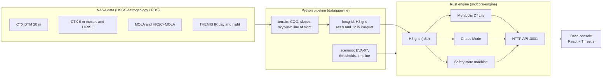

<div align="center">

# 🔴 R.E.D. ATLAS
### *Reconnaissance, EVA & Dynamic-survival Atlas*
**NASA Space Apps Challenge 2026 — Interplanetary Survival Guide: Martian Map**
**Team Red Project**

[](https://www.spaceappschallenge.org/2026/challenges/interplanetary-survival-guide-martian-map/)
[](./src/core-engine/)
[](./src/base-console/)
[](./docs/01-planetary-science-mission/)
[](./LICENSE)

</div>

---

## What it is

**R.E.D. ATLAS** is a survival map for a Mars surface excursion (EVA) on the floor of **Melas Chasma**, Valles Marineris (southwest basin, ~9.9°S, 283.4°E). It turns real NASA orbital data into a hexagonal terrain grid. On that grid it plans the route, computes how long the astronaut needs to get back to the base or to reach a shelter, and decides what to do when several hazards hit at once.

The demo scenario is **EVA-07**, a 4.9 km "Survival Triangle": Base → WP1 (ISRU water) → WP2 (hazardous slope) → WP3 (shelter). At T+105, four hazards coincide:

- a solar particle event (SPE);
- a dust front;
- a radio shadow;
- a soft-regolith ramp.

The system finds that returning to the base no longer fits the radiation flight rule and switches the goal to the shelter.

**Key figures (computed by the Rust engine on the real terrain):**

| Figure | Value | Provenance |
| :--- | :--- | :--- |
| Time to shelter WP3 from WP2 | **9.4 min** (595 m path) | D\* Lite planner on the H3 res-12 grid of the 20 m CTX DTM |
| Return to base from WP2 | **48 min** over **2.15 km** | Same planner; exceeds the 15 min open-sky window |
| Chaos Mode (10,000 runs, seed 42) | **96.0%** safe missions with shelter switching vs **23.8%** base-only | Stochastic Monte Carlo engine (synthetic corridor, see limitations) |
| Re-planning on goal switch | **17 ms** (median, optimised build) | Engine measurement on a corridor of the real grid |

Every figure in the documentation carries its provenance: **[M]** measured or published, **[D]** derived by calculation, **[E]** design-scenario assumption. The single source of truth is [`DATOS_CANONICOS.md`](docs/01-planetary-science-mission/DATOS_CANONICOS.md).

> **Language note:** this README and the submission texts are in English. The detailed technical documentation in `docs/` and the code comments are in Spanish, our team's working language.

---

## Implemented vs design

| Component | Status | Where |
| :--- | :--- | :--- |
| NASA data pipeline (STAC/PDS → COG, GeoJSON, Parquet; H3 grid; EVA-07 scenario) | Implemented (Python, 263 tests) | [`data/pipeline/`](data/pipeline/) |
| Mars H3 hexagonal grid with real indices (`h3o`) loaded from Parquet | Implemented (Rust) | [`h3_mars_grid.rs`](src/core-engine/src/h3_mars_grid.rs) |
| D\* Lite planner with metabolic cost and automatic goal switching | Implemented (Rust) | [`metabolic_dstar.rs`](src/core-engine/src/metabolic_dstar.rs), [`mission.rs`](src/core-engine/src/mission.rs) |
| Markov/Poisson hazard engine and Chaos Mode | Implemented (Rust) | [`stochastic_hazard.rs`](src/core-engine/src/stochastic_hazard.rs) |
| Safety state machine (5 states), single-alert triage and template voice message | Implemented (Rust, deterministic) | [`neuro_symbolic.rs`](src/core-engine/src/neuro_symbolic.rs) |
| GPS-denied positioning Kalman filter (Canyon-TRN) | Implemented, tested with simulated data | [`canyon_trn.rs`](src/core-engine/src/canyon_trn.rs) |
| Points marked during the EVA (hazard, shelter, ISRU) with re-planning | Implemented (Rust + console) | [`reported_points.rs`](src/core-engine/src/reported_points.rs) |
| Local HTTP API of the engine (port 3001) | Implemented (Rust standard library) | [`api_server.rs`](src/core-engine/src/bin/api_server.rs) |
| Base console: 3D cartography, Spyglass lens, route planner, EVA telemetry | Implemented (React + TypeScript + Three.js + Tailwind) | [`src/base-console/`](src/base-console/) |
| On-suit language model (Candle / ONNX Runtime) and `whisper-rs` voice | Design | [`ARQUITECTURA_E_IA.md`](docs/03-system-architecture-ai/ARQUITECTURA_E_IA.md) |
| Suit node with ROS 2 (`rclrs`) and Eclipse Zenoh link | Design (the API simulates the sync) | [`ARQUITECTURA_E_IA.md`](docs/03-system-architecture-ai/ARQUITECTURA_E_IA.md) |
| Augmented-reality helmet HUD | Design (the console's "EVA telemetry" view reproduces its logic) | [`docs/02-product-ux-ui/`](docs/02-product-ux-ui/) |
| Engine compiled to WebAssembly, CesiumJS | Design | — |

---

## Architecture



---

## How to run it

Requirements: **Rust** (stable, with `cargo`), **Node.js** 18+ with `npm`, and **uv** for the Python pipeline (only to regenerate the data or run its tests). The processed data is versioned in `data/`, so nothing needs to be downloaded to run the demo.

1. Engine API on `http://127.0.0.1:3001`:

```bash
cargo run --release --manifest-path src/core-engine/Cargo.toml --bin api_server
```

2. Console on `http://localhost:5173` (in another terminal):

```bash
npm --prefix src/base-console install
```

```bash
npm --prefix src/base-console run dev -- --port 5173 --strictPort
```

Console routes: `/cartografia-3d`, `/planificador`, `/telemetria-eva` and `/multiemergencia` (opens the telemetry at T+105). Without the API, the console still works with the stored mission data and says so.

**Full EVA-07 simulation in the terminal** (timeline, T+105 decision and Chaos Mode):

```bash
cargo run --release --manifest-path src/core-engine/Cargo.toml --bin eva07_mission_sim
```

**Tests:**

```bash
cargo test --manifest-path src/shared/Cargo.toml
```

```bash
cargo test --release --manifest-path src/core-engine/Cargo.toml
```

```bash
cd data/pipeline && uv run pytest
```

```bash
npm --prefix src/base-console run build
```

---

## NASA data used

All products are read by window from the USGS Astrogeology STAC catalog and repositories. Identifiers, URLs, licences and measured coverage of each one are in [`data/nasa-layers/sources_manifest.json`](data/nasa-layers/sources_manifest.json).

| Mission / instrument | Product | Resolution | Use |
| :--- | :--- | :--- | :--- |
| MRO Context Camera (CTX) | USGS controlled stereo DTMs (Ames Stereo Pipeline, aligned to MOLA) | 20 m | Working terrain: elevation, slope, sky view, radio line of sight, H3 grid |
| MRO CTX | Controlled equatorial mosaic, MC-18 Coprates quadrangle (Robbins et al., 2023) | 6 m | Orbital texture of the 3D twin |
| MRO HiRISE | Projected RDRs (uncontrolled, ±100 m) and a search for 1 m DTMs | 0.25 m | Visual context; no HiRISE DTM covers the route |
| Mars Global Surveyor MOLA | MEGDR global mosaic | 463 m | Altimetric reference and regional context |
| Mars Express HRSC + MGS MOLA | HRSC+MOLA blend v2 (USGS) | 200 m | Horizon and regional relief |
| 2001 Mars Odyssey THEMIS IR | Controlled day and night mosaics, MC-18 | 100 m | Qualitative thermal context |
| NASA Mars Trek | Viking MDIM 2.1 and MOLA hillshade tiles | 232 m / 463 m | 2D base map of the console |
| MSL RAD, MRO MCS, Mars 2020 MEDA | Published values (dose at Gale, dust, wind) | — | Scenario parameters, cited as analogues |

**What is not used as data, and we say so:** there is no accessible quantitative thermal-inertia map, so the node thermal inertias are scenario assumptions [E]. CRISM and SHARAD are not in the STAC catalog, so the WP1 hydration is also a scenario value. Details are in the `not_available` section of the manifest and in section 5 of [`CIENCIA_Y_MISION.md`](docs/01-planetary-science-mission/CIENCIA_Y_MISION.md).

---

## Use of AI tools (Super Intelligence)

The team did the brainstorming, analysis and design decisions without AI. These include the challenge, the site, the mission concept and what to build. We then used AI tools to accelerate development:

- **Anthropic Claude Code** (Claude Opus 5.5 and Claude Fable 5.2 models): wrote and refactored much of the Rust engine, the Python pipeline and the React console under the team's direction, and drafted and edited documentation and submission texts.
- **Google's AI coding agent** (Hydrogen, Argon and 3.8 Flash models): produced a large part of the architecture and core-engine work.
- **Google Stitch:** generated the first concept wireframes in [`docs/wireframes/`](docs/wireframes/). They carry a visible "AI-GENERATED CONCEPT" watermark and are superseded by the coded console.

All AI-assisted code was reviewed by the team and is checked by the automated tests listed above. No NASA data was generated or altered by AI.

---

## Repository layout

```text
├── data/
│   ├── pipeline/              # Python package red_atlas_pipeline (terrain, hexgrid, scenario) and tests
│   ├── nasa-layers/           # Source manifest, H3 grid in Parquet, site reality check
│   └── mission-scenarios/     # EVA-07: triangle GeoJSON, thresholds, timeline and engine results
├── src/
│   ├── shared/                # Rust crate with physical constants and the grid contract
│   ├── core-engine/           # Rust engine: H3 grid, D* Lite, Chaos Mode, state machine and API
│   ├── base-console/          # Web console (React + TypeScript + Three.js)
│   └── eva-tactical-hud/      # Helmet HUD design (no code of its own yet)
├── docs/
│   ├── 01-planetary-science-mission/   # Science dossier and canonical data
│   ├── 02-product-ux-ui/               # Product, UX and wireframes
│   ├── 03-system-architecture-ai/      # Engine and AI architecture
│   ├── 04-pitch-and-submission/        # Submission texts and pitch material
│   └── wireframes/                     # AI-generated concept wireframes (watermarked)
├── assets/                    # Pitch graphics
├── CONTRIBUTING.md
└── LICENSE                    # MIT
```

## Documentation (Spanish)

| Area | Document |
| :--- | :--- |
| Planetary science and data | [`CIENCIA_Y_MISION.md`](docs/01-planetary-science-mission/CIENCIA_Y_MISION.md) · [`DATOS_CANONICOS.md`](docs/01-planetary-science-mission/DATOS_CANONICOS.md) |
| Product and UX | [`PRODUCTO_UX_UI.md`](docs/02-product-ux-ui/PRODUCTO_UX_UI.md) |
| Architecture and AI | [`ARQUITECTURA_E_IA.md`](docs/03-system-architecture-ai/ARQUITECTURA_E_IA.md) |
| Data schemas | [`SCHEMA_HEXGRID.md`](data/nasa-layers/SCHEMA_HEXGRID.md) · [`SCHEMA_EVA07.md`](data/mission-scenarios/SCHEMA_EVA07.md) · [`SITE_REALITY_CHECK.md`](data/nasa-layers/SITE_REALITY_CHECK.md) |

## Team

Red Project — Mario Perdiguero, Guillermo Remesal and David Pérez.

## License

Code and documentation under the [MIT](LICENSE) licence. NASA and USGS products keep their original licences (public domain or CC0), listed in the source manifest.
