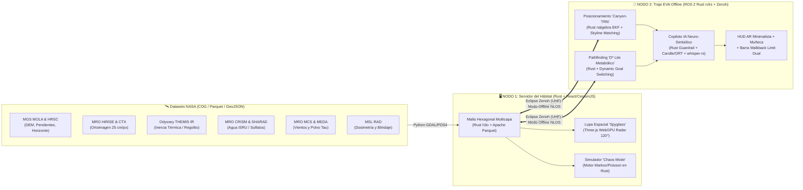

<div align="center">

# 🔴 R.E.D. ATLAS
### *Reconnaissance, EVA & Dynamic-survival Atlas*
**NASA Space Apps Challenge 2026 — Interplanetary Survival Guide: Martian Map**  
**Developed by Team Red Project**

[](https://www.spaceappschallenge.org/2026/challenges/interplanetary-survival-guide-martian-map/)
[-DEA584?style=for-the-badge&logo=rust&logoColor=black)](./docs/03-system-architecture-ai/)
[](./docs/02-product-ux-ui/)
[-E25822?style=for-the-badge)](./docs/01-planetary-science-mission/)
[](./LICENSE)

</div>

---

## 🌌 Descripción General del Proyecto

**R.E.D. ATLAS** es una plataforma de inteligencia cartográfica multicapa, planificación metabólica de rutas EVA (*Marswalk*) y supervivencia autónoma asistida por IA diseñada para la exploración humana de **Valles Marineris — Melas Chasma** (~9.8°S, 283.6°E).

Operar en el fondo de un cañón marciano de **7 a 9 km de profundidad** presenta desafíos extremos: paredes que bloquean la línea de visión de radio (dejando al astronauta incomunicado), taludes de deslizamiento $>20^\circ$, bancos traicioneros de regolito fino, vientos catabáticos y eventos de radiación solar (SPE) con hasta **22 minutos de retardo de comunicación con la Tierra**.

**R.E.D. ATLAS** resuelve este reto mediante un **Ecosistema Híbrido Dual Sincronizado** impulsado por un núcleo de misión crítica escrito en **Rust** que transforma los datos orbitales y de superficie de múltiples misiones de la NASA en decisiones de supervivencia en tiempo real.

---

## 🛠️ Stack Tecnológico Unificado (Acordado por los 3 Miembros)

Para garantizar coherencia absoluta entre **Ciencia (P1)**, **Producto/UX (P2)** y **Arquitectura/IA (P3)**, todo el equipo utiliza el siguiente stack tecnológico aeroespacial:

| Capa del Sistema | Tecnologías Oficiales de **R.E.D. ATLAS** | Justificación para Misión Crítica en Marte |
| :--- | :--- | :--- |
| **🦀 Núcleo Algorítmico y Servidor Base (`core-engine`)** | **Rust** (`h3o` para Malla Hexagonal H3, `Tokio` + `Axum`, `nalgebra`) + **DuckDB Spatial** | Ejecución determinista ultra-rápida, *memory-safe* (cero fallos de segmentación ni pausas de *Garbage Collector* durante una emergencia EVA) y compilación dual a nativo y **WebAssembly (WASM)**. |
| **🥽 Nodo Edge del Traje EVA e IA Offline (`eva-node`)** | **ROS 2 con Rust (`rclrs`)** + **Eclipse Zenoh** (protocolo espacial en Rust para radio intermitente) + **Hugging Face `Candle` / ONNX Runtime (`ort`)** + **`whisper-rs`** | Permite correr en el traje espacial la máquina de estados determinista, el posicionamiento sin GPS (**Canyon-TRN**), un SLM cuantizado a 4 bits y voz manos libres 100% offline con consumo $<5\text{ W}$. |
| **🖥️ Interfaz 3D de Base y Visor HUD (`frontend`)** | **TypeScript + React + CesiumJS + Three.js (WebGL / WebGPU Shaders) + TailwindCSS + Rust WASM** | Estándar usado por NASA *Mars Trek*; permite renderizar el DEM de Melas Chasma en 3D, programar el shader circular de 3 sectores de la **Lupa Espacial (*Spyglass*)** y proyectar el HUD AR. |
| **🛰️ Pipeline Científico de Datos NASA (`data-pipeline`)** | **Python** (`GDAL`, `Rasterio`, `PDS4-tools`) $\to$ exportando a **Cloud-Optimized GeoTIFF (COG)**, **Apache Parquet** y **GeoJSON** | Procesa los productos crudos del *Planetary Data System (PDS)* de la NASA (MOLA, HiRISE, THEMIS, CRISM, SHARAD, MCS, RAD) y los entrega indexados al motor en Rust. |
| **📐 Documentación y Diagramas** | **Markdown + Mermaid.js** | Todos los diagramas de arquitectura, flujos de usuario y mapas conceptuales se escriben en **Mermaid.js** embebido en Markdown para renderizado nativo en GitHub. |

---

## 🏛️ Arquitectura Conceptual del Ecosistema Dual



---

## 📂 Estructura Profesional del Repositorio

```text
nasa-hackathon-red-project/
├── 📁 docs/                                   # Documentación Técnica, Científica y Planes de Trabajo con IA
│   ├── 📁 01-planetary-science-mission/       # 🧑‍🚀 CARRIL PERSONA 1: Ciencia, Datos NASA y Simulación Marswalk
│   │   ├── PLAN_Y_PROMPTS_P1.md               # Hoja de ruta y Prompts de IA listos para ejecutar (P1)
│   │   └── ENTREGABLE_1_CIENCIA_Y_MISION.md   # Documento final de especificación científica y caso de uso
│   ├── 📁 02-product-ux-ui/                   # 🎨 CARRIL PERSONA 2: Producto, UX/UI y Sistema Visual Multicapa
│   │   ├── PLAN_Y_PROMPTS_P2.md               # Hoja de ruta y Prompts de IA listos para ejecutar (P2)
│   │   └── ENTREGABLE_2_PRODUCTO_UX_UI.md     # Especificación de pantallas (React/CesiumJS/Three.js), Spyglass y HUD
│   ├── 📁 03-system-architecture-ai/          # ⚙️ CARRIL PERSONA 3: Arquitectura en Rust, ROS 2, GIS e IA Offline
│   │   ├── PLAN_Y_PROMPTS_P3.md               # Hoja de ruta y Prompts de IA listos para ejecutar (P3)
│   │   └── ENTREGABLE_3_ARQUITECTURA_E_IA.md  # Especificación de Malla H3 (h3o), Canyon-TRN, D* Lite e IA (Candle/ORT)
│   └── 📁 04-pitch-and-submission/            # 🏆 FASE 4 CONJUNTA: Cierre, Pitch y Formulario Space Apps
│       ├── PLAN_Y_PROMPTS_FASE_4.md           # Prompts para generar el formulario NASA, Pitch Deck y Q&A
│       ├── SPACE_APPS_SUBMISSION.md           # Textos oficiales en inglés/español para la web de Space Apps
│       └── PITCH_AND_QA_DEFENSE.md            # Estructura de 10 slides, guion de vídeo (30s/3m) y defensa ante jueces
│
├── 📁 src/                                    # Estructura Modular de Componentes del Sistema
│   ├── 📁 base-console/                       # Nodo 1 (TypeScript/React/CesiumJS/Three.js + Rust WASM)
│   ├── 📁 eva-tactical-hud/                   # Nodo 2 (HUD AR + Tablet de Muñeca conectada a ROS 2 / Zenoh)
│   ├── 📁 core-engine/                        # Núcleo en Rust (h3o, Canyon-TRN, D* Lite, Markov/Poisson, Candle/ORT)
│   └── 📁 shared/                             # Constantes marcianas (0.38g), esquemas GeoJSON/Parquet y tipos comunes
│
├── 📁 data/                                   # Catálogos de Datos Espaciales (COG, GeoJSON, Apache Parquet)
│   ├── 📁 nasa-layers/                        # Referencias PDS / Mars Trek (MOLA, HiRISE, THEMIS, CRISM, MCS, RAD)
│   └── 📁 mission-scenarios/                  # Coordenadas GeoJSON del "Triángulo de Supervivencia" en Melas Chasma
│
├── 📁 assets/                                 # Recursos Visuales, Diagramas, Wireframes y Presentación
│   ├── 📁 diagrams/                           # Diagramas de arquitectura y mapas exportados
│   ├── 📁 mockups/                            # Wireframes y vistas conceptuales del HUD y Consola 3D
│   └── 📁 pitch/                              # Diapositivas, vídeo y recursos gráficos del equipo Red Project
│
├── 📄 CONTRIBUTING.md                         # Guía de trabajo en paralelo sin conflictos de Git para los 3 miembros
├── 📄 LICENSE                                 # Licencia Open Source MIT
└── 📄 README.md                               # Este documento maestro
```

---

## 🚀 Acceso Rápido por Miembro del Equipo

* 🧑‍🚀 **Persona 1 (Ciencia y Misión):** Ir a [`docs/01-planetary-science-mission/PLAN_Y_PROMPTS_P1.md`](./docs/01-planetary-science-mission/PLAN_Y_PROMPTS_P1.md)
* 🎨 **Persona 2 (Producto y UX/UI):** Ir a [`docs/02-product-ux-ui/PLAN_Y_PROMPTS_P2.md`](./docs/02-product-ux-ui/PLAN_Y_PROMPTS_P2.md)
* ⚙️ **Persona 3 (Arquitectura en Rust e IA):** Ir a [`docs/03-system-architecture-ai/PLAN_Y_PROMPTS_P3.md`](./docs/03-system-architecture-ai/PLAN_Y_PROMPTS_P3.md)
* 🏆 **Fase 4 (Cierre y Pitch Conjunto):** Ir a [`docs/04-pitch-and-submission/PLAN_Y_PROMPTS_FASE_4.md`](./docs/04-pitch-and-submission/PLAN_Y_PROMPTS_FASE_4.md)
