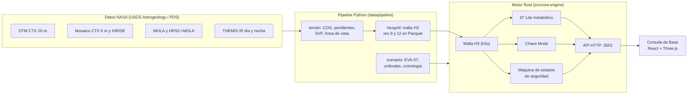

<div align="center">

# 🔴 R.E.D. ATLAS
### *Reconnaissance, EVA & Dynamic-survival Atlas*
**NASA Space Apps Challenge 2026 — Interplanetary Survival Guide: Martian Map**
**Equipo Red Project**

[](https://www.spaceappschallenge.org/2026/challenges/interplanetary-survival-guide-martian-map/)
[](./src/core-engine/)
[](./src/base-console/)
[](./docs/01-planetary-science-mission/)
[](./LICENSE)

</div>

---

## Qué es

**R.E.D. ATLAS** es un mapa de supervivencia para una salida a pie (EVA) en el fondo de **Melas Chasma**, en Valles Marineris (cuenca suroeste, ~9,9°S, 283,4°E). Convierte datos orbitales reales de la NASA en una malla hexagonal de terreno y, sobre ella, planifica la ruta, calcula cuánto tarda el astronauta en volver a la Base o en llegar a un refugio, y decide qué hacer cuando varias amenazas coinciden.

El escenario de demostración es la **EVA-07**, un «Triángulo de Supervivencia» de 4,9 km (Base → WP1 agua ISRU → WP2 talud peligroso → WP3 refugio). En T+105 coinciden cuatro amenazas: tormenta solar (SPE), frente de polvo, sombra de radio y una rampa de regolito blando. El sistema comprueba que volver a la Base ya no cabe en la regla de radiación y cambia el destino al refugio.

**Cifras clave (calculadas por el motor Rust sobre el terreno real):**

| Cifra | Valor | Procedencia |
| :--- | :--- | :--- |
| Tiempo al refugio WP3 desde el WP2 | **9,4 min** (595 m de camino) | Planificador D\* Lite sobre la malla H3 res 12 del DTM CTX de 20 m |
| Retorno a la Base desde el WP2 | **48 min** sobre **2,15 km** | Mismo planificador; excede la ventana de 15 min a cielo abierto |
| Chaos Mode (10.000 simulaciones, semilla 42) | **96,0 %** de misión segura con cambio al refugio frente a **23,8 %** solo con la Base | Motor estocástico Monte Carlo (corredor sintético, ver limitaciones) |
| Replanificación al cambiar de destino | **17 ms** (mediana, compilación optimizada) | Medida del motor sobre un corredor de la malla real |

Cada cifra de la documentación lleva su procedencia: **[M]** medida o publicada, **[D]** derivada por cálculo, **[E]** supuesto del escenario de diseño. La fuente única es [`DATOS_CANONICOS.md`](docs/01-planetary-science-mission/DATOS_CANONICOS.md).

---

## Qué está implementado y qué es diseño

| Componente | Estado | Dónde |
| :--- | :--- | :--- |
| Pipeline de datos NASA (STAC/PDS → COG, GeoJSON, Parquet; malla H3; escenario EVA-07) | Implementado (Python, 263 tests) | [`data/pipeline/`](data/pipeline/) |
| Malla hexagonal H3 de Marte con índices reales (`h3o`) cargada desde Parquet | Implementado (Rust) | [`src/core-engine/src/h3_mars_grid.rs`](src/core-engine/src/h3_mars_grid.rs) |
| Planificador D\* Lite con coste metabólico y cambio automático de destino | Implementado (Rust) | [`metabolic_dstar.rs`](src/core-engine/src/metabolic_dstar.rs), [`mission.rs`](src/core-engine/src/mission.rs) |
| Motor de amenazas Markov/Poisson y Chaos Mode | Implementado (Rust) | [`stochastic_hazard.rs`](src/core-engine/src/stochastic_hazard.rs) |
| Máquina de estados de seguridad (5 estados), triaje de alerta única y frase de voz por plantilla | Implementado (Rust, determinista) | [`neuro_symbolic.rs`](src/core-engine/src/neuro_symbolic.rs) |
| Filtro de Kalman de posicionamiento sin GPS (Canyon-TRN) | Implementado y probado con datos simulados | [`canyon_trn.rs`](src/core-engine/src/canyon_trn.rs) |
| Puntos marcados durante la EVA (peligro, refugio, ISRU) con replanificación | Implementado (Rust + consola) | [`reported_points.rs`](src/core-engine/src/reported_points.rs) |
| API HTTP local del motor (puerto 3001) | Implementado (Rust, biblioteca estándar) | [`src/core-engine/src/bin/api_server.rs`](src/core-engine/src/bin/api_server.rs) |
| Consola de Base: cartografía 3D, lupa Spyglass, planificador y telemetría EVA | Implementado (React + TypeScript + Three.js + Tailwind) | [`src/base-console/`](src/base-console/) |
| Modelo de lenguaje local (Candle / ONNX Runtime) y voz con `whisper-rs` | Diseño | [`ARQUITECTURA_E_IA.md`](docs/03-system-architecture-ai/ARQUITECTURA_E_IA.md) |
| Nodo del traje con ROS 2 (`rclrs`) y enlace Eclipse Zenoh | Diseño (la API simula la sincronización) | [`ARQUITECTURA_E_IA.md`](docs/03-system-architecture-ai/ARQUITECTURA_E_IA.md) |
| HUD de realidad aumentada en el casco | Diseño (la vista «Telemetría EVA» de la consola reproduce su lógica) | [`docs/02-product-ux-ui/`](docs/02-product-ux-ui/) |
| Motor compilado a WebAssembly, CesiumJS | Diseño | — |

---

## Arquitectura



---

## Cómo arrancarlo

Requisitos: **Rust** (stable, con `cargo`), **Node.js** 18 o superior con `npm`, y **uv** para el pipeline de Python (solo si se quieren regenerar los datos o pasar sus tests). Los datos ya procesados están versionados en `data/`, así que no hace falta descargar nada para ver la demo.

1. API del motor en `http://127.0.0.1:3001`:

```bash
cargo run --release --manifest-path src/core-engine/Cargo.toml --bin api_server
```

2. Consola en `http://localhost:5173` (en otra terminal):

```bash
npm --prefix src/base-console install
```

```bash
npm --prefix src/base-console run dev -- --port 5173 --strictPort
```

Rutas de la consola: `/cartografia-3d`, `/planificador`, `/telemetria-eva` y `/multiemergencia` (abre la telemetría en T+105). Sin la API, la consola sigue funcionando con los datos guardados y lo indica.

**Simulación completa de la EVA-07 en terminal** (cronología, decisión de T+105 y Chaos Mode):

```bash
cargo run --release --manifest-path src/core-engine/Cargo.toml --bin eva07_mission_sim
```

**Tests:**

```bash
cargo test --manifest-path src/shared/Cargo.toml
```

```bash
cargo test --release --manifest-path src/core-engine/Cargo.toml
```

```bash
cd data/pipeline && uv run pytest
```

```bash
npm --prefix src/base-console run build
```

---

## Datos de la NASA usados

Todos los productos se leen por ventana desde el catálogo STAC y los repositorios de USGS Astrogeology. Identificadores, URL, licencias y cobertura medida de cada uno están en [`data/nasa-layers/sources_manifest.json`](data/nasa-layers/sources_manifest.json).

| Misión / instrumento | Producto | Resolución | Uso |
| :--- | :--- | :--- | :--- |
| MRO Context Camera (CTX) | DTM estéreo controlados USGS (Ames Stereo Pipeline, alineados a MOLA) | 20 m | Terreno de trabajo: cotas, pendientes, SVF, línea de vista de radio, malla H3 |
| MRO CTX | Mosaico ecuatorial controlado, cuadrángulo MC-18 Coprates (Robbins et al., 2023) | 6 m | Textura orbital del gemelo 3D |
| MRO HiRISE | RDR proyectados (sin control, ±100 m) y búsqueda de DTM de 1 m | 0,25 m | Contexto visual; no hay DTM HiRISE sobre la ruta |
| Mars Global Surveyor MOLA | MEGDR, mosaico global | 463 m | Referencia altimétrica y contexto regional |
| Mars Express HRSC + MGS MOLA | Mezcla HRSC+MOLA v2 (USGS) | 200 m | Horizonte y relieve regional |
| 2001 Mars Odyssey THEMIS IR | Mosaicos controlados diurno y nocturno, MC-18 | 100 m | Contexto térmico cualitativo |
| NASA Mars Trek | Teselas Viking MDIM 2.1 y MOLA hillshade | 232 m / 463 m | Mapa base 2D de la consola |
| MSL RAD, MRO MCS, Mars 2020 MEDA | Valores publicados (dosis en Gale, polvo, viento) | — | Parámetros del escenario, citados como análogos |

**Lo que no se usa como dato, y se dice:** no hay mapa cuantitativo de inercia térmica accesible, así que las inercias térmicas de los nodos son supuestos de escenario [E]. CRISM y SHARAD no están en el catálogo STAC, así que la hidratación del WP1 también es escenario. El detalle está en la sección `not_available` del manifiesto y en la sección 5 de [`CIENCIA_Y_MISION.md`](docs/01-planetary-science-mission/CIENCIA_Y_MISION.md).

---

## Estructura del repositorio

```text
├── data/
│   ├── pipeline/              # Paquete Python red_atlas_pipeline (terrain, hexgrid, scenario) y sus tests
│   ├── nasa-layers/           # Manifiesto de fuentes, malla H3 en Parquet, comprobación de realidad del sitio
│   └── mission-scenarios/     # EVA-07: GeoJSON del triángulo, umbrales, cronología y resultados del motor
├── src/
│   ├── shared/                # Crate Rust con las constantes físicas y el contrato de la malla
│   ├── core-engine/           # Motor Rust: malla H3, D* Lite, Chaos Mode, máquina de estados y API
│   ├── base-console/          # Consola web (React + TypeScript + Three.js)
│   └── eva-tactical-hud/      # Diseño del HUD del casco (sin código propio todavía)
├── docs/
│   ├── 01-planetary-science-mission/   # Dossier científico y datos canónicos
│   ├── 02-product-ux-ui/               # Producto, UX y wireframes
│   ├── 03-system-architecture-ai/      # Arquitectura del motor y de la IA
│   ├── 04-pitch-and-submission/        # Textos de la entrega y material del pitch
│   └── wireframes/                     # Wireframes de las pantallas
├── assets/                    # Material gráfico del pitch
├── CONTRIBUTING.md
└── LICENSE                    # MIT
```

## Documentación

| Área | Documento |
| :--- | :--- |
| Ciencia planetaria y datos | [`CIENCIA_Y_MISION.md`](docs/01-planetary-science-mission/CIENCIA_Y_MISION.md) · [`DATOS_CANONICOS.md`](docs/01-planetary-science-mission/DATOS_CANONICOS.md) |
| Producto y UX | [`PRODUCTO_UX_UI.md`](docs/02-product-ux-ui/PRODUCTO_UX_UI.md) |
| Arquitectura e IA | [`ARQUITECTURA_E_IA.md`](docs/03-system-architecture-ai/ARQUITECTURA_E_IA.md) |
| Esquemas de datos | [`SCHEMA_HEXGRID.md`](data/nasa-layers/SCHEMA_HEXGRID.md) · [`SCHEMA_EVA07.md`](data/mission-scenarios/SCHEMA_EVA07.md) · [`SITE_REALITY_CHECK.md`](data/nasa-layers/SITE_REALITY_CHECK.md) |

## Licencia

Código y documentación bajo licencia [MIT](LICENSE). Los productos de la NASA y de USGS conservan sus licencias de origen (dominio público o CC0), indicadas en el manifiesto de fuentes.
