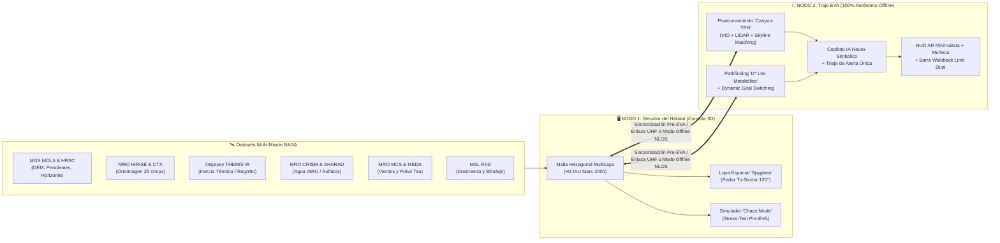

<div align="center">

# 🔴 R.E.D. ATLAS
### *Reconnaissance, EVA & Dynamic-survival Atlas*
**NASA Space Apps Challenge 2026 — Interplanetary Survival Guide: Martian Map**  
**Developed by Team Red Project**

[](https://www.spaceappschallenge.org/2026/challenges/interplanetary-survival-guide-martian-map/)
[-E25822?style=for-the-badge)](./docs/01-planetary-science-mission/)
[-2EA44F?style=for-the-badge)](./docs/03-system-architecture-ai/)
[](./LICENSE)

</div>

---

## 🌌 Descripción General del Proyecto

**R.E.D. ATLAS** es una plataforma de inteligencia cartográfica multicapa, planificación metabólica de rutas EVA (*Marswalk*) y supervivencia autónoma asistida por IA diseñada para la exploración humana de **Valles Marineris — Melas Chasma** (~9.8°S, 283.6°E).

Operar en el fondo de un cañón marciano de **7 a 9 km de profundidad** presenta desafíos extremos: paredes que bloquean la línea de visión de radio (dejando al astronauta incomunicado), taludes de deslizamiento $>20^\circ$, bancos traicioneros de regolito fino, vientos catabáticos y eventos de radiación solar (SPE) sin el blindaje de un campo magnético global y con hasta **22 minutos de retardo de comunicación con la Tierra**.

**R.E.D. ATLAS** resuelve este reto mediante un **Ecosistema Híbrido Dual Sincronizado** que transforma los datos orbitales y de superficie de múltiples misiones de la NASA en decisiones de supervivencia en tiempo real.

---

## 🏛️ Arquitectura Conceptual del Ecosistema Dual



---

## 📂 Estructura Profesional del Repositorio

El repositorio está organizado siguiendo buenas prácticas de ingeniería aeroespacial y de software, permitiendo el trabajo en paralelo de los **3 especialistas del equipo**:

```text
nasa-hackathon-red-project/
├── 📁 docs/                                   # Documentación Técnica, Científica y Planes de Trabajo con IA
│   ├── 📁 01-planetary-science-mission/       # 🧑‍🚀 CARRIL PERSONA 1: Ciencia, Datos NASA y Simulación Marswalk
│   │   ├── PLAN_Y_PROMPTS_P1.md               # Hoja de ruta y Prompts de IA listos para ejecutar (P1)
│   │   └── ENTREGABLE_1_CIENCIA_Y_MISION.md   # Documento final de especificación científica y caso de uso
│   ├── 📁 02-product-ux-ui/                   # 🎨 CARRIL PERSONA 2: Producto, UX/UI y Sistema Visual Multicapa
│   │   ├── PLAN_Y_PROMPTS_P2.md               # Hoja de ruta y Prompts de IA listos para ejecutar (P2)
│   │   └── ENTREGABLE_2_PRODUCTO_UX_UI.md     # Especificación de pantallas, Spyglass, HUD AR y Walkback Limit
│   ├── 📁 03-system-architecture-ai/          # ⚙️ CARRIL PERSONA 3: Arquitectura Técnica, GIS e IA Offline
│   │   ├── PLAN_Y_PROMPTS_P3.md               # Hoja de ruta y Prompts de IA listos para ejecutar (P3)
│   │   └── ENTREGABLE_3_ARQUITECTURA_E_IA.md  # Especificación de Malla H3, Canyon-TRN, D* Lite e IA Neuro-Simbólica
│   └── 📁 04-pitch-and-submission/            # 🏆 FASE 4 CONJUNTA: Cierre, Pitch y Formulario Space Apps
│       ├── PLAN_Y_PROMPTS_FASE_4.md           # Prompts para generar el formulario NASA, Pitch Deck y Q&A
│       ├── SPACE_APPS_SUBMISSION.md           # Textos oficiales en inglés/español para la web de Space Apps
│       └── PITCH_AND_QA_DEFENSE.md            # Estructura de 10 slides, guion de vídeo (30s/3m) y defensa ante jueces
│
├── 📁 src/                                    # Estructura Modular de Componentes del Sistema
│   ├── 📁 base-console/                       # Nodo 1: Consola Estratégica 3D del Hábitat (Spyglass + Chaos Mode)
│   ├── 📁 eva-tactical-hud/                   # Nodo 2: Interfaz Táctica EVA (HUD AR + Tablet de Muñeca)
│   ├── 📁 core-engine/                        # Motores: H3 Mars Grid, Canyon-TRN, D* Lite Metabólico e IA Local
│   └── 📁 shared/                             # Constantes físicas marcianas (0.38g), umbrales y esquemas comunes
│
├── 📁 data/                                   # Catálogos de Datos Espaciales y Coordenadas de Misión
│   ├── 📁 nasa-layers/                        # Referencias PDS / Mars Trek (MOLA, HiRISE, THEMIS, CRISM, MCS, RAD)
│   └── 📁 mission-scenarios/                  # Coordenadas del "Triángulo de Supervivencia" en Melas Chasma
│
├── 📁 assets/                                 # Recursos Visuales, Diagramas, Wireframes y Presentación
│   ├── 📁 diagrams/                           # Diagramas de arquitectura y mapas exportados
│   ├── 📁 mockups/                            # Wireframes y vistas conceptuales del HUD y Consola 3D
│   └── 📁 pitch/                              # Diapositivas, vídeo y recursos gráficos del equipo Red Project
│
├── 📄 CONTRIBUTING.md                         # Guía de trabajo en paralelo sin conflictos de Git para los 3 miembros
├── 📄 LICENSE                                 # Licencia Open Source MIT
└── 📄 README.md                               # Este documento maestro
```

---

## 🎯 Pilares Técnicos y Decisiones de Diseño (Checkpoints 1 y 2)

| Módulo | Innovación Clave de **R.E.D. ATLAS** |
| :--- | :--- |
| **1. Escenario "Triángulo de Supervivencia"** | Ruta cerrada de 4–5 km en el fondo de **Melas Chasma**: **Base** (Terraza aluvial) $\to$ **WP1** (Sulfatos polihidratados para extracción de agua ISRU) $\to$ **WP2** (Falla y lóbulo de deslizamiento $>20^\circ$) $\to$ **WP3** (Oquedad bajo escarpe vertical para refugio contra radiación y tormentas). |
| **2. Simulador Estocástico Multi-Amenaza** | Motor basado en **Cadenas de Markov y procesos de Poisson espaciales** que simula de forma realista la aparición aleatoria de **1, 2 o más peligros simultáneos** (Tormenta de polvo catabática, Radiación Solar SPE, Trampa de regolito THEMIS y Sombra de Radio NLOS). |
| **3. Lupa Espacial *"Spyglass"* y *"Chaos Mode"*** | En la Consola 3D de la Base, el cursor proyecta un radar dividido en 3 sectores de 120° (*Agua CRISM + Arena THEMIS + Pendiente MOLA*) y permite ejecutar pruebas de estrés estocásticas antes de autorizar la salida EVA. |
| **4. HUD AR Anti-Pánico y *"Walkback Limit Dual"*** | En el casco EVA, una barra superior monitoriza simultáneamente el límite de retorno a la Base y el límite de escape al Refugio WP3. Ante multiemergencias, fusiona las alertas cambiando el color del sendero AR en el suelo y dando **1 sola instrucción por voz**. |
| **5. Navegación *"Canyon-TRN"* y *"D* Lite Metabólico"*** | Sin GPS ni conexión de radio en el cañón, el traje se posiciona comparando con LiDAR y cámara la silueta de los muros de 7 km contra el DEM de MOLA (*Skyline Matching*) y recalcula en milisegundos rutas de escape con **Cambio Automático de Destino (*Dynamic Goal Switching*)**. |

---

## 🚀 Acceso Rápido por Miembro del Equipo

* 🧑‍🚀 **Persona 1 (Ciencia y Misión):** Ir a [`docs/01-planetary-science-mission/PLAN_Y_PROMPTS_P1.md`](./docs/01-planetary-science-mission/PLAN_Y_PROMPTS_P1.md)
* 🎨 **Persona 2 (Producto y UX/UI):** Ir a [`docs/02-product-ux-ui/PLAN_Y_PROMPTS_P2.md`](./docs/02-product-ux-ui/PLAN_Y_PROMPTS_P2.md)
* ⚙️ **Persona 3 (Arquitectura e IA):** Ir a [`docs/03-system-architecture-ai/PLAN_Y_PROMPTS_P3.md`](./docs/03-system-architecture-ai/PLAN_Y_PROMPTS_P3.md)
* 🏆 **Fase 4 (Cierre y Pitch Conjunto):** Ir a [`docs/04-pitch-and-submission/PLAN_Y_PROMPTS_FASE_4.md`](./docs/04-pitch-and-submission/PLAN_Y_PROMPTS_FASE_4.md)
