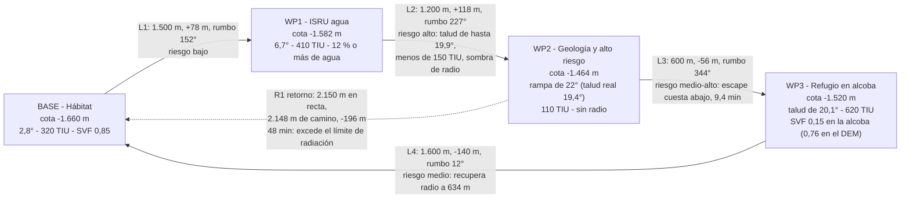
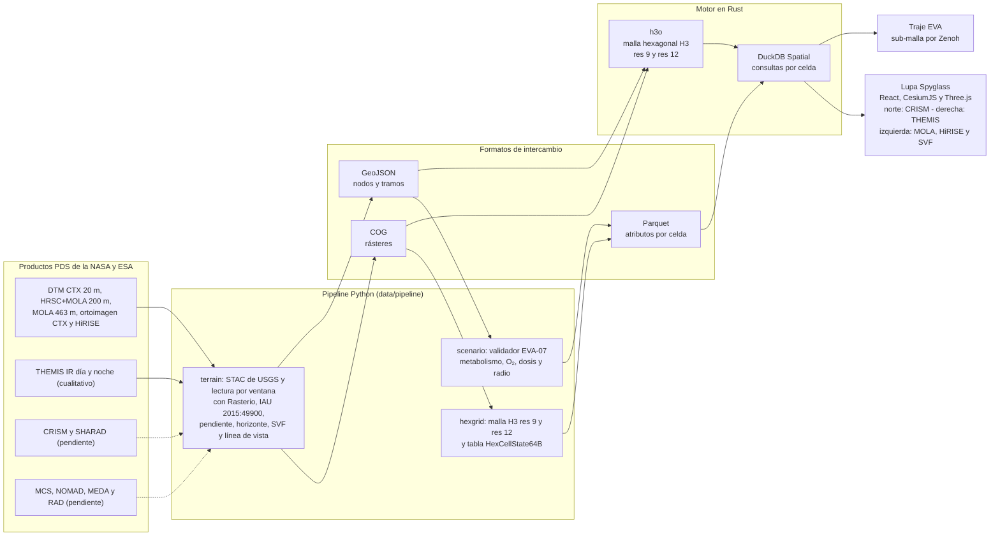
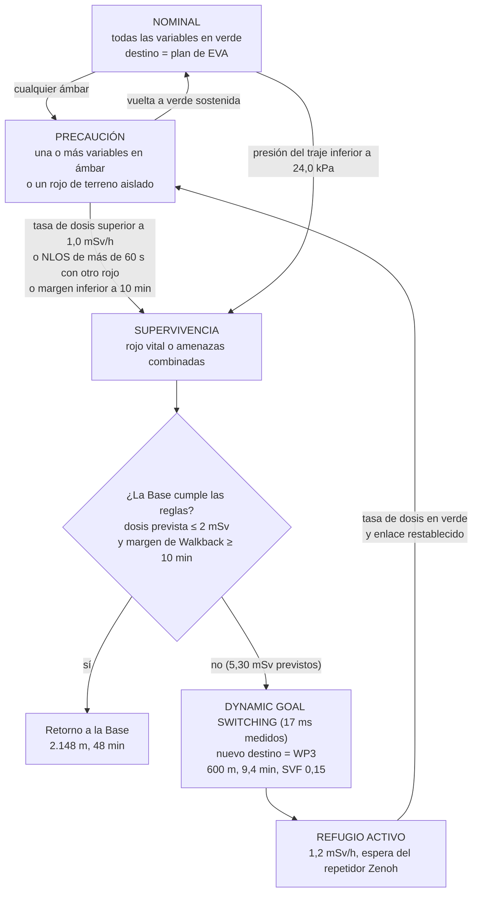
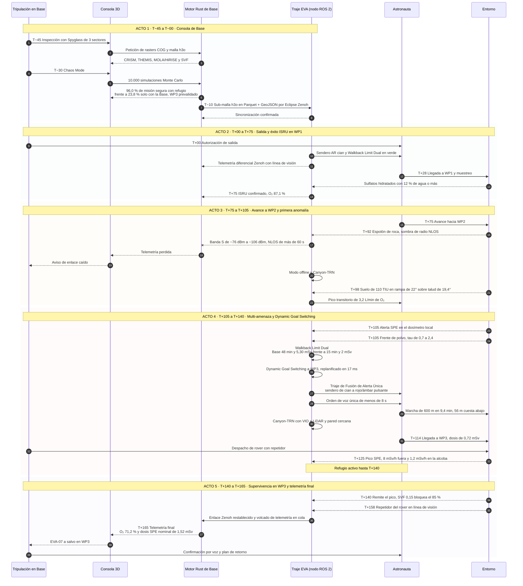

# 📘 Entregable 1: Dossier Científico, Cartografía NASA y Simulación de Misión "Marswalk"
**Proyecto:** **R.E.D. ATLAS** (*Reconnaissance, EVA & Dynamic-survival Atlas*)  
**Equipo:** Red Project — NASA Space Apps Challenge 2026  
**Responsable:** Persona 1 (Ciencia Planetaria, Datasets NASA y Escenario Operativo)

> [!NOTE]
> **Cómo leer las cifras.** Cada valor lleva su procedencia: **[M]** medido o publicado, **[D]** derivado por cálculo, **[E]** supuesto del escenario de diseño. Las posiciones de los nodos salen de una búsqueda sobre el DTM CTX real de 20 m; sus cotas son medidas y sus pendientes, SVF y líneas de vista, derivadas. Siguen siendo escenario de diseño la alcoba con cornisa del WP3, las inercias térmicas, la hidratación del WP1 y la rampa local de 22° del WP2; junto a cada una se da el valor real que mide el DTM. Los productos NASA usados están identificados en el manifiesto del pipeline; los de CRISM y SHARAD siguen por confirmar en PDS ODE.
>
> **Datos asociados:** [`triangulo_supervivencia.geojson`](../../data/mission-scenarios/triangulo_supervivencia.geojson) · [`eva_thresholds.json`](../../data/mission-scenarios/eva_thresholds.json) · [`eva07_events.json`](../../data/mission-scenarios/eva07_events.json) · [`SCHEMA_EVA07.md`](../../data/mission-scenarios/SCHEMA_EVA07.md) · [`sources_manifest.json`](../../data/nasa-layers/sources_manifest.json) · [`SITE_REALITY_CHECK.md`](../../data/nasa-layers/SITE_REALITY_CHECK.md) · [`SCHEMA_HEXGRID.md`](../../data/nasa-layers/SCHEMA_HEXGRID.md) · [`layers_catalog.json`](../../data/nasa-layers/layers_catalog.json)

---

## 1. Justificación Planetaria y Coordenadas del "Triángulo de Supervivencia" (Valles Marineris — Melas Chasma)

Convenciones de todo el documento: coma decimal en texto y tablas, punto decimal en JSON y coordenadas de fichero. Procedencia de cada cifra: **[M]** medido o publicado, **[D]** derivado por cálculo, **[E]** supuesto del escenario de diseño.

### 1.1 Por qué la cuenca suroeste de Melas Chasma

El escenario se sitúa en la cuenca suroeste de Melas Chasma, al pie de su pared suroeste (Base en 9,89646°S, 283,38920°E = 76,61080°W), por tres razones:

- **Paleolago.** La cuenca conserva depósitos lacustres y abanicos sedimentarios (Quantin et al. 2005; Metz et al. 2009; Williams & Weitz 2014): terreno estratificado y relativamente llano, apto para un hábitat.
- **Candidato de Mars 2020.** La cuenca suroeste de Melas fue uno de los 8 lugares de aterrizaje candidatos evaluados en el taller de 2015, de modo que su seguridad y su interés científico ya han sido examinados por la comunidad. El DEM real confirma que el triángulo está dentro de una cuenca cerrada de 46 × 24 km (690 km²) [D].
- **Mineralogía hidratada.** CRISM identifica sulfatos hidratados interestratificados con esmectitas de Fe/Mg, bajo una unidad gruesa de sulfato monohidratado, con jarosita y ópalo en exposiciones menores (Weitz et al. 2015; Liu et al. 2018, año y DOI pendientes de verificar). Es el recurso de agua del WP1.

**Aclaración sobre el relieve.** La cuenca no está en el fondo del cañón: está **colgada ~1 km sobre el piso principal** [M]. En el DEM es una **cuenca cerrada que desborda a unos −1.168 m** [D]: la Base (−1.677 m en MOLA; −1.660 m en el DTM CTX) queda 509 m por debajo del collado. Las cifras de relieve que usa el proyecto describen cosas distintas:

| Cifra | Qué mide | Procedencia |
|---|---|---|
| 7–9 km | Relieve total del sistema: de la meseta (≈ +4 km) al piso más profundo del sistema (≈ −5 km). Alrededor de la Base, el DEM da 8,2 km de relieve en 100 km y 8,7 km en 150 km; el piso más profundo dentro de esos 150 km está a −4.200 m | [M]; medida local [D] |
| 5–6 km | Relieve local de la pared en nuestro sitio: 5,5 km sobre la Base en 25 km (5,5–5,7 km en 25–50 km) | [D] |
| ~3 km en 10 km | Pared suroeste cercana: gana +1 km a 4,6 km de la Base (rampa de 3,2 km a 15,6° de media), 3,1 km en 10 km, y el borde de la meseta (≥ +3.000 m) está a 14,2 km. No hay un escarpe vertical de 4 km sobre el WP3: es una ladera | [D] |

**Por qué el triángulo está al pie de la pared y no en 9,8°S, 283,6°E.** El escenario se diseñó primero en 9,8°S, 283,6°E. La comprobación con el DTM CTX de 20 m ([`SITE_REALITY_CHECK.md`](../../data/nasa-layers/SITE_REALITY_CHECK.md)) confirmó que ese punto está dentro de la cuenca (−1.906 m), pero mostró un piso casi llano: 2,6° en el WP2 (máximo de toda la zona, 7,2°), ningún relieve de +1 km a menos de 8,5 km, SVF de 0,85–0,86 en toda la ruta y línea de vista de radio con el WP2 y el WP3. Ni el talud del WP2 ni el escarpe del WP3 existían. Por eso el triángulo se trasladó **13,6 km al suroeste (rumbo 245°), como figura rígida** (traslación y giro horario de 37°; mismas distancias y perímetro), mediante una búsqueda sobre 805 millones de colocaciones en cada par CTX por separado. Solo 1.022 cumplían a la vez Base llana, WP1 < 8°, WP2 en 18–26°, tramos L1 y L4 ≤ 25° y sombra de radio clara en el WP2 y el WP3; se ordenaron por cielo más cerrado en el WP3, se exigió que cumplieran en al menos dos pares CTX independientes (solo tres lo consiguen) y, entre esas tres, se eligió la de mayor margen de sombra de radio. El GeoJSON original se conserva como `triangulo_supervivencia_original_9.8S_283.6E.geojson`.

### 1.2 Nodos y tramos canónicos

Sistema de referencia: IAU 2015:49900 (Marte esférico, planetocéntrico, longitud Este positiva 0–360), R = 3.396.190 m. En el sitio (9,9°S), 1° de latitud = 59.274,7 m y 1° de longitud = 58.392,7 m.

| Nodo | Lat (°) | Lon E (°) | Cota CTX 20 m (m) [M] | Pendiente local 20 m [D] | TIU [E] | SVF | LOS radio con Base [D] |
|---|---|---|---|---|---|---|---|
| Base | −9,89646 | 283,38920 | −1.660 | 2,8° | 320 | 0,85 [D] | — |
| WP1 ISRU | −9,91880 | 283,40126 | −1.582 | 6,7° | 410 | 0,85 [D] | sí (+0,6 m, dentro del ruido de ±5 m) |
| WP2 riesgo | −9,93261 | 283,38623 | −1.464 | **19,4° real [D]**; rampa local **22° [E]** | 110 | 0,84 [D] | no (−24,7 m) |
| WP3 refugio | −9,92286 | 283,38349 | −1.520 | 20,1° (talud) | 620 | **0,15 [E]** alcoba; **0,76 [D]** real | no (−28,2 m) |

Las posiciones salen de la búsqueda rígida sobre el DTM CTX de 20 m `P18_007878_1703_XN_09S076W__P20_008735_1702_XI_09S076W` [D]; las cotas se leen en él [M] y las pendientes, el SVF y la línea de vista (con su margen en metros) se derivan de él [D]. Siguen siendo **[E]**: las inercias térmicas (no hay mapa THEMIS cuantitativo, véase 2.2), la rampa local de 22° del WP2 (el DTM mide 19,4° a 20 m, entre 14,0° y 19,4° según el par CTX) y la alcoba con cornisa del WP3, cuyo SVF de 0,15 un DEM no puede representar (el DTM da 0,76).

| Tramo | Distancia [D] | Δz [M/D] | Rumbo [D] | Pendiente media [D] | Pendiente máx. [D] | Riesgo |
|---|---|---|---|---|---|---|
| Base→WP1 (L1) | 1.500 m | +78 m | 152° | 2,96° | 8,0° | Bajo |
| WP1→WP2 (L2) | 1.200 m | +118 m | 227° | 5,62° | 19,9° | Alto: talud real de hasta 19,9°, <150 TIU [E], sombra de radio real |
| WP2→WP3 (L3) | 600 m | −56 m | 344° | −5,26° | 22,5° | Medio-alto: ruta de escape cuesta abajo por ladera, unos 9 min (9,4) a marcha urgente |
| WP3→Base (L4) | 1.600 m | −140 m | 12° | −5,02° | 20,1° | Medio: descenso, recupera la LOS a ~634 m del WP3 |
| **Perímetro** | **4.900 m** | 0 | | | | |
| WP2→Base (R1, retorno) | 2.150 m en línea recta; **2.148 m** de camino del planificador D\* Lite («unos 2,15 km») | −196 m | 5° | −5,20° | 21,4° | Contingencia |

La pendiente media del GeoJSON es la del perfil del DTM y difiere de atan(Δz/d) hasta 0,07° (L3: −5,26° frente a −5,33°). El recorrido sube 196 m de la Base al WP2, y el WP3 queda 56 m **por debajo** del WP2: el escape al refugio es cuesta abajo.

La pendiente media del tramo WP1→WP2 (5,62°) y la del WP2 no se contradicen: la primera promedia 1.200 m de recorrido; el nodo está en un talud real de 19,4° a 20 m, y los 22° son la rampa local de escenario sobre el lóbulo, más corta que la base de 40 m con la que el DTM mide la pendiente.

### 1.3 Geología de cada nodo

**Base (Nodo 0).** Terraza aluvial en la parte distal de un abanico, sobre el piso de la cuenca (unidad geológica [E]), al pie de la pared suroeste, que gana +1 km a 4,6 km de la Base: 2,8° de pendiente [D] (máximo de 3,8° a 60 m), 320 TIU [E] (suelo compactado con algo de cobertura fina) y SVF 0,85 [D]; la pared cierra el horizonte hasta 19,0° hacia el sur.

**WP1 — ISRU de agua.** Depósito estratificado claro donde los sulfatos polihidratados se interestratifican con monohidratados, sobre una pendiente real de 6,7° [D]. La hidratación del nodo es **[E]**: el pipeline no incluye todavía ningún producto CRISM, de modo que el ≥12 % de agua no está leído del sitio. El agua estructural por fase es [D]:

| Fase mineral | Fórmula | Agua (% en peso) | Liberación térmica |
|---|---|---|---|
| Kieserita | MgSO₄·H₂O | 13,0 | >300–350 °C |
| Yeso | CaSO₄·2H₂O | 20,9 | 100–150 °C |
| Starkeyita | MgSO₄·4H₂O | 37,4 | <150–200 °C |
| Hexahidrita | MgSO₄·6H₂O | 47,3 | <150–200 °C |
| Epsomita | MgSO₄·7H₂O | 51,2 | <150–200 °C |

Corrección obligatoria: la **kieserita es monohidratada**, no polihidratada. Esto condiciona el proceso, porque es la fase más pobre en agua y la que exige más temperatura. El objetivo ISRU es la fracción polihidratada, que cede el agua por debajo de 150–200 °C; agotar la kieserita obligaría a superar 300–350 °C por una ganancia marginal.

Balance del proceso: la mezcla del WP1 contiene ≥12 % de agua en roca total, es decir, 120 kg de agua por tonelada de regolito. La energía ideal de calentamiento y deshidratación es ≈ 153 kWh/t, equivalente a ≈ 1,3 kWh por kg de agua [D]. El proceso consiste en excavar y triturar, calentar en horno cerrado, condensar el vapor en trampa fría y depurar el agua antes de su uso o electrólisis. Al ser un valor ideal, el consumo real será mayor por pérdidas térmicas.

**WP2 — contacto geológico y trampa.** Confluyen el frente de un lóbulo de deslizamiento, la traza de una falla normal y bancos de polvo fino acumulados contra ambos [E: ninguno de los tres está identificado todavía en la imagen]. El interés científico es alto (el contacto expone material de la pared y el plano de falla), pero el nodo es una trampa por la combinación de dos valores:

- **110 TIU** [E] indica material fino no consolidado: la bota se hunde y patina.
- **22°** [E] de rampa local convierte ese hundimiento en un sobrecoste metabólico severo. El talud real del nodo mide **19,4°** a 20 m [D] (14,0–19,4° según el par CTX; hasta 20,0° a 100 m): una ladera de ~15–20° en la que la rampa de 22° es un supuesto local, más corto de lo que el DTM puede resolver.

Con el modelo metabólico del proyecto (factor de terreno η = 2,1 por debajo de 150 TIU, 30 % de deslizamiento, avance de 0,55 m/s, rampa de 22°), el gasto llega a 1.073 W = **3,2 L/min de O₂** [D], un pico cercano al VO₂máx que no se sostiene más de 2–3 min. Además, el relieve de la ladera corta la línea de visión con la Base: el rayo pasa 24,7 m por debajo del terreno [D], muy por encima del ruido de ±5 m del DTM. El astronauta queda lento, agotándose e incomunicado a la vez.

**WP3 — refugio topográfico.** El terreno real es un talud de 20,1° [D] (hasta 24,1° a 100 m), 56 m por debajo del WP2, con un horizonte de hasta 20,7° y un SVF derivado de **0,76** [D]. El escenario sitúa ahí una alcoba bajo cornisa en la base de un afloramiento de coladas basálticas estratificadas (620 TIU, roca firme) **[E]**: un DTM de 20 m no puede mostrar cornisas ni alcobas, y en toda la zona de la ruta el cielo más cerrado que mide es SVF 0,72, a 140 m del WP3. El requisito geométrico es estricto: **una pared sola solo tapa medio cielo (SVF ≈ 0,5)**. Para alcanzar SVF 0,15 hace falta techo de roca, es decir, una alcoba con cornisa. Con esa geometría, el pico de diseño de un evento solar de 8 mSv/h a cielo abierto [E] baja a 1,2 mSv/h, una reducción del 85 %; contando albedo del suelo y neutrones secundarios, la reducción real sería del 70–85 %. Como referencia medida, RAD registró solo −5 ± 1 % de dosis con un 19 % de cielo obstruido junto a un butte (Guo et al. 2021) [M]: el blindaje topográfico parcial apenas protege, y por eso se exige la alcoba.

### 1.4 Esquema de propiedades GeoJSON

Fichero: `data/mission-scenarios/triangulo_supervivencia.geojson`. CRS `IAU_2015:49900`; coordenadas en orden **`[lon, lat, elev]`** (longitud Este, latitud planetocéntrica, cota sobre el areoide MOLA en metros, medida en el DTM CTX). El fichero conserva el esquema original y añade campos para separar lo real de lo supuesto.

| Campo | Tipo | Unidad | Descripción |
|---|---|---|---|
| `node_id` | texto | — | `BASE`, `WP1`, `WP2`, `WP3` |
| `name` | texto | — | Nombre legible del nodo |
| `role` | texto | — | `habitat`, `isru_water`, `science_hazard`, `shelter` |
| `lat_pc_deg` | número | ° | Latitud planetocéntrica |
| `lon_e_deg` / `lon_w_deg` | número | ° | Longitud Este (0–360) y su equivalente Oeste |
| `elev_mola_m` | número | m | Cota sobre el areoide MOLA, medida en el DTM CTX de 20 m |
| `slope_local_deg` | número | ° | Pendiente local a 20 m (base de 40 m) |
| `thermal_inertia_tiu` | número | J m⁻² K⁻¹ s⁻¹ᐟ² | Inercia térmica (escenario: no hay mapa THEMIS cuantitativo) |
| `sky_view_factor` | número | 0–1 | Fracción de cielo visible que usa el motor (en el WP3, la alcoba de escenario: 0,15) |
| `sky_view_factor_dem` | número | 0–1 | SVF derivado del DEM (WP3: 0,76) |
| `radio_los_base` | booleano | — | Línea de visión de radio con la Base |
| `radio_los_margin_m` | número o nulo | m | Separación mínima entre el rayo y el terreno (negativa = obstruido) |
| `horizon_max_deg` | número | ° | Elevación máxima del horizonte |
| `h2o_wt_pct` | número o nulo | % en peso | Agua extraíble en roca total (solo WP1) |
| `hazards` | lista de texto | — | Peligros activos, p. ej. `H3_regolith_trap`, `H4_radio_shadow` |
| `geology` | texto | — | Unidad geológica |
| `provenance` | texto | — | Procedencia del nodo en texto |
| `property_provenance` | objeto | — | Procedencia de cada campo: `medido`, `derivado` o `escenario` |

Los tramos son `LineString` con `leg_id` (`L1`–`L4` planificados, `R1` de contingencia), `from`, `to`, `kind`, `distance_m`, `delta_elev_m`, `bearing_deg`, `mean_slope_deg`, `slope_max_deg`, `risk` y `property_provenance`; el L4 añade `los_recovered_at_m` (634 m). Ejemplo de un Feature (WP3), abreviado:

```json
{
  "type": "Feature",
  "id": "WP3",
  "geometry": { "type": "Point", "coordinates": [283.383486, -9.922858, -1520] },
  "properties": {
    "node_id": "WP3",
    "role": "shelter",
    "elev_mola_m": -1520,
    "slope_local_deg": 20.1,
    "thermal_inertia_tiu": 620,
    "sky_view_factor": 0.15,
    "sky_view_factor_dem": 0.76,
    "radio_los_base": false,
    "radio_los_margin_m": -28.2,
    "horizon_max_deg": 20.7,
    "h2o_wt_pct": null,
    "hazards": ["H4_radio_shadow"],
    "property_provenance": {
      "elev_mola_m": "medido",
      "slope_local_deg": "derivado",
      "thermal_inertia_tiu": "escenario",
      "sky_view_factor": "escenario",
      "sky_view_factor_dem": "derivado",
      "radio_los_base": "derivado"
    }
  }
}
```

### 1.5 Mapa conceptual del Triángulo de Supervivencia



---

## 2. Catálogo Maestro de Datasets y Capas de la NASA en R.E.D. ATLAS

### 2.1 Tabla maestra de las 6 capas

Los productos de las capas 1, 2 y 3, y el SVF de la capa 6, son los que el pipeline ha localizado y leído de verdad: están en [`sources_manifest.json`](../../data/nasa-layers/sources_manifest.json), con su URL, su licencia y la cobertura **medida** píxel a píxel en cada zona de interés. La huella de la ruta es 9,88–9,95°S, 283,36–283,42°E. Las capas 4, 5 y 6 (dosimetría) quedan fuera del pipeline: para ellas se da el tipo de producto PDS, sin contrastar, y sus IDs de escena siguen **por confirmar en PDS ODE**. `layers_catalog.json` conserva la descripción genérica de cada capa.

| Capa | Misión / instrumento | Producto usado (o tipo PDS si no está contrastado) | Cobertura real en el sitio | Resolución | Formato procesado | Unidad física | Lupa Spyglass |
|---|---|---|---|---|---|---|---|
| 1. Topografía, pendientes y horizonte | MRO CTX (estéreo); Mars Express HRSC + MGS MOLA; MGS MOLA; MRO HiRISE (estéreo) | **DTM CTX de 20 m de USGS** (Ames Stereo Pipeline, alineado a MOLA; Laura et al. 2023, doi:10.5066/P9JKVWR3), par de trabajo `P18_007878_1703_XN_09S076W__P20_008735_1702_XI_09S076W`; **mezcla HRSC+MOLA 200 m v2** (USGS); **MOLA MEGDR 463 m** (`MGS-M-MOLA-5-MEGDR-L3-V1.0`, mosaico global USGS); DTM HiRISE (`MRO-M-HIRISE-5-DTM-V1.0`) | **Sí**: el par de trabajo cubre el 99,9 % de la ruta; seis pares CTX tienen píxeles en ella y cuatro cubren la colocación completa. Mezcla y MOLA: cobertura total. **HiRISE DTM: no**, ninguno cubre la ruta (tres en el entorno, con < 2 % de cobertura). Las tiras HRSC sueltas (`MEX-M-HRSC-5-REFDR-DTM-V1.0`) solo entran a través de la mezcla | 20 m (CTX); 200 m (mezcla); 463 m (MOLA) | COG float32 + Parquet por celda H3 | m; grados; SVF 0–1 | Sector izquierdo: pendiente y SVF |
| 2. Ortoimagen de obstáculos y rocas | MRO CTX; MRO HiRISE | **Mosaico ecuatorial controlado CTX de 6 m**, cuadrángulo MC-18 Coprates (USGS; Robbins et al. 2023); **HiRISE RDR** `PSP_008735_1700_RED` (`MRO-M-HIRISE-3-RDR-V1.1`, sin control, ±100 m) y otras cinco observaciones RED sobre la ruta | **Sí**: mosaico CTX al 100 %; `PSP_008735_1700_RED` cubre el 96,6 % de la ruta. El mosaico CTX de 5 m de Murray Lab no se usa: solo se distribuye en teselas ZIP completas | 6 m (CTX); 0,25 m nativos, remuestreados a 1 m (HiRISE) | COG uint8/uint16 con *overviews* | Reflectancia I/F | Textura base 3D y sector izquierdo (rocas) |
| 3. Inercia térmica y trampas de regolito | Mars Odyssey THEMIS IR | **Mosaicos THEMIS IR diurno y nocturno controlados de 100 m**, MC-18 Coprates (USGS) | **Parcial**: los mosaicos cubren todo el entorno, pero son **cualitativos** (DN de 8 bits). No existe un mapa cuantitativo de inercia térmica (THEMIS o TES) accesible por ventana, y no se deriva TIU de los DN | 100 m | COG + Parquet (DN, no TIU) | DN cualitativo (las TIU de los nodos son [E]) | Sector derecho: <150 TIU en magenta/naranja |
| 4. Mineralogía hidratada e ISRU | MRO CRISM; MRO SHARAD; Mars Express OMEGA (contexto) | `MRO-M-CRISM-3-RDR-TARGETED-V1.0`; `MRO-M-CRISM-5-RDR-MPTARGETED-V1.0`; `MRO-M-SHARAD-4-RDR-V1.0` (sin contrastar) | **No comprobada**: no hay colecciones CRISM ni SHARAD en el catálogo STAC de USGS; la hidratación del WP1 es [E] | 18 m (FRT); 36 m (HRL/HRS); ~200 m (MSP); SHARAD 0,3–1 km × 3–6 km, 15 m vertical | COG float32 de parámetros espectrales + Parquet | Profundidad de banda (adim.); % en peso de H₂O estimado | Sector norte: sulfatos hidratados en azul eléctrico |
| 5. Dinámica atmosférica, polvo y vientos | MRO MCS; TGO NOMAD; Mars Express OMEGA; Mars 2020 MEDA (análogo en Jezero); modelo mesoescalar | `MRO-M-MCS-5-DDR-V1.0`; `urn:nasa:pds:mars2020_meda`; Mars Climate Database / modelo mesoescalar (sin contrastar) | Fuera del pipeline | Perfiles con ~5 km vertical (MCS); malla mesoescalar 1–2 km | Parquet (series temporales) + COG de campos de viento | τ; m/s; K; Pa | Modo Rayos X de 1 capa |
| 6. Radiación y Sky View Factor | MSL RAD (análogo en Gale); SVF derivado del DEM | `MSL-M-RAD-3-RDR-V1.0` (sin contrastar); **SVF y horizonte calculados por el pipeline** sobre la capa 1: campo cercano CTX de 20 m y campo lejano HRSC+MOLA de 200 m, 36 acimuts, SVF = 1 − media(sen θ) | SVF: **sí**, en toda la ruta (0,54–0,86). RAD: análogo, sin medida en Melas | Puntual (RAD); 20 m en campo cercano y 200 m en campo lejano (SVF) | Parquet (dosis) + COG float32 (SVF) | mSv/h; µGy/día; SVF 0–1 | Sector izquierdo: blindaje y sombra de radio |

Limitaciones: ningún DTM HiRISE cubre la ruta, así que la topografía de navegación es CTX de 20 m (pendiente medida sobre una base de 40 m: no ve bloques, escalones ni rampas más cortas); el RDR de HiRISE no está controlado (±100 m) y solo resuelve rocas de más de ~0,75–1 m.

### 2.2 Cómo THEMIS distingue arena suelta de roca

La inercia térmica mide la resistencia del suelo a cambiar de temperatura. De noche, el material suelto y fino se enfría deprisa y la roca conserva el calor, de modo que la temperatura nocturna de THEMIS IR separa ambos:

| Inercia térmica (TIU) | Interpretación | Factor de terreno η |
|---|---|---|
| <150 | Polvo o arena suelta: la bota se hunde | 2,1 |
| 150–250 | Arena con algo de cohesión | 1,6 |
| 250–400 | Suelo compactado o mezcla con fragmentos | 1,3 |
| >400 | Roca consolidada o costra firme | 1,0 |

En la ruta: el WP2 (110 TIU) es trampa; la Base (320) y el WP1 (410) son firmes; el WP3 (620) es roca. Los cuatro valores son **[E]**: en el sitio solo hay mosaicos THEMIS IR día/noche cualitativos, de modo que hasta que se disponga de un mapa cuantitativo de inercia térmica la malla H3 los lleva como valores de escenario en discos alrededor de los nodos, con su procedencia marcada, y los DN de THEMIS como capa aparte.

Límites que la consola debe mostrar junto al dato:

- **Incertidumbre de ~20 %** en el valor: un píxel de 140 TIU no es necesariamente seguro.
- **Solo sondea los centímetros superiores**: una capa fina de polvo sobre roca se lee como blanda, y una costra sobre arena se lee como firme.
- **Píxel de 100 m**: un banco de polvo de pocos metros queda diluido dentro del píxel.

Por eso el dato no se usa solo. Cada celda se cruza con la **textura HiRISE** (ondulaciones eólicas, bloques, afloramiento) y con la **pendiente** de la Capa 1; la celda se marca como trampa cuando coinciden baja inercia, textura de material suelto y pendiente fuerte.

### 2.3 Correcciones de atribución

- **OMEGA vuela en Mars Express**, no en TGO. En TGO va NOMAD. La formulación "TGO NOMAD/OMEGA" del plan queda corregida.
- **MEDA (Perseverance, Jezero) y RAD (Curiosity, Gale) son análogos extrapolados**, no medidas en Melas. No hay estación meteorológica en Melas: los vientos de ladera son modelados (10–30 m/s; Spiga & Forget 2009; Rafkin & Michaels 2003).
- **La columna de CO₂ del sitio es menor que en Gale.** En la Base (−1.660 m) la presión es de ~708 Pa y la columna de ~19,0 g/cm² [D] (P = 610 Pa · exp(−z / 11,1 km); columna = P / g), frente a ~23 g/cm² en Gale (−4,4 km) [M]. Nuestro sitio tiene **menos** blindaje atmosférico; la "mayor presión del fondo de Melas" solo vale para el piso más profundo del sistema (−5 km). En el WP2 (−1.464 m) la presión baja a 696 Pa.
- **SHARAD es solo contexto regional**: en Valles Marineris sufre *clutter* por los ecos de las paredes y no sirve para localizar agua a escala de ruta. La detección de agua recae en CRISM.

### 2.4 Pipeline de datos



### 2.5 Resoluciones H3 en Marte

H3 se define sobre una esfera, así que se aplica sobre la esfera de Marte del CRS (R = 3.396.190 m); las longitudes son las terrestres escaladas por la razón de radios (0,5331) y las áreas por su cuadrado (0,2842) [D].

| Resolución H3 | Arista en Marte | Área media en la AOI de ruta (medida) | Uso | Dato que la justifica |
|---|---|---|---|---|
| 9 | ≈ 93 m | 35.283 m² (~89 píxeles CTX por celda) | Capa de inercia térmica y atributos regionales | Equivale al píxel de 100 m de THEMIS |
| 12 | ≈ 5 m | 102,9 m² (~0,26 píxeles CTX por celda) | Navegación y planificación de ruta D\* Lite | Más fina que el dato: el DTM de la ruta es CTX de 20 m, sin HiRISE |

Las aristas de ≈ 93 m y ≈ 5 m coinciden con la tabla fija del motor Rust (92,86 m y 5,01 m); la arista media que da la librería H3 4.x escalada a Marte es 107,0 m y 5,77 m, y en esta latitud las celdas son algo mayores que la media global, por lo que la malla generada documenta el área real de cada celda. La resolución 9 hereda la limitación de THEMIS: un banco de polvo menor que la celda no se ve. La resolución 12 es más fina que el DTM: cada píxel de 20 m alimenta de media 3,8 celdas con el mismo valor, de modo que la resolución real de la información es la de la fuente, que se guarda como atributo; la navegación a esa escala se apoya además en la textura HiRISE.

### 2.6 Pipeline implementado (`data/pipeline/`)

El paso de los productos NASA a las capas del motor ya está implementado como paquete Python reproducible (`red_atlas_p1`, Python 3.12 gestionado con `uv`; dependencias principales: Rasterio, rio-cogeo, pystac-client, pyproj, Shapely, SciPy, PyArrow, `h3` 4.x y DuckDB). Descripción y órdenes en [`data/pipeline/README.md`](../../data/pipeline/README.md). Tiene tres módulos:

- **`terrain`.** Busca los productos en el catálogo STAC de USGS Astrogeology, mide su cobertura real píxel a píxel en cada zona de interés y lee solo la ventana necesaria (rangos HTTP sobre COG, nunca el fichero completo). Genera 13 COG en `data/pipeline/build/cog/` (no versionados): DEM CTX de 20 m (ruta y entorno), mezcla HRSC+MOLA de 200 m, MOLA de 463 m, ortoimágenes CTX de 6 m y HiRISE de 1 m, THEMIS IR día y noche de 100 m, pendiente y orientación, horizonte en 36 acimuts, SVF, línea de vista de radio con la Base y una capa de escenario con una banda de procedencia por variable (los rásteres medidos nunca llevan valores de escenario). Escribe `sources_manifest.json`, `terrain_outputs.json` (el contrato de ficheros, bandas, unidades y procedencia), `site_reality_check.json` y [`SITE_REALITY_CHECK.md`](../../data/nasa-layers/SITE_REALITY_CHECK.md); el submódulo `site_search` repite la búsqueda rígida del emplazamiento y `relocate` aplica la colocación al GeoJSON.
- **`scenario`.** Validador de referencia de la física de las secciones 3 y 4: lee el GeoJSON y `eva_thresholds.json` y produce la cronología minuto a minuto de la EVA-07 (`eva07_timeline.parquet`, 211 filas de T−45 a T+165) y sus hitos (`eva07_events.json`), con potencia por fase, O₂ restante, tres perfiles de tasa SPE, dosis acumulada, enlace de radio, amenazas activas y los dos lados del Walkback Limit. Esquema en [`SCHEMA_EVA07.md`](../../data/mission-scenarios/SCHEMA_EVA07.md).
- **`hexgrid`.** Agrega los COG a celdas H3 reales (índice `uint64`) sobre la ruta, a resolución 12 (141.313 celdas) y 9 (462 celdas). Cada resolución tiene dos Parquet: una tabla completa, con valor medido o derivado, valor de escenario, valor efectivo y procedencia por variable, y una tabla de contrato con exactamente los campos, tipos y orden de `HexCellState64B` del núcleo Rust: `h3_index`, `elev_m`, `slope_deg`, `aspect_deg`, `thermal_inertia_tiu`, `roughness_hi`, `isru_h2o_pct`, `sky_view_factor`, `los_base_rssi_dbm`, `base_metabolic_cost`, `horizon_hash_id`, `hazard_bitmask` y `padding_crc`. `los_base_rssi_dbm` sale del modelo de enlace con difracción descrito en 3.2 y `roughness_hi` es una rugosidad derivada del DTM: la desviación típica de la cota respecto al plano ajustado en una ventana de 60 m (mediana de 0,16 m en la ruta; no ve bloques métricos). `base_metabolic_cost` y `horizon_hash_id` los calcula el motor (dependen de la arista y de su base de horizontes), y los datos que faltan van como nulos de Parquet, nunca como 0; el motor los carga como «sin dato». Incluye una demostración de consultas DuckDB (celda, Spyglass de 3 sectores y perfil de tramo). Esquema en [`SCHEMA_HEXGRID.md`](../../data/nasa-layers/SCHEMA_HEXGRID.md).

Para regenerarlo todo, desde `data/pipeline/`:

```bash
uv sync
uv run python -m red_atlas_p1.terrain
uv run python -m red_atlas_p1.scenario
uv run python -m red_atlas_p1.hexgrid
uv run pytest
```

`terrain` necesita red y tarda unos 3 minutos (`--reuse` aprovecha los recortes ya descargados); `scenario` y `hexgrid` son deterministas y se ejecutan sin red sobre lo que deja `terrain`. La búsqueda del emplazamiento (`uv run python -m red_atlas_p1.terrain.site_search`) tarda unos 35 minutos.

**Tiempos de consulta medidos** sobre la malla de resolución 12 (141.313 celdas) en un portátil Apple M4. Son de esa máquina y esa ejecución, no una garantía para el ordenador del traje:

| Consulta | DuckDB sobre el Parquet (Python) | Motor Rust con la malla en memoria |
|---|---|---|
| Celda por índice H3 | mediana 2,79 ms; p95 2,96 ms | mediana 0,041 µs; p95 0,125 µs |
| Spyglass de 3 sectores, radio 100 m | mediana 7,02 ms; p95 7,34 ms | mediana 61,7 µs; p95 68,5 µs (≈ 307 celdas) |
| Spyglass por anillo k = 10 | mediana 2,60 ms; p95 2,97 ms | mediana 10,2 µs; p95 16,6 µs |
| Carga completa del Parquet | 14,6 ms en frío hasta la primera celda | mediana 117 ms; p95 119 ms |

La columna de DuckDB sale de [`hexgrid_duckdb_benchmark.json`](../../data/nasa-layers/hexgrid_duckdb_benchmark.json) e incluye el paso de Python a DuckDB. La del motor sale del test de medición `p1_res12_query_benchmark` de `src/core-engine/tests/p1_hexgrid.rs`, compilado en modo *release*. Es decir, en la consola de Base una consulta Spyglass cuesta unos pocos milisegundos con DuckDB; en el traje, con la malla ya cargada, menos de 0,1 ms.

---

## 3. Umbrales Físicos de Supervivencia y Matriz de Sinergia Multi-Amenaza

Esta sección fija los números que alimentan la máquina de estados determinista del traje y explica qué ocurre cuando el motor estocástico multi-amenaza dispara varios eventos a la vez. Procedencia de cada cifra: **[M]** medido o publicado, **[D]** derivado por cálculo, **[E]** supuesto del escenario de diseño. Los umbrales son los de `data/mission-scenarios/eva_thresholds.json` (versión de esquema 1.0), sin modificar.

### 3.1 Modelo metabólico paramétrico

El coste de caminar con traje se modela como la suma de tres términos [D]: un gasto basal, el coste de la marcha en horizontal (penalizado por el tipo de suelo) y el trabajo contra la gravedad (penalizado por la eficiencia muscular y por el deslizamiento).

> **M = 120 + η · 0,285 · W · v + W · v · sen θ / (0,25 · (1 − s))**   [W]

- **W** = 632,5 N: peso en Marte de la masa con traje (170 kg × 3,72 m/s²).
- **v**: velocidad de avance (m/s). **θ**: pendiente. **s**: fracción de deslizamiento (cada paso que resbala es trabajo perdido).
- **η**: factor de terreno ligado a la inercia térmica THEMIS: 1,0 (>400 TIU), 1,3 (250–400), 1,6 (150–250) y 2,1 (<150 TIU, regolito suelto).
- **0,25**: eficiencia muscular en trabajo positivo. **120 W**: gasto basal con traje presurizado.
- Conversión a oxígeno: 1 L O₂/min equivale a 335 W; densidad del O₂ 1,429 g/L (STPD).

| Caso | Condiciones | Potencia (W) | O₂ (L/min) | Zona | Proc. |
|---|---|---|---|---|---|
| Llano firme | 0°, 1,0 m/s, η 1,0, sin deslizamiento | 300 | 0,90 | Verde | [D] |
| Rampa de 10° | suelo firme, velocidad reducida | 592 | 1,77 | Rojo si se sostiene | [D] |
| Rampa de 20° | suelo firme, velocidad reducida | 839 | 2,50 | Rojo | [D] |
| **WP2** | 22°, 0,55 m/s, η 2,1 (110 TIU), deslizamiento 30 % | **1.073** | **3,2** | Rojo (pico) | [D] |
| Huida a WP3 | Ruta del planificador D\* Lite sobre el terreno real, **cuesta abajo** (−56 m), topes de huida de 1,25 m/s y 650 W: 9,4 min a 1,05 m/s de media | 548 (media) | 1,64 | Ámbar | [D] |

Las potencias de cada fase de la EVA-07 salen del mismo modelo con la pendiente media real de cada tramo (DTM CTX), la velocidad media que imponen los hitos de la cronología y el η de la TIU media de los dos nodos del tramo; ninguna está ajustada para cuadrar el O₂ [D]:

| Fase | T | Potencia | Parámetros |
|---|---|---|---|
| Marcha L1 | 0–28 | 447 W | 0,893 m/s, +2,98°, η 1,3 |
| ISRU en WP1 | 28–75 | 250 W [E] | trabajo ligero de muestreo |
| Marcha L2 | 75–98 | 539 W | 0,870 m/s, +5,62°, η 1,3 (ámbar 23 min, bajo el rojo de 585 W) |
| Pico en la rampa del WP2 | 98–101 | **1.073 W** | 22° [E], 0,55 m/s, η 2,1, s 0,30 |
| Rampa lenta | 101–105 | 585 W | ritmo regulado al rojo sostenido: 0,268 m/s |
| Huida a WP3 (incluye la entrada bajo la cornisa) | 105–114,4 | **548 W** | planificador D\* Lite: 9,4 min, 1,05 m/s de media |
| Refugio | 114,4–165 | 130 W [E] | reposo presurizado |

La media de la rampa del WP2 (T+98–105) es de 794 W. La huida (T+105–114,4) no sale del modelo por tramos sino del planificador D\* Lite del motor Rust, que recorre celda a celda la malla H3 de resolución 12 sobre el terreno real con el mismo modelo de velocidad y los topes de huida de `eva_thresholds.json` (1,25 m/s y 650 W): 9,4 min, 1,05 m/s y 548 W de media, 15,4 L de O₂ [D]. Solo el pico del WP2 (3 min) pasa de 585 W. El modelo por tramos daba un tiempo más corto porque el L3 baja 56 m en media y no acredita pendiente; el camino real, suavizado sobre la malla, sube y baja por la ladera. Tampoco cuenta el coste excéntrico de frenar en una ladera de hasta 22,5°: la potencia de huida sigue siendo optimista.

Los **3,2 L/min del WP2 no son un régimen de marcha**: son un pico transitorio cercano al VO₂máx, insostenible más de 2–3 min. Su valor operativo es de alarma: indica que el astronauta está gastando casi toda su potencia aeróbica en no hundirse, y que cada minuto adicional en la rampa contrae el margen de retorno a pie. Con las reservas del escenario (800 g útiles de O₂ primario [E]) el oxígeno **no** es el consumible limitante de la EVA-07: lo es la radiación.

### 3.2 Tabla de umbrales Verde / Ámbar / Rojo

| Variable | Unidad | Verde (nominal) | Ámbar (precaución) | Rojo (aborto / cambio de destino) | Proc. | Qué dispara en la máquina de estados |
|---|---|---|---|---|---|---|
| Pendiente del terreno | ° | <10 | 10–20 | >20 | [D] | Ámbar: recalcula la ruta D\* Lite y la tasa metabólica prevista. Rojo: celda H3 marcada como trampa de pendiente |
| Tasa metabólica | W | <450 | 450–585 | >585 sostenido; pico 1.072 | [D] | Ámbar: aviso de ritmo. Rojo: contrae el Walkback Limit y ordena reducir carga o salir de la rampa |
| Consumo de O₂ | L/min STPD | <1,35 | 1,35–1,75 | >1,75 sostenido; pico 3,2 | [D] | Igual que la anterior (es la misma magnitud en otra unidad); recalcula la autonomía |
| Inercia térmica del suelo | TIU | >400 | 150–400 | <150 | [M]/[E] | Ámbar: η sube a 1,3–1,6. Rojo: celda vetada para el planificador (rodeo) |
| Factor de terreno η | — | 1,0 | 1,3–1,6 | 2,1 | [D] | Multiplica el coste de la arista en el grafo de rutas |
| Fracción de deslizamiento | — | <0,05 | 0,05–0,20 | >0,20 | [E] | Rojo: evento «Trampa de regolito»; pasa a Precaución aunque la pendiente sea ámbar |
| Opacidad del polvo τ (880 nm) | — | <1,0 | 1,0–2,0 | >2,0 | [M]/[E] | Ámbar: Canyon-TRN baja la confianza del *Skyline Matching*. Rojo: navegación en VIO + LiDAR y balizado de la pared cercana |
| Velocidad del viento | m/s | <10 | 10–20 | >20 | [D]/[E] | Precursor de polvo: adelanta la predicción de τ; no se trata como carga mecánica |
| Tasa de dosis | mSv/h | <0,05 | 0,05–1,0 | >1,0 | [M]/[E] | Rojo: evento «SPE»; arranca el integrador de dosis y la búsqueda de refugio por SVF |
| Presupuesto de dosis SPE por EVA | mSv | <0,5 | 0,5–2,0 | >2,0 | [E] | Regla de vuelo. Si la dosis prevista hasta el destino supera 2,0, dispara el Dynamic Goal Switching |
| Señal de radio (enlace primario en banda S, 2,4 GHz: sesión Eclipse Zenoh sobre ROS 2) | dBm | > −85 | −85 a −100 | < −100 o NLOS >60 s | [D]/[E] | Ámbar: baja la tasa de telemetría. Rojo: el traje pasa a autonomía total en el borde, con almacenamiento local y reenvío diferido |
| Presión del traje | kPa | 28,0–30,5 | 24,0–28,0 | <24,0 | [M]/[E] | Rojo: Supervivencia inmediata, con independencia de las demás variables |
| O₂ primario | % | >50 | 30–50 | <30 | [E] | Entrada del Walkback Limit Dual (rama de consumibles) |
| Agua de refrigeración LCVG | % | >40 | 20–40 | <20 | [E] | Limita la potencia metabólica sostenible (calor que el traje puede evacuar) |
| Batería | % | >40 | 25–40 | <25 | [E] | Ámbar: apaga cargas no esenciales. Rojo: rama de consumibles del Walkback Limit |
| Margen del Walkback Limit Dual | min | >30 | 10–30 | <10 | [E] | Ámbar: Precaución. Rojo: Supervivencia y destino más cercano que cumpla todas las reglas |

Nota sobre el pico metabólico: la fórmula da ≈1.072,9 W; el fichero de umbrales lo guarda truncado (1.072) y el resto del documento lo redondea (1.073). Es el mismo valor.

Referencias para situar los valores: el fondo de rayos cósmicos medido por RAD en Gale es ≈0,027 mSv/h [M] (verde); la SPE de diseño alcanza 8 mSv/h a cielo abierto [E]; la presión nominal del traje es 29,6 kPa [E]; el enlace primario de datos, en banda S (2,4 GHz, 1 W, antenas isótropas), pierde 108,0 dB en espacio libre a 2,5 km y da ≈ −78 dBm con línea de vista [D].

**Señal real en la sombra de radio.** La malla H3 calcula el nivel recibido en cada celda con el perfil real del DTM CTX y difracción en filo de cuchillo sobre la arista dominante (ITU-R P.526). El enlace primario de datos, el que transporta la sesión Zenoh y se pierde tras el relieve, es **banda S a 2,4 GHz y 1 W**: **−78,2 dBm en el WP1, −103,1 dBm en el WP2 y −107,9 dBm en el WP3**, con 26,4 y 33,8 dB de difracción en el WP2 y el WP3 y unos ±2 dB de incertidumbre por el ruido del DTM [D]; en la ruta baja hasta −114,0 dBm. El WP2 y el WP3 quedan en rojo por nivel y, además, por pasar más de 60 s sin línea de vista. La **baliza UHF de 435 MHz y 1 W**, de baja tasa, solo pierde 19–26 dB tras el relieve (−81,0 dBm en el WP2 y −85,7 dBm en el WP3): sobrevive degradada y el sistema no depende de ella. Por eso la sombra de radio es la del enlace en banda S; con UHF no llegaría a rojo por nivel. La cronología de la sección 4 aplica 30 dB de difracción en NLOS (media de los dos nodos), que dan −106,7 dBm en el WP2 y −104,1 dBm en el WP3 [D]. Es un modelo de una sola arista: varias aristas, reflexiones o la rugosidad métrica que el DTM no resuelve darían más pérdida.

### 3.3 Esquema de datos de los umbrales

Cada umbral es una fila de una tabla Apache Parquet y, a la vez, un registro de una estructura de Rust que el traje carga al arrancar. El fichero JSON actual guarda los límites como texto legible; para el motor se proponen límites numéricos, con este esquema:

| Campo | Tipo Parquet | Tipo Rust | Unidad | Descripción |
|---|---|---|---|---|
| `schema_version` | BYTE_ARRAY (UTF8) | cadena | — | Versión del esquema («1.0») |
| `threshold_id` | BYTE_ARRAY (UTF8) | cadena | — | Identificador, por ejemplo `slope_deg` o `dust_tau_880nm` |
| `unit` | BYTE_ARRAY (UTF8) | cadena | — | Unidad física de la variable |
| `sense` | BYTE_ARRAY (ENUM) | enumeración | — | Sentido del peligro: creciente, decreciente o banda |
| `green_limit` | FLOAT | f32 | la de `unit` | Frontera Verde / Ámbar |
| `red_limit` | FLOAT | f32 | la de `unit` | Frontera Ámbar / Rojo |
| `green_upper_limit` | FLOAT (opcional) | f32 opcional | la de `unit` | Límite superior del verde cuando `sense` es banda (30,5 kPa en la presión del traje) |
| `peak_value` | FLOAT (opcional) | f32 opcional | la de `unit` | Pico transitorio admitido (1.072 W; 3,2 L/min) |
| `persistence_s` | INT32 | u16 | s | Tiempo que debe mantenerse la condición (60 s para NLOS) |
| `provenance` | BYTE_ARRAY (UTF8) | enumeración | — | M, D, E o combinación (M/E, D/E) |
| `fsm_action` | BYTE_ARRAY (UTF8) | enumeración | — | Transición o evento que dispara |

Las constantes físicas del fichero (gravedad 3,72076 m/s², masa con traje 170 kg, 335 W por L/min, 1,429 g/L, 708 Pa y 19,0 g/cm² de columna de CO₂ en la Base) viajan como metadatos clave-valor del Parquet.

### 3.4 Notas de rigor

- **El viento empuja poco.** Con una densidad del aire de ~0,018 kg/m³, una ráfaga de 30 m/s ejerce solo ~8 Pa de presión dinámica [D]: no derriba a nadie. El peligro de los vientos de ladera (10–30 m/s modelados) es el polvo que levantan y la **visibilidad**; por eso el umbral de viento actúa como precursor de τ.
- **El sublimador no funciona a 708 Pa.** La presión de la Base supera el punto triple del agua (611 Pa), así que el hielo no sublima de forma estable: el traje usa un evaporador de membrana (SWME). El campo se sigue llamando «agua de refrigeración LCVG».
- **RAD y MEDA son análogos.** RAD mide en Gale (Curiosity) y MEDA en Jezero (Perseverance); ninguno ha medido en Melas. Sus valores se extrapolan. Además, nuestra Base (−1,66 km, ~19,0 g/cm² de CO₂ [D]) tiene **menos** blindaje atmosférico que Gale (~23 g/cm² [M]).
- **La SPE del escenario es una envolvente de diseño.** El pico de 8 mSv/h [E] está unos dos órdenes de magnitud por encima de lo medido en superficie en septiembre de 2017 (2–3 veces el fondo). Es un caso extremo de espectro duro elegido para dimensionar el sistema, no una predicción.
- **El 85 % exige techo.** Una pared sola da un SVF ≈ 0,5; el SVF de 0,15 del WP3 requiere una alcoba con cornisa [E]. El terreno real del WP3, a 20 m, tiene un SVF de 0,76 [D]: sin la cornisa, el talud quitaría como mucho ~24 % de la dosis con el criterio proporcional, y la medida de RAD junto a un butte sugiere bastante menos. Contando albedo y neutrones secundarios, la reducción con alcoba estaría entre el 70 y el 85 %.

### 3.5 Matriz de sinergia: Combos A, B y C

| | Combo A: Trampa táctica | Combo B: Tormenta en el abismo | Combo C: Crisis máxima |
|---|---|---|---|
| Amenazas | Regolito y pendiente en WP2 + sombra de radio NLOS | Catabático y polvo local + sobreesfuerzo metabólico | SPE + NLOS + ráfagas de polvo (sobre el suelo del Combo A) |
| Qué ocurre físicamente | Suelo de 110 TIU en rampa de 22° (talud real de 19,4°): deslizamiento del 30 %, η 2,1. El relieve que tapa la Base (rayo 24,7 m bajo el terreno) añade unos 26 dB de difracción en banda S (34 dB en el WP3) | τ pasa de 0,7 a 2,4 en una capa de 1–2 km: visibilidad 1,6–3 km. Viento de 10–30 m/s, solo ~8 Pa | Tasa de dosis de 8 mSv/h a cielo abierto, con el enlace caído y la visibilidad degradada |
| Qué ocurre operativamente | Pico de 1.073 W (3,2 L/min), insostenible más de 2–3 min. Sin línea de vista durante más de 60 s y enlace primario en banda S a −103 dBm en el WP2 (rojo por las dos ramas): se corta la sesión Zenoh y la Base no ve la telemetría; solo queda la baliza UHF de baja tasa | Marcha más lenta y más cara; el Walkback Limit se contrae. Canyon-TRN pierde los muros lejanos | La regla de 2 mSv se agota en 15 min a cielo abierto. Nadie en la Base puede ordenar ni confirmar el aborto |
| Volver a la Base (2,15 km, 48 min) | Posible, pero a solas: 2.148 m de camino del planificador, casi la recta, recorridos sin enlace | Navegación degradada casi 50 min, con la Base en el límite de la visibilidad | 5,30 mSv de dosis de decisión: más del doble de la regla de vuelo, sin radio y casi a ciegas |
| WP3 (600 m, unos 9 min, SVF 0,15) | A 9,4 min y 56 m más abajo: el astronauta sale del banco blando y baja a 548 W de media hasta roca firme (620 TIU [E], talud de 20,1°) | La pared, a 600 m, sigue visible: sirve de referencia para LiDAR y VIO | Dosis de decisión de la ruta 0,89 mSv; acumulada a la llegada ≈0,7 mSv (0,72; 1,26 con la envolvente); después, 1,2 mSv/h bajo la cornisa (reducción del 85 %) |

**Combo A.** Aislado, no mata a nadie: es la avería que quita margen a todo lo demás. El astronauta gasta su potencia aeróbica en una rampa que cede y, a la vez, deja de existir para la Base (NLOS de más de 60 s, rojo). El WP3 **no** devuelve la radio (tampoco tiene línea de visión con la Base: el rayo pasa 28,2 m bajo el terreno); lo que ofrece es terreno firme a unos 9 min, cuesta abajo, frente a 48 min de regreso en solitario. El enlace se recupera más tarde con un repetidor desplegado desde la Base.

**Combo B.** La intuición de «el viento te tira» es falsa: lo que cambia es lo que se ve. Con τ = 2,4 se pierden los muros lejanos del cañón, de modo que el *Skyline Matching* de Canyon-TRN deja de tener horizonte que emparejar y la localización se degrada a VIO + LiDAR. La pared cercana, a 600 m, queda dentro del alcance visual y es el único rasgo fiable. La Base, a 2,15 km de camino, está en el borde de la visibilidad; cada rectificación de rumbo cuesta vatios y minutos, y el margen del Walkback Limit cae hacia el ámbar. El escape al WP3 es cuesta abajo: 548 W de media durante 9,4 min según el planificador, por debajo del rojo sostenido, breve y con final conocido. El modelo no cuenta el coste excéntrico de bajar una ladera de hasta 22,5° con visibilidad reducida, así que esa cifra es optimista.

**Combo C.** Hay que decirlo con honestidad: **la radiación sola no es letal de forma aguda en la superficie de Marte**. Los 5,30 mSv que el traje proyecta para el regreso a la Base están muy lejos de un síndrome agudo y de los límites de carrera de la NASA (600 mSv). Lo inaceptable es otra cosa: recibir más del doble de lo que permite una regla de vuelo (5,30 frente a 2 mSv) durante 48 min **sin radio, con visibilidad degradada y con terreno trampa en la ruta directa**, es decir, sin margen para ningún otro fallo. El WP3 convierte ese problema en uno acotado: unos 9 min de marcha (9,4), ≈0,7 mSv acumulados al llegar y 1,2 mSv/h bajo la cornisa mientras pasa el pico. Con el perfil nominal del evento (la tasa sube hasta 8 mSv/h en T+125, se mantiene hasta T+140 y baja a 2 mSv/h en T+165), la dosis SPE total de la EVA es **1,52 mSv** [D], por debajo de la regla. Hay que decir también el caso peor: si la envolvente de 8 mSv/h se aplicara constante desde T+105 hasta el final, el total sería **2,27 mSv** [D], un 13 % por encima de la regla. Incluso así la decisión no cambia: volver a la Base daría 5,30 mSv de dosis de decisión, más del doble de la regla.

### 3.6 Máquina de estados y disparo del Dynamic Goal Switching



La decisión es determinista: los umbrales se evalúan en el propio traje, sin depender de la Base, y la replanificación del cambio de destino tarda 17 ms, medidos en modo optimizado sobre un corredor de la malla real; el WP3 llega prevalidado desde T−30.

**Dependencia espacial y horaria de las tasas de disparo.** El motor estocástico trata cada amenaza como un proceso de Poisson cuya tasa no es constante, sino función de la celda H3 y de la hora solar local:

- **Catabático y polvo:** la tasa crece al caer la tarde, cuando la pared entra en sombra y el aire frío desciende por la ladera; es mayor al pie de las paredes.
- **NLOS:** casi determinista; se activa en las celdas sin línea de visión geométrica con la Base, que el DTM CTX calcula celda a celda (el 66 % de la zona de la ruta, incluidos el WP2 y el WP3).
- **Trampa de regolito:** solo puede dispararse donde la inercia térmica es <150 TIU y la pendiente supera los 20°. En el WP2 esa regla se cumple con la rampa local de 22° [E]; con el talud real de 19,4° [D] la celda del nodo queda justo por debajo, y la malla H3 no le pone la bandera de pendiente crítica.
- **SPE:** depende del Sol, no del lugar ni de la hora local; su tasa es uniforme en todo el mapa. Lo que sí cambia con la posición es la consecuencia, a través del SVF de cada celda.

Por eso el Combo C no es una coincidencia forzada: tres de las cuatro amenazas comparten lugar y hora (el tramo del WP2, sin línea de vista con la Base, por la tarde), y basta con que la cuarta, independiente, llegue en ese intervalo.

---

## 4. Simulación Cronológica Minuto a Minuto: Misión EVA-07 en Melas Chasma

Esta sección ejecuta el «Triángulo de Supervivencia» (Base → WP1 → WP2 → WP3) como una única salida extravehicular, de T−45 a T+165 min (minutos terrestres; salida a las 14:45 LMST). Cada evento se ancla a un dato físico de las secciones anteriores y a la pieza de R.E.D. ATLAS que actúa. Procedencia de las cifras: **[M]** medido o publicado, **[D]** derivado por cálculo, **[E]** supuesto del escenario de diseño.

> **Nota sobre el ajuste de cronología.** El plan original situaba la «llegada» al refugio en el Acto 5 (T+140). Físicamente no es posible: con 9,4 min de huida hasta WP3 (planificador D\* Lite) y una ventana de radiación de 15 min a cielo abierto, la llegada tiene que producirse en **T+114** (T+114,4). Los cinco actos conservan sus rangos, pero el Acto 4 incluye la llegada y el refugio activo, y el Acto 5 pasa a ser la permanencia, la recuperación y la telemetría final.

### 4.1 Acto 1 (T−45 a T−00): la misión se gana en la consola de Base

La EVA-07 empieza sentada. En la Consola 3D de la Base, la tripulación recorre la cuenca suroeste de Melas Chasma con la Lupa Espacial «Spyglass» de 3 sectores y comprueba, celda a celda, que el mapa dice lo mismo que el plan. Después pulsa «Chaos Mode» para someter la ruta a miles de tardes malas antes de vivir una sola. Solo cuando el refugio de WP3 queda prevalidado se copia al traje todo lo que necesitará para decidir solo.

| Tiempo | Qué ocurre | Dato físico | Pieza del sistema | Tecnología del stack |
|---|---|---|---|---|
| T−45 | Inspección de los rasters COG del triángulo: sector norte (CRISM, azul eléctrico) sobre WP1, sector derecho (THEMIS, magenta/naranja) sobre WP2, sector izquierdo (MOLA/HiRISE + SVF) sobre WP3 | WP1: mezcla de sulfatos con ≥12 % de H₂O en roca total [E]; WP2: 110 TIU y rampa de 22° [E] sobre un talud real de 19,4° [D]; WP3: SVF 0,15 de la alcoba y 620 TIU [E] (SVF real del DEM 0,76 [D]) | Spyglass de 3 sectores | Python (`data/pipeline`: GDAL vía Rasterio, rio-cogeo) → COG; React + CesiumJS + Three.js (shader WebGPU) |
| T−45 a T−30 | Trazado de la ruta y del retorno seguro desde WP2 | Perímetro 4.900 m; retorno WP2→Base 2.148 m de camino del planificador («unos 2,15 km») [D] | Planificador metabólico de ruta | Motor Rust de Base (`h3o` + DuckDB Spatial); GeoJSON |
| T−30 | «Chaos Mode»: 10.000 simulaciones Monte Carlo (semilla fija), 100 trayectorias visibles en pantalla | **96,0 %** de misión segura con cambio automático al refugio frente a **23,8 %** si solo se permite volver a la Base [D] | Chaos Mode (motor estocástico Markov/Poisson) | Rust compilado a WASM en la consola |
| T−10 | Sincronización de la sub-malla hexagonal al nodo del traje | Arista de celda ≈ 93 m en res 9 y ≈ 5 m en res 12 [D] | Caché local del traje | `h3o` en Apache Parquet + GeoJSON por Eclipse Zenoh; ROS 2 (`rclrs`) |
| T−00 | Esclusa despresurizada; «go» de la tripulación | Traje a 29,6 kPa; O₂ primario 800 g útiles (100 %) [E] | HUD AR en estado nominal | Enlace primario en banda S (2,4 GHz) sobre Zenoh; baliza UHF de baja tasa |

**Qué mide el Chaos Mode.** Una simulación cuenta como **misión segura** si el astronauta llega a un destino (la Base o, cuando se permite el cambio, el refugio del WP3) con una dosis SPE de 2 mSv o menos y O₂ primario disponible; si no, se clasifica por el fallo más grave: consumibles agotados, destino no alcanzado o regla de vuelo incumplida (más de 2 mSv). Con cambio automático al refugio, 9.602 de 10.000 simulaciones son seguras; las demás son, casi todas, incumplimientos de la regla de dosis (396). Solo con la Base son seguras 2.384: 4.484 no llegan y 3.132 superan los 2 mSv. El resultado lo exporta el motor Rust (`chaos_mode_results.json`) y tiene una limitación que el propio fichero declara: corre sobre un **corredor sintético** de Melas (H3 de resolución 11), con las celdas muestreadas por su posición en el corredor y no a lo largo de la ruta planificada, solo el O₂ primario como consumible y la huida al refugio modelada como un tramo al 55 % de la dosis a cielo abierto. Mide la ventaja de poder cambiar de destino, no la probabilidad de éxito de esta EVA concreta.

### 4.2 Acto 2 (T+00 a T+75): salida y éxito ISRU en WP1

El astronauta sale con un HUD casi vacío: un sendero cian pintado sobre el suelo y, arriba, la barra «Walkback Limit Dual» con sus dos tramos en verde (Base y WP3). El terreno es firme y casi llano, la radio tiene línea de visión y la telemetría fluye. En WP1 el mapa de CRISM precargado se convierte en roca: el afloramiento hidratado está donde la consola dijo que estaría.

| Tiempo | Qué ocurre | Dato físico | Pieza del sistema | Tecnología del stack |
|---|---|---|---|---|
| T+00 | Salida de Base con rumbo 152° | Tramo de 1.500 m, +78 m, pendiente media 2,96° y máxima 8,0° [D] | Sendero AR cian; Walkback Limit Dual | Three.js; D\* Lite Metabólico en el traje |
| T+00–28 | Marcha nominal sobre suelo firme | 447 W, 1,33 L/min de O₂ a 0,89 m/s, η 1,3 [D] (verde, justo bajo los 450 W); señal en verde (> −85 dBm) | Telemetría diferencial con LOS | ROS 2 (`rclrs`) + Eclipse Zenoh |
| T+28 | Llegada a WP1 | O₂ restante 93,3 % [D]; 410 TIU [E], 6,7° [D] | HUD AR: hito alcanzado | Caché Parquet/`h3o` |
| T+28–75 | Muestreo ISRU guiado por la capa CRISM (250 W [E]) | Mezcla con ≥12 % de H₂O en roca total [E]; la kieserita (13,0 %) es monohidratada y los polihidratados liberan agua por debajo de 150–200 °C [D] | Capa de hidratación sobre el HUD y la tablet de muñeca | COG de CRISM precargado |
| T+75 | Objetivo ISRU cumplido; salida hacia WP2 | O₂ restante 87,1 % [D] | Walkback Limit Dual recalculada | D\* Lite Metabólico |

### 4.3 Acto 3 (T+75 a T+105): avance a WP2 y primera anomalía

El tramo hacia WP2 sube 118 m en 1.200 m con rumbo 227°, trepa por el pie de la pared y se mete detrás de un espolón de la ladera que tapa la Base. En T+92 la Base desaparece del espectro: el traje deja de ser un terminal y pasa a ser un sistema autónomo. Seis minutos después el suelo cede bajo las botas en la rampa del lóbulo de deslizamiento y el consumo de oxígeno se dispara.

| Tiempo | Qué ocurre | Dato físico | Pieza del sistema | Tecnología del stack |
|---|---|---|---|---|
| T+75–92 | Aproximación al lóbulo de WP2 | 1.200 m, +118 m, pendiente media 5,62° y máxima 19,9° [D]; 539 W (1,61 L/min) a 0,87 m/s: ámbar durante 23 min, bajo el rojo de 585 W [D] | Sendero AR cian; aviso de ritmo | D\* Lite Metabólico |
| **T+92** | **Amenaza 1: sombra de radio (NLOS).** El relieve de la ladera corta la línea de visión (en el WP2 el rayo pasa 24,7 m bajo el terreno [D]) | El enlace primario en banda S cae de ≈ −76 dBm a ≈ −106 dBm con 30 dB de difracción [D] (el modelo de una arista sobre el DTM da −103,1 dBm en el nodo WP2): rojo por nivel y, pasado un minuto, también por NLOS > 60 s. La baliza UHF sigue en ≈ −81 dBm, sin capacidad para la sesión Zenoh | Paso automático a modo 100 % offline; icono «Canyon-TRN» | ROS 2 (`rclrs`); Zenoh pasa a cola local a la espera de reconexión |
| T+92 | Posicionamiento sin GPS ni radio | *Skyline Matching* de la silueta de los muros contra el DEM (CTX 20 m en campo cercano, HRSC+MOLA 200 m en campo lejano); relieve local de pared ≈ 5–6 km [D] | Canyon-TRN | EKF en `nalgebra` (IMU + VIO + LiDAR) |
| **T+98** | **Amenaza 2: regolito suelto en pendiente** | 110 TIU y rampa de 22° [E] sobre un talud real de 19,4° [D]; η = 2,1, deslizamiento del 30 %, 0,55 m/s → 1.073 W = **3,2 L/min** [D]; O₂ restante 80,5 % [D] | Walkback Limit Dual en ámbar; aviso metabólico | D\* Lite Metabólico (coste por celda `h3o`) |
| T+98–105 | Progresión lenta por la rampa del lóbulo: 3 min de pico y después ritmo regulado a 0,268 m/s (585 W, el límite del rojo sostenido); media de 794 W | O₂ restante 77,5 % en T+105 [D] | Copiloto IA Neuro-Simbólico en vigilancia | Máquina de estados determinista en Rust |

**El pico de 3,2 L/min es un transitorio, no un régimen.** Equivale a 1.073 W, cerca del VO₂máx, y es insostenible más de 2–3 min; el umbral rojo sostenido del traje es 1,75 L/min. Por eso el sistema no lo trata como una fuga de consumibles, sino como una señal para sacar al astronauta de esa celda cuanto antes.

### 4.4 Acto 4 (T+105 a T+140): multi-amenaza y Dynamic Goal Switching

En T+105, sin radio y con las botas todavía en terreno blando, el dosímetro local del traje detecta el inicio de un evento de partículas solares (SPE) y, a la vez, el viento catabático que baja de la pared en sombra levanta un frente de polvo: τ pasa de 0,7 a 2,4. Las cuatro amenazas están activas a la vez. La decisión se toma dentro del traje, porque la Base no puede oír nada desde T+92.

**Walkback Limit Dual en T+105**

| Magnitud | Volver a Base | Ir a WP3 (refugio) |
|---|---|---|
| Distancia | 2.148 m de camino del planificador («unos 2,15 km») [D] | 595 m de camino (600 m en línea recta) [D] |
| Tiempo estimado | 48 min (47,6 del planificador, 0,75 m/s, 354 W) [D] | 9,4 min (1,05 m/s, 548 W) [D] |
| Ventana de radiación a cielo abierto | 15 min (regla de 2 mSv a 8 mSv/h) [E] | 15 min [E] |
| O₂ necesario | 50,3 L (71,9 g) [D] | 15,4 L (22,1 g) [D] |
| Dosis de decisión (motor: envolvente de 8 mSv/h constante × SVF de cada celda del camino) | **5,30 mSv** = 2,65× la regla [D] | **0,89 mSv** [D] |
| O₂ disponible | 77,5 % (no es el limitante) [D] | 77,5 % (no es el limitante) [D] |
| Margen | −32,6 min [D] | 5,6 min (rojo por umbral; la regla de 10 min solo se aplica a la Base) [D] |
| Veredicto | **Bloqueada**: 48 min > 15 min | **Viable**: 9,4 min < 15 min |

El traje decide con la **dosis de decisión** del motor: al detectar la SPE supone lo peor que ha medido, la envolvente de 8 mSv/h constante desde el primer minuto, y la multiplica por el Sky View Factor de cada celda del camino que propone el planificador. La Base da 5,30 mSv, más del doble de la regla de 2 mSv; el refugio, 0,89 mSv. La dosis que la cronología acumula de verdad es otra (0,72 mSv al llegar al WP3 con el perfil nominal; 1,26 con la envolvente), porque sigue la rampa temporal de la tormenta y toma cielo abierto durante la marcha, mientras que la proyección supone la tasa máxima desde T+105 y el SVF de cada celda.

El D\* Lite Metabólico ejecuta el **Dynamic Goal Switching** (la replanificación tarda 17 ms medidos): el destino deja de ser la Base y pasa a ser WP3. El HUD aplica el «Triaje de Fusión de Alerta Única»: en lugar de cuatro avisos, el tramo de Base de la barra queda tachado y el sendero AR pasa de cian a chevrones rojo/ámbar pulsantes que apuntan a la pared del cañón. El Copiloto IA Neuro-Simbólico emite una única orden de voz de menos de 8 segundos (situación + acción + tiempo al refugio):

> «Tormenta solar y polvo. Base fuera de alcance. Sigue el sendero rojo al refugio WP3, a nueve minutos.»

| Tiempo | Qué ocurre | Dato físico | Pieza del sistema | Tecnología del stack |
|---|---|---|---|---|
| **T+105** | **Amenazas 3 y 4: alerta SPE + frente de polvo**, sumadas a NLOS y suelo blando | Envolvente de diseño: pico de 8 mSv/h a cielo abierto [E]; τ 0,7 → 2,4 [E]; vientos de ladera de 10–30 m/s [M, modelado] | Motor estocástico multi-amenaza; dosímetro local | Nodo ROS 2 (`rclrs`) |
| T+105 | Cambio de destino a WP3 | 48 min frente a 15 min; replanificación en 17 ms | Dynamic Goal Switching | D\* Lite Metabólico en Rust |
| T+105 | Fusión de cuatro alarmas en una sola salida | Sendero de cian a rojo/ámbar pulsante | Triaje de Fusión de Alerta Única | Three.js en el visor |
| T+105 | Orden de voz única | Duración inferior a 8 s | Copiloto IA Neuro-Simbólico | Candle / `ort` + `whisper-rs` |
| T+105–114,4 | Marcha de escape hacia el rumbo 344°, cuesta abajo, por la ruta del planificador | 600 m, −56 m: 9,4 min a 1,05 m/s y 548 W de media (topes de huida 1,25 m/s y 650 W), incluida la entrada bajo la cornisa por el talud real de 20,1° [D]; visibilidad ~1,6–3 km [D] | Canyon-TRN degradado | EKF `nalgebra` con VIO + LiDAR |
| **T+114** | **Llegada a WP3** bajo la cornisa (T+114,4), dentro de la ventana de 15 min | Dosis SPE acumulada ≈ 0,7 mSv (0,72 con el perfil nominal; 1,26 con la envolvente) [D], frente a 0,89 mSv de dosis de decisión de la ruta; O₂ restante 74,9 % [D] | Walkback Limit Dual: refugio alcanzado | Máquina de estados determinista |
| T+125 | Pico del SPE | 8 mSv/h a cielo abierto; 1,2 mSv/h en la alcoba [E], aún por encima del umbral rojo de tasa (> 1,0 mSv/h); dosis acumulada 0,91 mSv [D] | Monitor de dosis | Nodo ROS 2 del traje |
| T+115–140 | Refugio activo: reposo, vigilancia y telemetría en cola | Reposo presurizado, 130 W [E]; en T+115, O₂ restante 74,7 % y dosis acumulada 0,73 mSv [D]; enlace aún en NLOS | Copiloto en vigilancia silenciosa | Cola local Zenoh |

> **Nota sobre la navegación con polvo.** Con τ = 2,4 concentrado en la capa límite, la visibilidad baja a ~1,6–3 km: los muros lejanos se pierden y el *Skyline Matching* de Canyon-TRN deja de aportar. El filtro continúa con VIO + LiDAR, y la pared cercana, a 600 m, sigue visible y sirve de referencia directa. A 30 m/s el viento solo ejerce ~8 Pa de presión dinámica: el peligro es la visibilidad y el polvo, no el empuje.

Mientras tanto, la Base solo sabe que perdió la telemetría en T+92. Su respuesta es despachar un rover con un repetidor para devolver la línea de visión detrás del espolón.

### 4.5 Acto 5 (T+140 a T+165): supervivencia en WP3 y telemetría final

El refugio funciona por geometría. La alcoba de WP3 solo deja ver el 15 % del cielo (SVF 0,15), así que el flujo de protones solares, que llega desde la bóveda celeste, se reduce en la misma proporción: de **8 a 1,2 mSv/h, un 85 % menos**. Dos matices obligan a ser honestos con esa cifra. Primero, el 85 % exige techo de roca, es decir, una alcoba con cornisa: una pared sola, por alta que sea, deja un SVF ≈ 0,5; la pared real que se alza sobre el WP3 (gana 3,1 km en los 10 km que rodean la Base) solo eleva el horizonte hasta 20,7° y deja un SVF de 0,76 [D], así que es la cornisa [E], que ningún DEM puede mostrar, la que cierra el cielo. Segundo, con el albedo del suelo y los neutrones secundarios la reducción real sería del 70–85 %. La misma oquedad abriga del frente de polvo, que es un problema de visibilidad y de deposición, y su suelo de roca (620 TIU [E]), en un talud de 20,1°, permite esperar en reposo.

| Tiempo | Qué ocurre | Dato físico | Pieza del sistema | Tecnología del stack |
|---|---|---|---|---|
| T+140 | Remite el pico del SPE | La tasa a cielo abierto desciende desde los 8 mSv/h [E]; dosis acumulada 1,21 mSv [D] | Walkback Limit Dual: sigue en refugio | Máquina de estados determinista |
| T+140–158 | Permanencia protegida | ≤ 1,2 mSv/h en la alcoba, en descenso [E] | Copiloto en vigilancia | Candle / `ort` |
| **T+158** | **Se restablece el enlace Zenoh** a través del repetidor desplegado por el rover desde la Base | Vuelve la línea de visión; fin del NLOS iniciado en T+92 (66 min, derivado); dosis acumulada 1,47 mSv [D] | Reconexión y volcado de la telemetría en cola | Eclipse Zenoh + ROS 2 (`rclrs`) |
| T+165 | Telemetría final recibida en la consola | O₂ restante 71,2 % (570 g) [D] | Consola 3D de Base | React + CesiumJS |

**Telemetría final en T+165**

| Magnitud | Perfil nominal | Envolvente de 8 mSv/h constantes | Procedencia |
|---|---|---|---|
| O₂ primario restante | 71,2 % (570 g de 800 g) | — | [D] (reserva inicial [E]) |
| Dosis SPE en ruta (T+105 a T+114,4) | 0,72 mSv | 1,26 mSv | [D] |
| Dosis SPE en refugio (T+114,4 a T+165) | 0,80 mSv | 1,01 mSv (50,6 min a 1,2 mSv/h) | [D] |
| **Dosis SPE total acumulada** | **1,52 mSv**, por debajo de la regla de 2 mSv por EVA | 2,27 mSv, un 13 % por encima de la regla | [D] |
| Fondo GCR durante la EVA (165 min a ≈ 0,027 mSv/h) | 0,074 mSv, contabilizado aparte de la regla SPE | — | [D] |
| Contrafactual: volver a Base (dosis de decisión del motor: 2.148 m en 47,6 min) | — | 5,30 mSv (envolvente × SVF de cada celda) = 2,65× la regla | [D] |
| Enlace con la Base | Restablecido en T+158 | — | [E] |

El perfil nominal sube de 0 a 5 mSv/h en tres minutos, llega a 8 mSv/h en T+125, se mantiene hasta T+140 y baja a 2 mSv/h en T+165; su primer nudo es un parámetro que se ajustó para reproducir los ≈ 0,6 mSv de la llegada con el escape más corto de la versión anterior y no se ha recalibrado: con la huida de 9,4 min da 0,72 mSv. No es una predicción. La envolvente es el caso peor que usa el traje para decidir. La reubicación del triángulo no cambia ninguna dosis: dependen de la cronología y del SVF 0,15 de la alcoba, no de la geometría.

El oxígeno nunca fue el limitante: sobra más del 71 % del depósito, aunque la ruta real suba 196 m hasta el WP2. Lo fue la radiación, y la resolvió un cambio de destino replanificado en 17 ms con datos cargados 115 minutos antes (derivado: de T−10 a T+105).

### 4.6 Diagrama de secuencia de la misión EVA-07



---

## 5. Ajustes respecto al plan original y supuestos abiertos

Esta sección es para los compañeros de P2, P3 y Fase 4, que citan las mismas cifras.

### 5.1 Ajustes aplicados

| Tema | Plan original | Entregable 1 | Motivo |
| :--- | :--- | :--- | :--- |
| Llegada al refugio | "Llegada" en el Acto 5 (T+140) | Llegada en T+114 (T+114,4), dentro del Acto 4; el Acto 5 es permanencia y recuperación | Con 9,4 min de huida y 15 min de ventana, llegar en T+140 incumpliría el límite |
| Tiempo al refugio WP3 | 8 min (600 m a 1,25 m/s; versión anterior de este entregable) | **9,4 min («unos 9 min»)**, 1,05 m/s y 548 W de media; llegada en T+114,4 con 0,72 mSv | Lo calcula el planificador D\* Lite del motor Rust sobre la malla H3 real: el camino suavizado sobre el terreno es más largo y accidentado que la recta, y los topes de huida (1,25 m/s y 650 W) bajan la velocidad media. La Base queda en 48 min (47,6) |
| Distancia WP2 → Base | "2,5 km"; 2.500 m por una «ruta segura» con rodeo de 1,16 (versión anterior de este entregable) | 2.150 m en línea recta; **2.148 m** de camino del planificador («unos 2,15 km») en 47,6 min | La geometría (perímetro 4.900 m) no admite 2,5 km en línea recta, y el planificador del motor sobre la malla real no confirma el rodeo: su camino es casi la recta |
| Chaos Mode | 100 escenarios, 99,4 % (la versión anterior de este entregable lo mantenía con 10.000 simulaciones) | **96,0 %** de misión segura con cambio al refugio frente a **23,8 %** solo con la Base (10.000 simulaciones, semilla 42) | El 99,4 % no salía de ninguna simulación; la cifra la exporta ahora el motor Rust (`chaos_mode_results.json`), sobre un corredor sintético |
| Replanificación del cambio de destino | Menos de 10 ms | **17 ms** medidos | Medida del motor en modo optimizado sobre un corredor de la malla real |
| Dosis de decisión en T+105 | 6,4 mSv volviendo a la Base (8 mSv/h durante 48 min a cielo abierto) | **5,30 mSv** a la Base y **0,89 mSv** al refugio | Modelo del motor: envolvente constante × SVF de cada celda del camino; la cronología conserva aparte la dosis acumulada (0,72 mSv al llegar) |
| Banda del enlace de datos | UHF 435 MHz, ≈ −63 dBm con línea de vista a 2,5 km | Enlace primario en **banda S** (2,4 GHz, 1 W): 108,0 dB en espacio libre, ≈ −78 dBm con línea de vista; UHF queda como baliza de baja tasa | Con UHF, la difracción real solo resta 19–26 dB y la sombra de radio no llegaba a rojo por nivel |
| O₂ a 3,2 L/min | Consumo en el talud | Pico transitorio (≈1.073 W), insostenible más de 2–3 min; el umbral rojo sostenido es 1,75 L/min | 3,2 L/min está cerca del VO₂máx humano |
| Radiación SPE | Volver a la Base "resulta letal" | Regla de vuelo de 2 mSv por EVA frente a una envolvente de diseño de 8 mSv/h | En superficie, lo medido por RAD en 2017 fue 2–3 veces el fondo; la letalidad viene de la combinación de amenazas |
| Blindaje del 85 % | Pared de roca | Alcoba con cornisa (SVF 0,15); con albedo, 70–85 % | Una pared sin techo deja SVF ≈ 0,5 |
| Presión del sitio | "Mayor presión del fondo de Melas" | ~708 Pa en la Base, columna ~19,0 g/cm², menor que en Gale | La cuenca suroeste está colgada; la Base está a −1.660 m |
| OMEGA | Atribuido a TGO | Mars Express | Corrección de atribución; NOMAD sí va en TGO |
| Sulfatos | Kieserita como polihidratada | Kieserita monohidratada (13,0 % H₂O); polihidratados aparte | Corrección mineralógica |
| Refrigeración | "Agua de sublimación" | Evaporador de membrana (SWME) | 708 Pa supera el punto triple del agua (611 Pa) |
| Emplazamiento | Triángulo con la Base en 9,8°S, 283,6°E | Base en 9,89646°S, 283,38920°E: 13,6 km al suroeste, rumbo 245°, al pie de la pared suroeste; figura rígida con las mismas distancias | En el sitio original el DTM CTX no muestra ni el talud del WP2 (2,6°) ni el escarpe del WP3, y hay línea de vista de radio con ambos |
| Cotas, pendientes, SVF y radio de los nodos | Escenario de diseño [E] | Cotas medidas [M]; pendientes, SVF y línea de vista derivadas del DTM CTX de 20 m [D] | El pipeline lee el DTM real |
| Pendiente del WP2 | 22° (rampas de 18–26°) | Talud real de 19,4° a 20 m [D]; la rampa local de 22° se conserva como escenario [E] | Es la cifra compartida con la que salen 1.073 W y 3,2 L/min |
| WP3 | Alcoba al pie de un escarpe, 30 m por encima del WP2 (escenario anterior) | Talud de 20,1°, 56 m **por debajo** del WP2; alcoba con cornisa [E]; SVF real 0,76 | El escape es cuesta abajo |
| Potencia del escape | 580–650 W (versión anterior de este entregable) | 548 W de media en 9,4 min (planificador D\* Lite) | Ruta real celda a celda, con topes de 1,25 m/s y 650 W |
| Señal en la sombra de radio | −95…−110 dBm (versión anterior de este entregable) | −103,1 dBm en el WP2 y −107,9 dBm en el WP3 en banda S, con difracción sobre el DTM real [D]; la cronología usa 30 dB en NLOS | La malla H3 calcula el nivel en cada celda; con UHF, −63 dBm menos 19–26 dB no llegaba a −95 dBm |
| Potencias de marcha y O₂ | Llano de 300 W; O₂ restante 75,0 % al final (versión anterior de este entregable) | L1 447 W, L2 539 W; O₂ restante 71,2 % al final | Pendiente media real de cada tramo y velocidades que imponen los hitos |
| Dosis SPE total | ≤ 1,6 mSv (versión anterior de este entregable) | 1,52 mSv con el perfil nominal; 2,27 mSv con la envolvente constante | El 1,6 sumaba dos perfiles distintos; el validador los separa |

**Valores unificados con P3.** Cifras que el núcleo Rust de P3 (`src/shared/`) y este documento comparten ya con el mismo valor:

| Magnitud | Valor común | Nota |
|---|---|---|
| Radio de referencia de Marte para H3 | 3.396,19 km | El de la esfera del CRS IAU 2015:49900 |
| Factor de escala lineal de H3 (Marte / Tierra) | 0,5331 (áreas: 0,2842) | Razón de radios 3.396,19 / 6.371,0088 km |
| Masa con traje | 170 kg (peso 632,5 N) | Modelo metabólico de 3.1 |
| Equivalente energético del O₂ | 20.100 J por litro de O₂ | 1 L/min = 335 W |
| Umbral rojo de radio | −100 dBm (ámbar a −85 dBm) | Más NLOS > 60 s |
| Envolvente SPE de diseño | 8 mSv/h a cielo abierto | Presupuesto de 2 mSv por EVA: 15 min |
| Índices de celda | H3 reales: el motor usa `h3o` y carga directamente el Parquet de P1 (`hexgrid_route_res12_hexcell64b.parquet`) | Los nulos de Parquet entran como «sin dato» (NaN), no como 0 |
| Topes de ritmo | Huida: 1,25 m/s y 650 W; retorno sostenido: 1,0 m/s y 585 W | En `eva_thresholds.json` (`constants`); con ellos el planificador da 9,4 min al WP3 y 47,6 min a la Base |
| Umbrales de refugio e ISRU | Refugio si SVF ≤ 0,20; ISRU apto si H₂O ≥ 12 % | Ahora también en `eva_thresholds.json` (`shelter_sky_view_factor`, `isru_h2o_wt_pct`); las banderas de la malla se calculan desde ahí |
| Tiempo al refugio y a la Base | 9,4 min («unos 9 min») y 48 min (47,6, por 2.148 m de camino) | Planificador D\* Lite del motor sobre la malla H3 real |
| Cifras de decisión | Walkback en T+105 (0,89 / 5,30 mSv), T_vital (17,9 min) y Chaos Mode (96,0 / 23,8 %) | `planner_walkback.json` y `chaos_mode_results.json`, exportados por el motor |

**Origen de las cifras de decisión.** El Walkback Limit Dual en T+105 (caminos, tiempos, velocidades, potencias, O₂ y dosis de decisión), T_vital y el Chaos Mode se regeneran con `cargo run --release --bin export_mission_results` en `src/core-engine`, que escribe `data/mission-scenarios/planner_walkback.json` y `data/mission-scenarios/chaos_mode_results.json`. El validador de P1 lee esos ficheros (no copia las cifras) y falla si faltan o no cuadran. Los 17 ms de replanificación son una medida aparte del motor y no están en esos JSON.

### 5.2 Supuestos abiertos

- **Robustez del emplazamiento:** la colocación cumple todas las condiciones en 2 de los 4 pares CTX que la cubren. La sombra de radio y la Base llana se sostienen en los cuatro, pero el par de trabajo está fijado a mano entre los dos que cumplen (el criterio automático elegiría otro, con la Base a 4,2° y el WP2 a 15,9°).
- **Talud del WP2:** está en el **límite inferior** del rango de 18–26°: 19,4° en el par de trabajo, que es el valor más alto, y entre 14,0° y 19,4° según el par. Es una ladera de ~15–20°, no una rampa de 22°; la rampa local, el lóbulo de deslizamiento y la traza de falla siguen siendo [E] hasta que se identifiquen en HiRISE.
- **Refugio del WP3:** depende por completo de una **cornisa que un DEM no puede mostrar**. El DTM de 20 m da al WP3 un SVF de 0,76, y el cielo más cerrado de toda la zona de la ruta es 0,72. Antes de cualquier uso operativo hay que buscar la oquedad en la ortoimagen HiRISE (el RDR disponible no está controlado: ±100 m).
- **Línea de vista al WP1 y en el L1:** el margen al WP1 (+0,6 m; +0,8 a +3,5 m en los otros pares) está dentro del ruido de ±5 m del DTM, así que es indeterminada; y el tramo L1 pierde la línea de vista geométrica en el 51 % de sus celdas, aunque el escenario lo trate como tramo con radio.
- **Inercias térmicas (320, 410, 110 y 620 TIU):** valores de escenario coherentes con los rangos publicados. En el sitio solo hay mosaicos THEMIS IR cualitativos; no existe un mapa cuantitativo de inercia térmica accesible.
- **Hidratación del WP1 (≥ 12 % de agua):** escenario. No hay producto CRISM en el pipeline; los IDs de escena CRISM y SHARAD siguen por confirmar en PDS ODE para la huella 9,88–9,95°S, 283,36–283,42°E.
- **Dosis con la envolvente:** si la tasa de 8 mSv/h se mantuviera constante toda la EVA, el total (2,27 mSv) superaría la regla de 2 mSv; el margen del WP3 en T+105 es de 5,6 min (15 − 9,4), por debajo de los 10 min que se exigen a la Base.
- **Chaos Mode sobre un corredor sintético:** el 96,0 % no recorre la ruta planificada de la EVA-07; falta correrlo sobre la malla real y con el resto de consumibles.
- **Modelo de radio:** una sola arista de difracción sobre un DTM de 20 m, sin reflexiones ni rugosidad métrica; puede quedarse corto en pérdida. La bandera NLOS del motor está documentada solo como RSSI < −100 dBm, mientras que la malla de P1 la activa también por falta de línea de vista geométrica: P3 tiene que alinear ese criterio.
- **Vientos:** proceden de modelos mesoescalares de Valles Marineris; no hay estación meteorológica en Melas.
- **Modelo metabólico:** paramétrico, ajustado a 300 W en llano firme; no cuenta el coste excéntrico de bajar laderas, y la TIU media del L2 (260) está a 10 TIU del corte de η entre 1,3 y 1,6. P3 debe calibrarlo antes de usarlo en la función de coste de D\* Lite.

### 5.3 Referencias

Verificar año y DOI antes de la entrega oficial.

- Quantin et al. (2005) — valles y lago en la cuenca sur de Melas.
- Metz et al. (2009) — abanicos sublacustres en la cuenca suroeste de Melas.
- Williams y Weitz (2014), *Icarus* 242, 19–37 — historia acuosa de la cuenca suroeste de Melas.
- Weitz et al. (2015); Liu et al. (2018) — sulfatos hidratados, esmectitas Fe/Mg, jarosita y ópalo con CRISM.
- Fergason et al. (2006) — inercia térmica con THEMIS.
- Hassler et al. (2014) — entorno de radiación en superficie medido por MSL RAD.
- Zeitlin et al. (2018) — evento de partículas solares de septiembre de 2017 en superficie.
- Guo et al. (2021), *Geophysical Research Letters* — direccionalidad de la radiación y blindaje topográfico.
- Spiga y Forget (2009); Rafkin y Michaels (2003) — vientos de ladera a mesoescala.
- Laura et al. (2023), doi:10.5066/P9JKVWR3 — DTM y ortoimágenes CTX controladas de USGS (Ames Stereo Pipeline).
- Robbins et al. (2023) — mosaico ecuatorial controlado CTX de 6 m de USGS.
