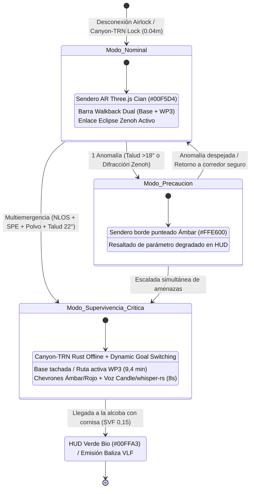

# R.E.D. ATLAS — Especificación UX/UI del modo táctico EVA
## Modo Táctico EVA: Visor AR de Casco (Waveguide) & Display de Muñeca (Cuff Unit)
**Challenge:** Interplanetary Survival Guide: Martian Map (NASA Space Apps)  
**Usuario Objetivo:** Dra. Elena Rostova (Especialista EVA-1 / Geóloga Planetaria)  
**Stack de Traje EVA:** Nodo ROS 2 en Rust (`rclrs`) + Protocolo Eclipse Zenoh (radio intermitente) + Canyon-TRN + D* Lite Metabólico (Rust) + Sendero AR (`Three.js / WebGL`) + Copiloto IA (`Candle` / ONNX Runtime `ort` + `whisper-rs`)  
**Normativa de Factores Humanos:** NASA-STD-3001 (Vol. 2) & ISO 9241-210 (Human-Centered Design)  
**Estilo de Diseño:** Aero Precision Control — Minimalista, funcional, alto contraste sin saturación visual.


> **Documento de diseño.** Describe la experiencia prevista; el stack citado arriba es el objetivo de arquitectura. La consola implementada y sus diferencias están en [`PRODUCTO_UX_UI.md`](PRODUCTO_UX_UI.md). Las cifras de misión siguen [`DATOS_CANONICOS.md`](../01-planetary-science-mission/DATOS_CANONICOS.md); los valores dentro de los wireframes son ilustrativos.

---

## 1. PANTALLA 3 (MODO EVA - ESTADO NOMINAL): HUD AR MINIMALISTA Y BARRA "WALKBACK LIMIT DUAL"

### 1.1 Wireframe Estructural del Visor Waveguide (Campo Visual FOV 70° x 40°)

```text
+-----------------------------------------------------------------------------------------------------------------------------------+
| [!] CANYON-TRN: LOCK (0.04m) | BEARING: 034° NNE | SOL 142 · MET 04:38 | PLSS: 94% O2 · 5.2h | REFUGIO WP3: +1.8h RESERVA         |
| +-------------------------------------------------------------------------------------------------------------------------------+ |
| | [============ CONSUMIBLES O2/BATT: 94% =============]   [--- MARGEN RETORNO BASE: 2h 44m ---] | [*** ESCAPE WP3: +1.8h ***] | |
| +-------------------------------------------------------------------------------------------------------------------------------+ |
|                                                                                                                                   |
|                                                                                                                                   |
|                                                     [ WP1 · SULFATOS ISRU ]                                                       |
|                                                     | 420 m // AZM 034°   |                                                       |
|                                                     o---------------------'                                                       |
|                                                    /                                                                              |
|                                                   /                                                                               |
|                                                  /  <-- Sendero Conformal AR (Línea Continua Cian #00F5D4)                        |
|                                                 /                                                                                 |
|                                                /                                                                                  |
|                                               /                                                                                   |
|                                              /                                                                                    |
|                                             o                                                                                     |
|                                                                                                                                   |
|                                                                                                                                   |
|                                                                                                                                   |
| [ TELEMETRÍA FISIOLÓGICA ]                                                                              [ CADENCIA Y PENDIENTE ]  |
| FC: 82 BPM | VO2: 1.35 L/m                                                                              PASO: 74 SPM | INCL: 6.2° |
| TRAJE: 29.6 kPa (NOMINAL)                                                                               SUELO: REGOLITO COMPACTO  |
+-----------------------------------------------------------------------------------------------------------------------------------+
```

### 1.2 Anatomía de la Barra Superior "Walkback Limit Dual" (`D* Lite Metabólico en Rust`)
La **Barra de Walkback Dual** resuelve la fragmentación de indicadores críticos mediante una única escala horizontal normalizada, alimentada en tiempo real por el nodo **ROS 2 (`rclrs`)** ejecutando el algoritmo **D* Lite Metabólico en Rust**:
1. **Segmento A (Consumibles Totales):** Barra de progreso continua que representa el valor limitante de la tríada vital ($O_2$, agua sublimador y batería Li-Ion). En estado nominal muestra un 94% con degradación asintótica.
2. **Marca 1 — Límite de Retorno a Hábitat (Base Alpha):** Línea vertical que indica el Punto de No Retorno (PNR). Se recalcula en tiempo real según el perfil topográfico ascendente de vuelta ($4.2\text{ km}$, $+202\text{ m}$ de desnivel). En estado nominal marca $02\text{h }44\text{m}$.
3. **Marca 2 — Límite de Escape a Refugio WP3 (Oquedad Basáltica):** Zona de margen extendido garantizada por la proximidad del refugio natural ($680\text{ m}$, talud descendente), otorgando $+1.8\text{h}$ de holgura operativa segura.

* **Proyección del Sendero AR (`Three.js / WebGL`):** Sobre el terreno marciano se proyecta el sendero luminoso conformal en color **Cian Eléctrico (`#00F5D4`)**, anclado mediante **Canyon-TRN** (Skyline Matching con precisión de `0.04 m`).

### 1.3 Wireframe de la Unidad de Muñeca (Cuff Display Unit - 7 pulgadas con botones sobredimensionados)
Diseñada para operarse con guantes rígidos presurizados RMG (pérdida del 85% de motricidad fina), relegando las acciones secundarias fuera del visor principal y evitando gestos táctiles finos (sin *pinch-to-zoom* ni *swipes*):
```text
+-----------------------------------------------------------------------+
|  CUFF UNIT // XEMU-04             [ ENLACE BASE: NOMINAL ]  MET 04:38 |
+-----------------------------------------------------------------------+
|  +---------------------------------+  +-----------------------------+ |
|  |     [ 1 ] CAPAS HUD CONTEXTUAL  |  |    [ 2 ] REGISTRAR MUESTRA  | |
|  |       (MALLA / PENDIENTES)      |  |         GEOLÓGICA ISRU      | |
|  +---------------------------------+  +-----------------------------+ |
|  +---------------------------------+  +-----------------------------+ |
|  |     [ 3 ] DIAGNÓSTICO TRAJE     |  |    [ 4 ] PROTOCOLO RETORNO  | |
|  |         Y CONSUMIBLES           |  |         ABORTAR A BASE      | |
|  +---------------------------------+  +-----------------------------+ |
|  [ DIAL MECÁNICO ROTATORIO: POSICIÓN 2 DE 3 // RESISTENCIA 14 N·cm ] |
+-----------------------------------------------------------------------+
```

---

## 2. PANTALLA 4 (MODO MULTIEMERGENCIA): FUSIÓN DE ALERTA ÚNICA & EVACUACIÓN A REFUGIO

### 2.1 Wireframe Estructural del HUD en Multiemergencia Simultánea

```text
+-----------------------------------------------------------------------------------------------------------------------------------+
| [!] AUTÓNOMO EDGE // CORTE NLOS | DOSIS SPE: 8 mSv/h (ENVOLVENTE) | VENTANA A CIELO ABIERTO: 15 MIN  | PROTOCOLO 07-ALPHA ACTIVO        |
+-----------------------------------------------------------------------------------------------------------------------------------+
| [ RETORNO BASE: NO VIABLE (48 MIN / 5,30 mSv) ] ===>> [ RUTA ACTIVA: REFUGIO WP3 // 595 m // 9,4 MINUTOS RESTANTES ]  |
+-----------------------------------------------------------------------------------------------------------------------------------+
|                                                                                                                                   |
|                                       / \                                                                                         |
|                                      / ! \  ALERTA FUSIONADA: EVACUAR A REFUGIO WP3                                               |
|                                     '-----' [ SPE CRÍTICO + VIENTO 35 m/s + TALUD 22° ]                                           |
|                                                                                                                                   |
|                                             [ REFUGIO WP3: 595 m ]                                                                |
|                                             | TECHO BASALTO > 5 m |                                                               |
|                                             +---------------------'                                                               |
|                                            ^                                                                                      |
|                                           / \                                                                                     |
|                                          / ^ \   <-- Chevrones Ámbar/Rojo Pulsantes (Escape Dinámico D* Lite)                     |
|                                         / / \ \                                                                                   |
|                                           / \                                                                                     |
|                                          / ^ \                                                                                    |
|                                                                                                                                   |
| [ ACCIÓN INMEDIATA COGNITIVA ]                                                                          [ CADENCIA DE ESCAPE ]    |
| CAMINAR 9 MINUTOS AL REFUGIO NORTE                                                                      OBJETIVO: 88 PASOS/MIN    |
| REFUGIO BAJO CORNISA: PROTECCIÓN 85 %                                                                    RUMBO: 344° NNO          |
+-----------------------------------------------------------------------------------------------------------------------------------+
```

### 2.2 Protocolo de Triaje "Fusión de Alerta Única" (Anti-Pánico)
* **Justificación de Factores Humanos (NASA-STD-3001):** En situaciones de peligro extremo en superficie marciana (visibilidad $<4\text{ m}$, radio **Eclipse Zenoh** cortada en sombra NLOS, talud inestable de $22^\circ$ y radiación ionizante SPE), presentar 4 pop-ups o notificaciones separadas desencadena parálisis cognitiva y visión de túnel.
* **Mecanismo de Fusión:**
  1. El nodo **ROS 2 (`rclrs`)** sintetiza los 4 disparadores en una única directriz táctica unívoca mediante **Dynamic Goal Switching** en **D* Lite Metabólico (Rust)**.
  2. La barra Walkback bloquea y tacha en gris/rojo el retorno al Hábitat (tiempo requerido \text{ min} a una ventana de \text{ min} cielo abierto) y activa automáticamente el tramo hacia el **Refugio WP3 ($680\text{ m}$ / $8\text{ min}$)**.
  3. El sendero AR renderizado con **Three.js / WebGL** sobre el regolito muta de línea continua cian a **chevrones ámbar/rojo pulsantes** hacia el rumbo $285^\circ$ (vector más corto y firme fuera de la trampa de arena).
  4. **Mensaje de Voz Manos Libres del Copiloto IA Neuro-Simbólico (`Candle` + `whisper-rs`, 8 segundos):**  
     *"Alerta combinada. Retorno a Base inviable por radiación solar. Siga chevrones rumbo dos-ocho-cinco hacia refugio basáltico. Ocho minutos a paso firme."*

### 2.3 Matriz Comparativa de Comportamiento UI según Nivel de Alerta

| Componente UI | Modo Nominal (Pantalla 3) | Modo Precaución (1 Anomalía) | Modo Supervivencia Crítica (Pantalla 4) |
| :--- | :--- | :--- | :--- |
| **Barra Walkback Dual** | Verde/Cian estático; balance Base vs Refugio visible. | Ámbar en sector afectado; recálculo de margen. | Retorno a Base tachado en gris/carmesí; foco 100% en Refugio WP3 (9,4 min). |
| **Sendero Conformal AR (`Three.js`)** | Línea fina continua cian (`#00F5D4`), anclaje estático. | Borde punteado amarillo sobre áreas con talud $>18^\circ$. | Chevrones gruesos dinámicos ámbar/rojo indicando cadencia de escape. |
| **Iconografía Superior** | `ZENOH LOS: 100%` / `CANYON-TRN: LOCK (0.04m)`. | `ENLACE ZENOH DIFRACCIÓN: 72%` (Advertencia). | `AUTÓNOMO EDGE // CORTE NLOS` (`Canyon-TRN Rust Offline`). |
| **Métricas Traje/Soporte** | Desglose completo (FC, $VO_2$, kPa, autonomía). | Resaltado del parámetro degradado. | Supresión total; únicamente tiempo restante a refugio y rumbo. |
| **Audio y Háptica (`Candle` / `whisper-rs`)** | Pings suaves azimutales a 800 Hz cada 10 s. | Alerta por tono doble en proximidad a talud. | Mensaje único de 8 s + baliza binaural continua a 1.2 kHz y pulso direccional en muñeca. |

---

### 2.4 Diagrama de Estados UI del Casco EVA (`stateDiagram-v2`)


