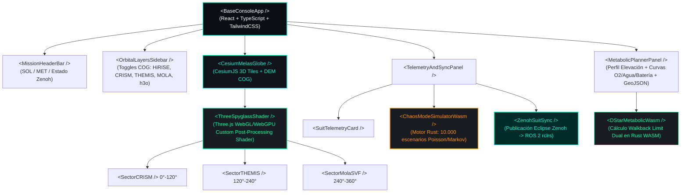

# R.E.D. ATLAS — Especificación UX/UI de la consola de Base
## Consola Estratégica 3D de Base de Hábitat (Melas Base Alpha)
**Challenge:** Interplanetary Survival Guide: Martian Map (NASA Space Apps)  
**Sistema:** Consola Táctica de Hábitat y Gemelo Digital 3D (Aris Thorne - SAGAT 3)  
**Stack Tecnológico:** TypeScript + React + CesiumJS (3D Tiles / DEM) + Three.js (WebGL/WebGPU Custom Shaders) + TailwindCSS + Rust (WebAssembly / WASM)  
**Datos y Comunicaciones:** Cloud-Optimized GeoTIFF (COG), GeoJSON, Apache Parquet / JSON, Malla Hexagonal `h3o`, Eclipse Zenoh (hacia nodo `rclrs` del traje)  
**Normativa Aplicada:** NASA-STD-3001 (Human Integration Design) & ISO 9241-210


> **Documento de diseño.** Describe la experiencia prevista; el stack citado arriba es el objetivo de arquitectura. La consola implementada y sus diferencias están en [`PRODUCTO_UX_UI.md`](PRODUCTO_UX_UI.md). Las cifras de misión siguen [`DATOS_CANONICOS.md`](../01-planetary-science-mission/DATOS_CANONICOS.md); los valores dentro de los wireframes son ilustrativos.

---

## 1. PANTALLA 1: EXPLORADOR 3D DE MELAS CHASMA Y LUPA ESPACIAL "SPYGLASS" TRI-SECTORIAL

### 1.1 Wireframe Estructural de Pantalla Completa (Ultrawide 32:9 / 4K Habitat Console)

```text
+-----------------------------------------------------------------------------------------------------------------------------------------------------------+
| [NASA HSID // MELAS ALPHA]   R.E.D. ATLAS TACTICAL CONSOLE v4.2   [SOL 142 · MET 04:38:12]   [BANDWIDTH: 144.2 Mbps]   [ENCRYPT: AES-256 GCM]  [ARIS THORNE]  |
+-----------------------------------------------------------------------------------------------------------------------------------------------------------+
| [A] PANEL GIS ORBITAL (IZQ.)  | [B] VIEWPORT GEMELO DIGITAL 3D PRINCIPAL (CENTRAL EXPANSIVO)                                   | [C] MONITOR TELEMETRÍA PRE-EVA |
| +---------------------------+ | +--------------------------------------------------------------------------------------------+ | +----------------------------+ |
| | CAPAS RASTER (COG / H3O)   | | |  AZM: 148.2°  ELEV: 34.1°  SUN CCT: 5200K  SCALE: 1:25,000 [H3O RES-12] RMS: 0.04m          | | | ESTADO XEMU-04 (ELENA)     | |
| | [x] HiRISE DEM 1m (Active)| | |                                                                                            | | | • Primario O2: 6.8h (94%)  | |
| | [x] CRISM Polihidratados  | | |                   [Pared Norte Melas Chasma: -3.420m a +3.580m]                            | | | • Sublimador H2O: 88% (4.2L| |
| | [x] THEMIS Inercia Térm.  | | |                                                                                            | | | • PLSS Li-Ion: 82% (1.4kWh)| |
| | [x] MOLA Sky View Factor  | | |                                       /\ (Cresta 7 km)                                     | | | • Presión Traje: 4.3 psi   | |
| | [x] Malla Hexagonal H3    | | |                                      /  \                                                  | | +----------------------------+ |
| +---------------------------+ | |                                     /    \                                                 | | [D] ISÓCRONA WALKBACK DUAL   | |
| | METEOROLOGÍA & ORBITAL    | | |                   +----------------(  WP3  )-----------------+                             | | +----------------------------+ |
| | • Viento: 14.2 m/s NW     | | |                   |   Oquedad Basáltica Refugio SPE          |                             | | | Consumo Límite: 62% [NOM]  | |
| | • Opacidad Tau: 0.42      | | |                   |   [Cornisa [E] // Protección 85 %]      |                             | | | [=======>        ] 1.8h Mgn| |
| | • Próx. Pase MRO: 44 min  | | |                   +------------------------------------------+                             | | | Retorno PNR: 02:44 MET     | |
| | • NLOS Canyon: BLOQUEADO  | | |                                        /                                                   | | +----------------------------+ |
| +---------------------------+ | |                                       / (Vector Escape 595m)                               | | [E] SYNC ECLIPSE ZENOH     | |
| | SELECTOR MODO LUPA        | | |                       +------------(  WP2  )-------------+                                 | | +----------------------------+ |
| | ( ) Modo X-Ray 1 Capa     | | |                       | Escarpe Falla Peligrosa          |                                 | | | GeoJSON + Parquet / h3o    | |
| | (*) Lupa Tri-Sector 120°  | | |                       | Talud 23.4° // Peligro Slip >20° |                                 | | | Checksum: 0x9F4A [ZENOH]   | |
| |   - Radio Lupa: [ 180 px ]| | |                       +----------------------------------+                                 | | | [ SYNC A NODO RCLRS EVA ]  | |
| |   - Opacidad:   [  85 %  ]| | |                                       /                                                    | | +----------------------------+ |
| |                           | | |                                      /                                                     | | [F] CHAOS ENGINE (RUST WASM)| |
| +---------------------------+ | |                  [ === LUPA SPYGLASS TRI-SECTOR 120° === ]                                 | | +----------------------------+ |
|                               | |                 /             Sector Norte:              \                                 | | | TEST ESTOCÁSTICO POISSON   | |
|                               | |                |            CRISM H2O Sulfatos            |                                | | | 100 Corridas Monte Carlo   | |
|                               | |                |          [14.8 L/m3 // #00F5D4]          |                                | | | SPE Flux Spike: 1.4e3 p/cm2| |
|                               | |               /--------------------------------------------\                               | | | Catabatic Wind: 35 m/s     | |
|                               | |              / Sector Izquierdo:     |  Sector Derecho:     \                              | | | Comms Loss: NLOS 100%      | |
|                               | |             |  HiRISE Slope >20°     |   THEMIS Dust Trap    |                             | | |                            | |
|                               | |             |  Shadow & SVF Blindaje |   <150 TIU Regolito   |                             | | | [ EJECUTAR CHAOS MODE ]    | |
|                               | |              \  [#00FFA3 / Hazard]  |  [#FF9100 / #FF1744]  /                              | | +----------------------------+ |
|                               | |               \--------------------------------------------/                               |                                  |
|                               | |                                      \                                                     |                                  |
|                               | |                      +------------(  WP1  )-------------+                                  |                                  |
|                               | |                      | Depósito Sulfato Polihidratado   |                                  |                                  |
|                               | |                      | Recurso Hídrico ISRU // 2.4 km   |                                  |                                  |
|                               | |                      +----------------------------------+                                  |                                  |
|                               | |                                     /                                                      |                                  |
|                               | |                       (Ruta D* Lite / Cian #00F5D4)                                        |                                  |
|                               | |                                   /                                                        |                                  |
|                               | |                      +--------( BASE ALPHA )--------+                                      |                                  |
|                               | |                      | Origen Hábitat (-3.418m)     |                                      |                                  |
|                               | |                      +------------------------------+                                      |                                  |
+-----------------------------------------------------------------------------------------------------------------------------------------------------------+
| [G] PERFIL LONGITUDINAL DE ELEVACIÓN, CURVA METABÓLICA D* LITE Y MATRIZ DE RIESGO DE PROPAGACIÓN ESTOCÁSTICA (DESPLEGABLE INFERIOR)                     |
+-----------------------------------------------------------------------------------------------------------------------------------------------------------+
```

---

### 1.2 Diseño Detallado de la Herramienta Insignia: Lupa Espacial "Spyglass" Tri-Sectorial (`Three.js / WebGPU` sobre `CesiumJS`)

La **Lupa Spyglass Tri-Sectorial** resuelve el mayor cuello de botella en cartografía planetaria: la sobrecarga cognitiva provocada por conmutar manualmente decenas de capas GIS superpuestas (overplotting). Al posar el cursor o apuntador háptico sobre el terreno 3D de **CesiumJS** (3D Tiles y DEM de Melas Chasma en **Cloud-Optimized GeoTIFF (COG)** + celdas hexagonales **`h3o`** cargadas desde **Apache Parquet / JSON**), el operador despliega un viewport analítico circular de 360° dividido en **tres cuñas angulares de 120°**. El recorte y fusión multiespectral se renderiza en tiempo real mediante un **Custom Post-Processing Shader en Three.js (WebGL / WebGPU)** superpuesto al canvas de CesiumJS.

```
                      SECTOR NORTE (0° a 120°)
                     CRISM / SHARAD (Agua & ISRU)
                           .---''''---.
                        .-'     |      '-.
                      .'        |         '.
                     /    CRISM | SHARAD    \
                    |   SULFATOS| POLIHID.   |
                    |   14.8 L/m³ Agua Rec.  |
                    |    (Cian Eléctrico)    |
                    |-----------+------------|
                     \   MOLA   |   THEMIS  /
                      \  HiRISE |  INERCIA /
                       '. SVF   |  TÉRMICA'
                         '-.    |     .-'
                            '---....-'
              SECTOR IZQUIERDO          SECTOR DERECHO
              (240° a 360°)             (120° a 240°)
           MOLA/HiRISE DEM + SVF        THEMIS Inercia Térmica
           Pendientes Críticas &        Trampas de Polvo Fino <150 TIU
           Blindaje Radiación           (Magenta / Ámbar Peligro)
```

#### Especificación Técnica de los Tres Sectores:

1. **Sector Norte (Azimut 0° a 120°) — Sensor CRISM / SHARAD (Recurso Hídrico ISRU):**
   * **Propósito:** Detección de depósitos minerales de sulfatos hidratados (Kieserita, Yeso) e interfaces dieléctricas de hielo subsuperficial.
   * **Representación Visual:** Gradiente espectral en **Azul Cian Eléctrico (`#00F5D4` a `#0077B6`)**. Las zonas con concentraciones de agua estructural $> 12\text{ L/m}^3$ emiten una retícula pulsante de micro-puntos cian con etiqueta HUD flotante: `ISRU: HYDRATED SULFATES // 14.8 L/m³`.
   * **Aplicación en WP1:** Identificación exacta del afloramiento mineral donde la astronauta Elena Rostova debe extraer muestras geológicas para soporte vital.

2. **Sector Derecho (Azimut 120° a 240°) — Sensor THEMIS (Inercia Térmica y Riesgo Mecánico):**
   * **Propósito:** Detección de regolito no consolidado, depósitos eólicos de polvo ultrafino y trampas de rodadura.
   * **Representación Visual:** Escala cromática termográfica inversa. Zonas con inercia térmica baja ($< 150\text{ J}\cdot\text{m}^{-2}\cdot\text{K}^{-1}\cdot\text{s}^{-1/2}$) se representan en **Naranja Quemado / Ámbar (`#FF9100`)** y **Magenta de Alerta (`#FF1744`)**.
   * **Aplicación en WP2:** Revela un manto de polvo suelto sobre el escarpe del talud de $23.4^\circ$, advirtiendo de alto riesgo de deslizamiento por licuefacción mecánica de regolito si la astronauta camina sobre él.

3. **Sector Izquierdo (Azimut 240° a 360°) — Sensor MOLA/HiRISE DTM + Sky View Factor (Topografía y Blindaje SPE):**
   * **Propósito:** Análisis micro-topográfico de escarpes y cálculo del *Sky View Factor* (SVF, fracción visible de la bóveda celeste) para protección radiológica pasiva.
   * **Representación Visual:** Las pendientes $> 20^\circ$ se marcan con sombreado de rayas de advertencia (*hazard stripes*). Las zonas con SVF $< 0.15$ (oquedades y covachas con $> 5\text{ m}$ de roca basáltica en el techo que ocluyen el 85% del cielo) se renderizan en **Verde Esmeralda de Refugio (`#00FFA3`)**.
   * **Aplicación en WP3:** Confirma que la oquedad basáltica de la pared norte reduce la dosis SPE en torno a un 85 % (alcoba con cornisa, SVF 0,15; supuesto de escenario [E]).

#### Micro-Interacciones de la Lupa Spyglass:
* **Foco Variable:** Giro de la rueda del trackball/mouse expande el radio de la lente de $100\text{ px}$ a $400\text{ px}$ sobre el terreno.
* **Toggle de Modo:** Presionando `[SPACE]` o el gatillo háptico, la lupa colapsa instantáneamente de 3 sectores a "Modo Rayos X Unificado" de la capa actualmente seleccionada.
* **Freeze Frame & Pinning:** Doble clic fija la lente en las coordenadas marcianas seleccionadas, permitiendo abrir hasta 3 lupas comparativas simultáneas entre WP1, WP2 y WP3.

---

## 2. PANTALLA 2: PLANIFICADOR METABÓLICO DE RUTA (GEOJSON) Y SIMULADOR "CHAOS MODE" (RUST WASM)

### 2.1 Wireframe del Panel Longitudinal y Planificador Metabólico (Sección Inferior de la Consola)

```text
+-----------------------------------------------------------------------------------------------------------------------------------------------------------+
| TRAYECTORIA (GEOJSON): BASE ALPHA -> WP1 (1,5 km) -> WP2 (1,2 km) -> WP3 (0,6 km) | PERÍMETRO: 4,9 km | LLEGADA A WP3: T+114 | VENTANA SPE: 15 min                 |
+-----------------------------------------------------------------------------------------------------------------------------------------------------------+
| (A) PERFIL DE ELEVACIÓN Y TALUD [EJE Y: COTA -3.420m A -3.210m // EJE X: DISTANCIA 0 a 5.0 km]                                                           |
| Elev.                                                                                                                                                     |
| -3.200m |                                                          (WP2) Escarpe 23.4° [SLIP RISK]                                                        |
|         |                                                            /\                                                                                   |
| -3.300m |                                 (WP1) Depósito Sulfatos   /  \                (WP3) Oquedad Refugio (-3.340m)                                   |
|         |                                       _..---''           /    \               +-----------------+                                               |
| -3.400m |  [Base Alpha]                   _..-''                  /      \______________| Cornisa [E]     |                                               |
|         |  o----------------------------''                       /                      +-----------------+                                               |
|         +--+----------------------------------+------------------+-------------------------------+----------------------------------------------------+   |
|         0,0 km                                1,5 km             2,7 km                          3,3 km                                               Dist|
| Pendiente:  1.2°                              4.8°               23.4° [NO-GO >20°]              3.1°                                                     |
| Terreno:    Regolito Compacto                 Sulfato Masivo     Polvo Suelto <150 TIU           Lecho Basáltico                                          |
+-----------------------------------------------------------------------------------------------------------------------------------------------------------+
| (B) TELEMETRÍA PREDICTIVA MULTICANAL D* LITE [CURVAS CONSUMIBLES VS DISTANCIA / TIEMPO]                                                                  |
| 100% |~~~ O2 RESTANTE (PLSS-1): Margen Seguro a Término = 36% ~~~~~~~~~~~~~~~~~~~~~~~~~~~~~~~~~~~~~~~~~~~~~~~~~~~~~~~~~~~~~~~~~~~\                        |
|  80% |=== AGUA SUBLIMADOR REFRIGERACIÓN: Margen = 24% ===========================================\                              \                       |
|  60% |--- BATERÍA LI-ION TRAJE: Margen = 42% -----------------------------------------------------\                              \                      |
|  40% |                                                                        [PUNTO DE NO RETORNO (PNR)]                          \ [Límite Seguro 20%]  |
|  20% |.................................................................................|.......................................... \                     |
|   0% +---------------------------------------------------------------------------------+---------------------------------------------+--------------------+
| Tasa VO2:  0.34 L/min (Reposo)                1.25 L/min (Marcha)      1.82 L/min (Pico Talud)    1.10 L/min (Marcha)          MET: 03h 14m               |
+-----------------------------------------------------------------------------------------------------------------------------------------------------------+
| (C) COBERTURA DE ENLACE DE RADIO ECLIPSE ZENOH // SOMBRA NLOS (7 KM PARED DE CAÑÓN)                                                                         |
| RF ZENOH: [################### 100% LOS ####################] [############# 72% LOS ############] [    0% CORTE TOTAL NLOS (PARED CAÑÓN)  ]             |
| Estado: SESIÓN ZENOH ESTABLE                                  DIFRACCIÓN DE BORDE                  OFFLINE TRN ACTIVO (NODO RCLRS CANYON-TRN EN TRAJE)    |
+-----------------------------------------------------------------------------------------------------------------------------------------------------------+
| (D) MONITOR DE CERTIFICACIÓN ESTOCÁSTICA: "CHAOS MODE" (RUST WASM // POISSON & MONTE CARLO N=100 SCENARIOS)                                               |
|                                                                                                                                                           |
| [ !!! INICIAR STRESS-TEST CHAOS MODE !!! ]  ==> ESTADO: CERTIFICACIÓN COMPLETADA (100/100 SEMILLAS EN RUST WASM)                                          |
|                                                                                                                                                           |
| • Misión segura solo con Retorno a Base: 23,8 % [48 MIN Y 2,15 KM: DOSIS DE DECISIÓN 5,30 mSv > REGLA DE 2 mSv]             |
| • Misión segura con cambio a Refugio WP3: 96,0 % [MARCHA 9,4 MIN // 595 m // DOSIS DE DECISIÓN 0,89 mSv]         |
|                                                                                                                                                           |
| DISTRIBUCIÓN DE PROBABILIDAD DE SUPERVIVENCIA EN REFUGIO WP3:                                                                                             |
|                                                   +----+                                                                                                  |
|                                                   |    |                                                                                                  |
|                                                   |    |                                                                                                  |
|                                              +----+    |                                                                                                  |
|                                              |    |    |  +----+   [10.000 simulaciones // semilla 42]                                                   |
|                                         +----+    |    |  |    |                                                                                          |
|                                    +----+    |    |    |  |    |   RESULTADO: RUTA AUTORIZADA PARA DESPLIEGUE                                             |
|        ----+----+----+----+----+----+----+----+----+----+----+----+                                                                                       |
|       0%   20%  40%  60%  80% 96,0% 100% Misión segura                                                                                                 |
+-----------------------------------------------------------------------------------------------------------------------------------------------------------+
```

---

### 2.2 Arquitectura del Simulador Estocástico "Chaos Mode" (`Rust WASM`)

El botón **"Chaos Mode"** ejecuta a velocidad nativa en el navegador un motor en **Rust compilado a WebAssembly (WASM)** basado en Procesos de Poisson no homogéneos y Cadenas de Markov de 100 iteraciones concurrentes. Modela los tres riesgos fatales combinados de Melas Chasma:

1. **Inyección de Tormenta de Polvo Catabática:** Caída de visibilidad a $< 3.8\text{ m}$ y aumento del coeficiente de fricción por regolito aerotransportado.
2. **Evento de Partículas Solares (SPE Spike):** Envolvente de diseño de \text{ mSv/h} cielo abierto: la regla de vuelo de \text{ mSv} EVA se agota en \text{ minutos}575
3. **Pérdida de Enlace RF (NLOS Absoluto):** Caída a cero de enlaces satelitales por oclusión contra las paredes de 7 km del cañón.

```mermaid
flowchart TD
    Init[Operador Pulsa 'Chaos Mode'] --> Spawn[Generación de 10.000 Escenarios Monte Carlo (100 visibles)]
    
    subgraph INYECCION_PERTURBACIONES ["Inyección de Perturbaciones (Poisson / Markov)"]
        PERT1[Viento Catabático > 35 m/s]
        PERT2[Pico SPE de 8 mSv/h a cielo abierto]
        PERT3[Corte Total de Radio NLOS]
        PERT4[Talud > 20° con Falla Mecánica Traje]
    end
    
    Spawn --> PERT1
    Spawn --> PERT2
    Spawn --> PERT3
    Spawn --> PERT4
    
    PERT1 & PERT2 & PERT3 & PERT4 --> SimEngine[Motor Cinemático & Metabólico D* Lite]
    
    subgraph EVALUACION_VECTORES ["Evaluación Comparativa de Vectores de Egress"]
        V_Base["Vector Retorno a Base: 2,15 km<br/>Tiempo: 48 min<br/>Dosis de decisión: 5,30 mSv<br/><b>NO VIABLE: supera la regla de 2 mSv</b>"]
        V_WP3["Vector a Refugio WP3: 595 m<br/>Tiempo: 9,4 min<br/>Blindaje 85 % (alcoba con cornisa)<br/><b>VIABLE: 0,89 mSv</b>"]
    end
    
    SimEngine --> V_Base
    SimEngine --> V_WP3
    
    V_Base --> Compare{"¿Cabe en la regla de 2 mSv por EVA?"}
    V_WP3 --> Compare
    
    Compare -- No hacia Base --> BlockBase[Bloqueo de Retorno Directo en Emergencia]
    Compare -- Sí hacia WP3 --> Certify[Certificación Verde: Refugio WP3 Blindado]
    
    Certify --> LockCrypt[Generación de Hash Criptográfico AES-256]
    LockCrypt --> PushSuit[Habilitación de Botón 'PUSH TELEMETRÍA A AIRLOCK']
    
    style Init fill:#191c22,stroke:#00f5d4,stroke-width:2px,color:#fff
    style Spawn fill:#10131a,stroke:#00f5d4,stroke-width:1px,color:#00f5d4
    style INYECCION_PERTURBACIONES fill:#191c22,stroke:#ff9100,stroke-width:1px,color:#ff9100
    style V_Base fill:#3d000b,stroke:#ff1744,stroke-width:2px,color:#fff
    style V_WP3 fill:#003822,stroke:#00ffa3,stroke-width:2px,color:#fff
    style Certify fill:#003822,stroke:#00ffa3,stroke-width:2px,color:#00ffa3
    style PushSuit fill:#00f5d4,stroke:#00f5d4,stroke-width:2px,color:#0b0e14
```

#### Respuesta de Interfaz tras pulsar "Chaos Mode":
1. **Feedback Visual Inmediato:** El gemelo 3D proyecta una simulación cinemática acelerada en color ámbar durante 1.2 segundos mostrando 100 de las 10.000 trazas calculadas por el motor **Rust**.
2. **Visualización de la Bifurcación:** El vector de retorno a Base Alpha se pinta instantáneamente en **Rojo Carmesí (`#FF1744`) con la etiqueta `NO VIABLE // 48 MIN > VENTANA DE 15 MIN`**: volver a la Base supone 5,30 mSv de dosis de decisión, por encima de la regla de 2 mSv por EVA. La radiación sola no es letal de forma aguda; el riesgo viene de la combinación de amenazas.
3. **Validación Triunfal de WP3:** El vector de desvío hacia la cavidad basáltica WP3 brilla en **Verde Bio-Seguro (`#00FFA3`)** con la etiqueta `VIABLE // 9,4 MIN // 0,89 mSv` y el resultado del Chaos Mode: 96,0 % de misión segura con el refugio frente a 23,8 % solo con la Base.
4. **Desbloqueo y Sincronización Eclipse Zenoh:** Se exporta el plan en **GeoJSON** + malla **`h3o`** en **Apache Parquet**, se genera el hash SHA-256 y el botón interactivo principal pasa de ámbar a **Cian Brillante (`#00F5D4`)**: `[ SYNC VÍA ECLIPSE ZENOH A NODO RCLRS DEL TRAJE ]`.

---

### 2.3 Jerarquía de Componentes Frontend (`React + TypeScript + CesiumJS + Three.js + Rust WASM`)


