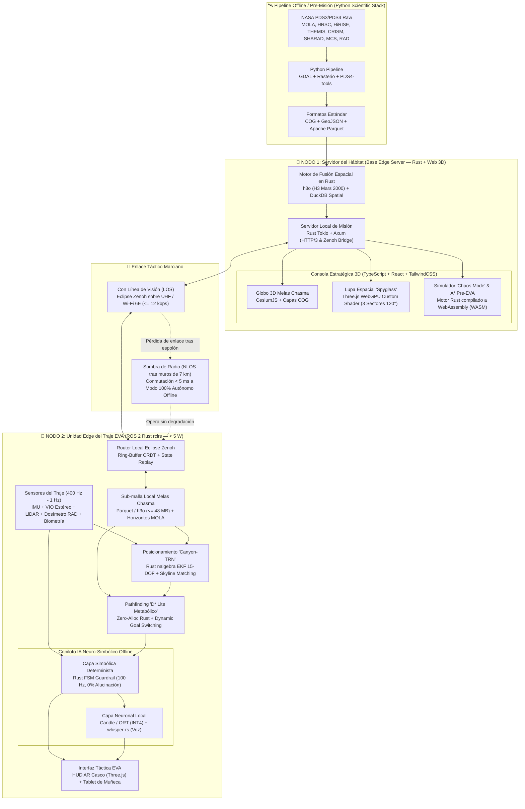
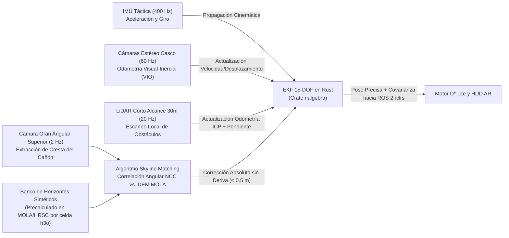
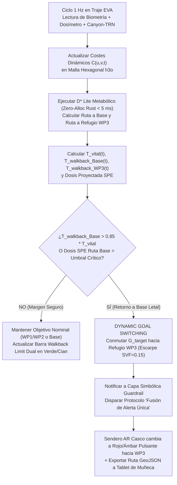
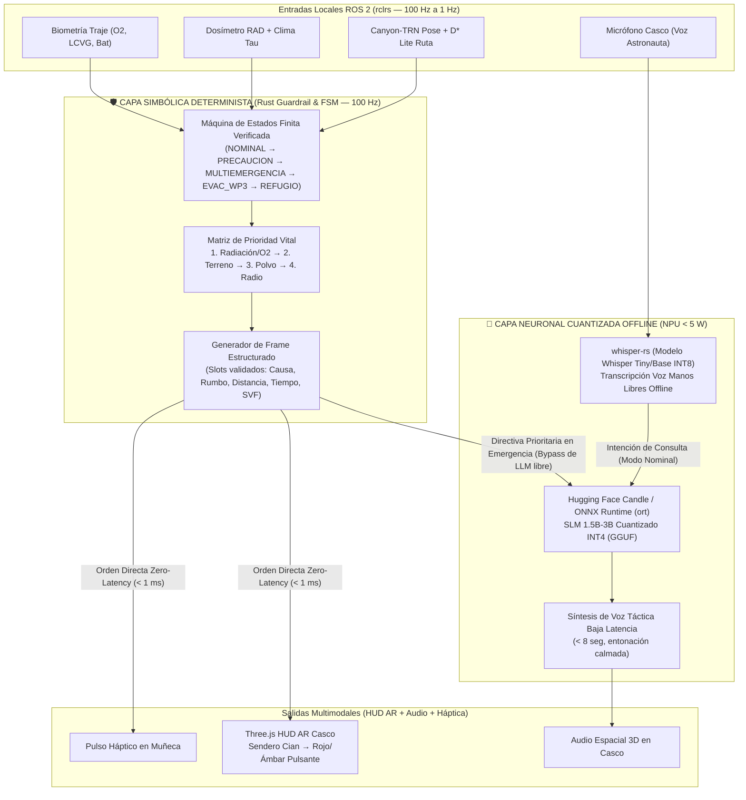

# 📗 Entregable 3: Arquitectura de Sistemas en Rust, Ingeniería de Datos NASA e IA Offline
**Proyecto:** **R.E.D. ATLAS** (*Reconnaissance, EVA & Dynamic-survival Atlas*)  
**Equipo:** Red Project — NASA Space Apps Challenge 2026  
**Responsable:** Persona 3 (Arquitectura Técnica, Motores Geoespaciales e IA)  
**Escenario Operativo:** Valles Marineris — Melas Chasma (`~9.8°S, 283.6°E`) | Ruta *"Triángulo de Supervivencia"*  
**Modalidad:** Especificación Integral de Ingeniería Aeroespacial (0% código fuente / 100% diseño arquitectónico, esquemas de datos y formulación matemática)

---

## 1. Arquitectura Híbrida Dual de R.E.D. ATLAS ("Rust-First") y Posicionamiento "Canyon-TRN"

### 1.1 Justificación Aeroespacial de Rust para Software de Misión Crítica en Marte

En un cañón marciano de **7 a 9 km de profundidad**, un fallo de software en el ordenador del traje espacial (*PLSS — Portable Life Support System*) durante una multiemergencia no es un error de aplicación: es un fallo catastrófico de soporte vital. Por ello, **R.E.D. ATLAS** adopta una arquitectura **"Rust-First"** en su núcleo algorítmico y robótico frente a alternativas tradicionales como Python puro o C++ sin verificación formal:

| Criterio de Ingeniería Espacial (NASA NPR 7150.2) | Limitación en Otros Ecosistemas | Ventaja Determinista de **Rust** en **R.E.D. ATLAS** |
| :--- | :--- | :--- |
| **Seguridad de Memoria (*Memory Safety*)** | C/C++ exponen a *buffer overflows*, punteros colgantes y *use-after-free* (~70% de vulnerabilidades críticas). | El *borrow checker* garantiza en tiempo de compilación ausencia total de corrupción de memoria sin necesidad de un entorno gestionado pesado. |
| **Determinismo Temporal (*Zero-GC*)** | Python, Java o Go sufren pausas impredecibles del *Garbage Collector* (GC) e intérpretes lentos. | **Ausencia absoluta de GC:** el bucle crítico de supervivencia (`Safety Guardrail` a 100 Hz y recálculo `D* Lite`) opera con latencia acotada **$< 5\text{ ms}$** y cero asignaciones dinámicas en ejecución (*zero-allocation hot loop*). |
| **Concurrencia sin *Data Races*** | Los hilos paralelos de sensores (IMU a 400 Hz + LiDAR + radio + dosímetro) sufren condiciones de carrera sutiles. | El sistema de tipos (`Send` / `Sync`) prohíbe en compilación cualquier acceso concurrente inseguro al vector de estado del astronauta. |
| **Tolerancia a Fallos Explícita** | Excepciones no capturadas en vuelo provocan reinicios del sistema en mitad de una EVA. | Uso obligatorio de tipos algebraicos (`Result` / `Option`) y prohibición de `panic!` en rutas de vuelo (*zero-panic policy*). |
| **Portabilidad Dual (*Single-Source-of-Truth*)** | Mantener dos motores distintos (uno para servidor web y otro para el traje) genera divergencias de cálculo. | **Un único código fuente en Rust** compila tanto a binario nativo **ARM64/RISC-V** para el traje EVA como a **WebAssembly (`WASM`)** para correr el simulador *"Chaos Mode"* en la Consola 3D del Hábitat (`React + CesiumJS`). |

---

### 1.2 Diagrama de Bloques de Alto Nivel del Ecosistema Híbrido Dual

La arquitectura física se divide en **dos nodos de cómputo independientes en Marte** (debido al retardo de comunicación Tierra-Marte de **4 a 22 minutos** por sentido), sincronizados mediante **Eclipse Zenoh**:

---

### 1.3 Protocolo de Sincronización Dual y Conmutación a Modo 100% Autónomo Offline

El enlace entre la Consola de Base y el Traje EVA sigue una **arquitectura *Offline-First*** tolerante a desconexiones frecuentes (*DTN — Delay/Disruption Tolerant Networking* ligera mediante **Eclipse Zenoh**):

1. **Fase 1 — Sincronización Pre-EVA (En Hábitat / Esclusa):**
   * Antes de iniciar la salida *Marswalk*, el Servidor de Base empaqueta la sub-malla hexagonal (`h3o` resoluciones `9` a `14`) correspondiente a un corredor de $6 \times 6\text{ km}$ alrededor del *"Triángulo de Supervivencia"* en Melas Chasma.
   * El paquete binario compacto (**$\le 48\text{ MB}$** en **Apache Parquet** + **GeoJSON** de los 4 nodos + banco comprimido de horizontes sintéticos para *Skyline Matching*) se transfiere al nodo del traje por enlace cableado/Wi-Fi de esclusa y se verifica mediante suma criptográfica **SHA-256**.
2. **Fase 2 — Operación Nominal con Línea de Visión (LOS):**
   * Mientras las antenas del traje ven la torre de comunicaciones de la Base, **Eclipse Zenoh** (protocolo *pub/sub* escrito en Rust con sobrecarga de cabecera de apenas unos bytes) mantiene un canal diferencial de bajo ancho de banda ($\le 12\text{ kbps}$).
   * El traje envía exclusivamente *deltas* de telemetría (posición `Canyon-TRN`, tasa metabólica, reservas de $O_2$/batería, dosis acumulada) a **1 Hz**, y la Base envía actualizaciones ambientales de gran escala (imágenes MCS/frentes de polvo).
3. **Fase 3 — Conmutación Automática a Modo 100% Autónomo Offline (NLOS):**
   * Cuando el astronauta rodea un espolón basáltico de Melas Chasma (ej. acercándose al **Waypoint 2**), la potencia de señal cae por debajo de **$-115\text{ dBm}$**.
   * El *watchdog* de **Eclipse Zenoh** detecta la pérdida de **3 *heartbeats* consecutivos ($\approx 150\text{ ms}$)** y dispara la transición de estado interno en **$< 5\text{ ms}$** hacia el modo `AUTONOMOUS_NLOS`.
   * **Cero degradación táctica:** Todos los motores (`Canyon-TRN`, `D* Lite Metabólico`, `Guardrail` y `Candle`/`whisper-rs`) ya residen en la memoria ECC del traje. Las muestras científicas y la traza de telemetría se registran en un *ring-buffer* persistente estructurado como **CRDT (*Conflict-free Replicated Data Type*)**, ejecutando un *State Replay* automático si se restablece el enlace con la Base o con un rover repetidor.

---

### 1.4 Subsistema de Posicionamiento sin GPS ni Radio ("Canyon-TRN")

Marte carece de constelación GPS/GNSS, y las paredes de **7–9 km** de altura de Melas Chasma bloquean cualquier triangulación por radio con la Base. Para evitar que la odometría inercial derive decenas de metros en pocos minutos (lo cual sería mortal cerca de un talud de $22^\circ$ o en una tormenta de polvo), el módulo **`canyon-trn`** en Rust implementa un **Filtro de Kalman Extendido (EKF) de 15 estados** sobre el crate de álgebra lineal **`nalgebra`**:

* **Vector de Estado $\mathbf{x}_k \in \mathbb{R}^{15}$:**
  $$\mathbf{x}_k = \begin{bmatrix} \mathbf{p}_k^T & \mathbf{v}_k^T & \mathbf{q}_k^T & \mathbf{b}_{a,k}^T & \mathbf{b}_{g,k}^T \end{bmatrix}^T$$
  Donde $\mathbf{p}_k$ es la posición planetocéntrica en el marco **IAU Mars 2000**, $\mathbf{v}_k$ la velocidad lineal, $\mathbf{q}_k$ el cuaternión de actitud, y $\mathbf{b}_a, \mathbf{b}_g$ los sesgos dinámicos de acelerómetro y giroscopio.

* **Innovación Clave — *Skyline Matching* contra los Muros de Melas Chasma:**
  1. A **2 Hz**, la cámara gran angular superior del casco captura la línea de horizonte donde las crestas de 7 km de altura de Melas Chasma recortan el cielo marciano.
  2. Un extractor de bordes en Rust (resiliente al contraste reducido durante brumas o polvo $\tau \le 2.5$ mediante ecualización adaptativa CLAHE y filtrado por gradiente vertical) construye la curva de elevación angular del horizonte observado $\phi_{\text{obs}}(\alpha)$ para $\alpha \in [0^\circ, 360^\circ)$.
  3. Se evalúa la correlación angular rápida (*Normalized Cross-Correlation* + distancia de Chamfer sobre 360 *bins* de acimut) frente a los horizontes sintéticos precalculados $\phi_{\text{DEM}}(\alpha \mid h_i)$ almacenados para todas las celdas hexagonales `h3o` en un radio de incertidumbre de **$50\text{ m}$** ($3\sigma$ de la covarianza actual del EKF).
  4. Al encontrar la celda candidata con máxima verosimilitud, se inyecta una observación absoluta de posición $(x, y, z)$ y rumbo $(\psi)$ en el EKF, **anulando la deriva acumulada** y manteniendo un error horizontal **RMS $< 0.5\text{ m}$** ($3\sigma < 1.2\text{ m}$) sin ningún satélite ni señal externa.

---

## 2. Pipeline de Ingesta y Fusión Espacial NASA sobre Malla Hexagonal (`h3o` + Apache Parquet + COG)

### 2.1 Pipeline de Preprocesado Multi-Resolución

Las misiones de la NASA producen datos con escalas espaciales que difieren en **tres órdenes de magnitud** (desde $128\text{ m/px}$ en MOLA hasta $0.25\text{ m/px}$ en HiRISE). El pipeline de ingesta ejecutado en **Python (`GDAL`, `Rasterio`, `PDS4-tools`)** normaliza, reproyecta e indexa los 6 conjuntos de datos hacia formatos geoespaciales modernos listos para ser consumidos por el núcleo en **Rust**:

```mermaid
flowchart LR
    subgraph RAW["Productos PDS3/PDS4 NASA"]
        R1["MGS MOLA MEGDR + MEX HRSC"]
        R2["MRO HiRISE RDR/DTM + CTX"]
        R3["Mars Odyssey THEMIS IR"]
        R4["MRO CRISM MTRDR + SHARAD"]
        R5["MRO MCS + TGO NOMAD + MEDA"]
        R6["MSL RAD + Geometría Cañón"]
    end

    subgraph PIPE["Pipeline Python Científico (GDAL / Rasterio / PDS4-tools)"]
        P1["1. Reproyección Unificada\nDatum IAU Mars 2000 / Esferoide MOLA"]
        P2["2. Derivación Física\nPendiente, Aspecto, TIU, Sky View Factor, LOS"]
        P3["3. Exportación Estándar"]
        P1 --> P2 --> P3
    end

    subgraph STORAGE["Almacenamiento Dual Estandarizado"]
        COG["Cloud-Optimized GeoTIFF (COG)\nPirámides internas para CesiumJS / Three.js"]
        PARQUET["Apache Parquet + GeoJSON\nTablas columnares indexadas por H3Index"]
    end

    subgraph RUST["Indexador Rust Core (h3o + DuckDB Spatial)"]
        H3["Malla Hexagonal Jerárquica (Res 7 a 14)\nVector de Estado Tensorial de 64 bytes/celda"]
    end

    RAW --> PIPE
    P3 --> COG & PARQUET
    PARQUET --> H3
    COG -->|"Streaming HTTP Range Requests"| WEB["Consola 3D Base"]
```

| Capa # | Misión / Instrumento NASA | Producto PDS Original | Resolución Nativa | Formato Procesado | Variable Física y Rol en **R.E.D. ATLAS** |
| :--- | :--- | :--- | :--- | :--- | :--- |
| **1. Topografía y Horizonte** | `MGS MOLA` + `Mars Express HRSC` | `MEGDR` / `HRSC DTM` | `128 m/px` (MOLA) / `12.5 m/px` (HRSC) | `COG` + `Parquet` | Elevación absoluta ($z$), macro-pendientes, cálculo de *Sky View Factor* ($\Psi_{\text{SVF}}$) y banco de horizontes para **Canyon-TRN**. |
| **2. Ortoimagen y Micro-Obstáculos** | `MRO HiRISE` + `MRO CTX` | `HiRISE RDR/DTM` / `CTX EDR` | `0.25 m/px` (Ortho) / `1 m/px` (DTM) / `6 m/px` | `COG` + `Parquet` | Detección de cantos rodados, grietas, micro-pendientes de talud ($>20^\circ$) y textura fotorrealista en CesiumJS. |
| **3. Inercia Térmica y Suelo** | `Mars Odyssey THEMIS` (IR Día/Noche) | `THEMIS BTR / Derived TI` | `100 m/px` (interpolado con textura HiRISE) | `COG` + `Parquet` | Inercia Térmica en **TIU** ($\text{J m}^{-2}\text{ K}^{-1}\text{ s}^{-1/2}$): identifica trampas de polvo blando ($<150\text{ TIU}$) frente a roca firme ($>400\text{ TIU}$). |
| **4. Mineralogía e ISRU** | `MRO CRISM` + `MRO SHARAD` | `CRISM MTRDR` / `SHARAD RGRAM` | `18 m/px` (CRISM) / `15 m` vert. (SHARAD) | `COG` + `Parquet` | Índice espectral de **sulfatos polihidratados** ($\%\text{ H}_2\text{O}$ estructural en WP1) y anomalías dieléctricas del subsuelo. |
| **5. Clima y Polvo del Cañón** | `MRO MCS` + `TGO NOMAD` + Modelo `MEDA` | `MCS DDR` + Perfiles Mesoescalares | Grilla mesoescalar (`~500 m`) | `Parquet` (Series temporales) | Opacidad atmosférica de polvo ($\tau$ a 880 nm), perfiles térmicos y campo vectorial de **vientos catabáticos** por hora solar. |
| **6. Radiación y Blindaje** | `MSL RAD` (extrapolado a $-4.2\text{ km}$) + DEM | `RAD RDR` + Trazado de rayos 3D | Celda táctil (`~2 m` a `13 m`) | `Parquet` + `GeoJSON` | Flujo base GCR ($\approx 0.42\text{ mSv/día}$ en el fondo de Melas Chasma) y factor geométrico de atenuación ante picos **SPE**. |

---

### 2.2 Indexación Espacial Jerárquica en Rust (`h3o` sobre Elipsoide Marciano)

El sistema utiliza el *crate* **`h3o`** (implementación segura en Rust puro de la teselación hexagonal icosaédrica H3) parametrizada métricamente para el radio medio de Marte ($R_{\text{Mars}} = 3389.5\text{ km} \approx 0.532\, R_{\text{Earth}}$). Las métricas hexagonales en el elipsoide **IAU Mars 2000** quedan calibradas con un factor de escala superficial de $\approx 0.283\times$ respecto a la Tierra:

| Resolución `h3o` | Longitud Media del Lado (Marte) | Área del Hexágono (Marte) | Dominio de Uso en **R.E.D. ATLAS** |
| :--- | :--- | :--- | :--- |
| **Resolución 7** | $\approx 650\text{ m}$ | $\approx 1.46\text{ km}^2$ | Campos climáticos mesoescalares (`MCS` / `MEDA`), frentes de tormenta de polvo y cálculo regional de eventos SPE. |
| **Resolución 9** | $\approx 93\text{ m}$ | $\approx 0.030\text{ km}^2$ | Zonificación térmica (`THEMIS`) y mapas de abundancia mineralógica ISRU (`CRISM` / `SHARAD`). |
| **Resolución 11** | $\approx 13\text{ m}$ | $\approx 608\text{ m}^2$ | Planificación inicial **A\*** en Consola Base y caché macro de visibilidad radio (`LOS/NLOS`). |
| **Resolución 13** | $\approx 1.9\text{ m}$ | $\approx 12.4\text{ m}^2$ | Navegación táctica estándar EVA, cálculo de gradientes de pendiente local y *Skyline Matching*. |
| **Resolución 14** | $\approx 0.72\text{ m}$ | $\approx 1.77\text{ m}^2$ | **Celda elemental de paso humano ("Boot-Step Grid"):** detección de bloques HiRISE ($0.25\text{ m/px}$), grietas y bordes de trampa de regolito para **`D* Lite Metabólico`**. |

**Estrategia de Fusión Multi-Resolución:** Las capas de baja resolución (`THEMIS`, `MCS`) se heredan de padre a hijo mediante el árbol jerárquico nativo de `h3o` (*Zero-Copy Parent Lookup*), combinándose con factores de modulación locales calculados sobre `HiRISE DTM` (por ejemplo, la acumulación de polvo fino estimada por concavidad local del terreno) para evitar discontinuidades artificiales en los bordes de píxel de $100\text{ m}$.

---

### 2.3 Esquema del Vector de Estado Tensorial y Conexión con la Lupa "Spyglass"

Cada celda hexagonal activa en el corredor de Melas Chasma se representa en **Apache Parquet** y en memoria de Rust como un registro empaquetado de **64 bytes alineado a caché** (*Cache-Line Aligned Struct*), lo que permite consultar y filtrar decenas de miles de hexágonos sin fallos de caché:

| Campo del Registro | Tipo en Esquema (Rust / Parquet) | Bytes | Unidad / Rango | Descripción Técnica y Conexión con UX (`Spyglass` / `HUD`) |
| :--- | :--- | :--- | :--- | :--- |
| `h3_index` | `u64` / `UINT64` | 8 | Identificador H3 | Clave primaria espacial de la celda en la malla `h3o` (IAU Mars 2000). |
| `elev_m` | `f32` / `FLOAT32` | 4 | $\text{m}$ (datum MOLA) | Cota topográfica fusionada (`HRSC` + `HiRISE DTM`, ej. `-4215.4 m`). |
| `slope_deg` | `f32` / `FLOAT32` | 4 | Grados ($0^\circ\text{–}90^\circ$) | Gradiente máximo local hacia celdas vecinas (alimenta Sector Izquierdo de `Spyglass`). |
| `aspect_deg` | `f32` / `FLOAT32` | 4 | Grados ($0^\circ\text{–}360^\circ$) | Orientación de la pendiente (para calcular componente de viento catabático y sol). |
| `thermal_inertia_tiu` | `f32` / `FLOAT32` | 4 | $\text{TIU}$ ($20\text{–}1200$) | Inercia térmica `THEMIS` ($<150\text{ TIU}$ dispara alerta en Sector Derecho de `Spyglass`). |
| `roughness_hi` | `f32` / `FLOAT32` | 4 | Índice adim. ($0\text{–}1$) | Densidad de rocas/obstáculos extraída de varianza local `HiRISE 0.25 m/px`. |
| `isru_h2o_pct` | `f32` / `FLOAT32` | 4 | $\% \text{ masa}$ ($0\text{–}25\%$) | Fracción de agua estructural en sulfatos `CRISM` (alimenta Sector Norte de `Spyglass`). |
| `sky_view_factor` | `f32` / `FLOAT32` | 4 | $\Psi_{\text{SVF}} \in [0.05, 1.0]$ | Fracción de hemisferio celeste no obstruido por los muros de Melas Chasma (blindaje SPE). |
| `los_base_rssi_dbm` | `f32` / `FLOAT32` | 4 | $\text{dBm}$ ($-140\text{ a }-40$) | Intensidad de señal UHF estimada con la Base (identifica zonas `NLOS` $< -115\text{ dBm}$). |
| `base_metabolic_cost` | `f32` / `FLOAT32` | 4 | $\text{W}$ (Watts base) | Gasto metabólico estacionario al cruzar la celda a velocidad nominal ($1.0\text{ m/s}$). |
| `horizon_hash_id` | `u32` / `UINT32` | 4 | Índice de tabla | Puntero al perfil angular precalculado $\phi_{\text{DEM}}(\alpha)$ para `Canyon-TRN`. |
| `hazard_bitmask` | `u16` / `UINT16` | 2 | Flags binarios | Máscara de riesgos estáticos (ej. `IS_SLOPE_CRITICAL`, `IS_SHELTER`, `IS_NLOS`). |
| `padding_crc` | `u8[14]` | 14 | Alineación + CRC | Relleno de alineación a 64 bytes y suma de verificación rápida contra *bit-flips* (SEU). |

**Integración en $< 2\text{ ms}$ con el Shader "Spyglass" de la Persona 2:**
Cuando el operador mueve el cursor en la Consola 3D (`CesiumJS + Three.js`), el navegador obtiene en $O(1)$ el `h3_index` bajo el puntero y sus $k$-anillos vecinos (radio de $150\text{ m}$) mediante **Rust WASM**. Este *slice* de registros de 64 bytes se vuelca directamente a un *Uniform / Storage Buffer* de **WebGPU/WebGL**, permitiendo que el *Fragment Shader* circular de **3 sectores de $120^\circ$** pinte en tiempo real a 60–120 FPS:
* **Sector Norte ($120^\circ$):** `isru_h2o_pct` (`CRISM/SHARAD` — azul eléctrico para sulfatos con $>10\%\text{ H}_2\text{O}$).
* **Sector Derecha ($120^\circ$):** `thermal_inertia_tiu` (`THEMIS` — magenta/naranja para arena trampa $<150\text{ TIU}$).
* **Sector Izquierda ($120^\circ$):** `slope_deg` + `sky_view_factor` + `los_base_rssi_dbm` (`MOLA/HiRISE` — rojo en pendientes $>20^\circ$, cian en sombras protectoras contra radiación del WP3).

---

## 3. Motor Estocástico Multi-Amenaza (Markov/Poisson) y Pathfinding "D* Lite Metabólico" en Rust

### 3.1 Formulación Matemática del Motor Estocástico Multi-Amenaza

Para dotar tanto al simulador **"Chaos Mode"** (Consola 3D vía Rust WASM) como al entorno de prueba del traje EVA de realismo operativo en Melas Chasma, modelamos las **4 amenazas** como un proceso estocástico acoplado donde pueden activarse **1, 2, 3 o 4 eventos simultáneos**:

$$\mathbf{H}(t) = \big( H_1(t),\, H_2(t),\, H_3(t),\, H_4(t) \big) \in \{0, 1\}^4$$

* $H_1$: **Tormenta de polvo / vientos catabáticos** ($\tau > 2.0$, $v_{\text{wind}} > 25\text{ m/s}$).
* $H_2$: **Evento de Partículas Solares — SPE** (radiación aguda en cielo abierto $\dot{D}_{\text{SPE}} > 50\text{ mSv/h}$).
* $H_3$: **Trampa geomorfológica activa** (regolito inestable con $I_{\text{THEMIS}} < 150\text{ TIU}$ y pendiente $\theta > 20^\circ$).
* $H_4$: **Sombra de comunicaciones NLOS** (corte de sesión Zenoh con Base, $\text{RSSI} < -115\text{ dBm}$).

#### Tasas de Disparo Espacial-Temporales (Proceso de Poisson No Homogéneo)
Cada amenaza $k$ posee una tasa instantánea de aparición $\lambda_k(\mathbf{x}, t_{\text{sol}})$ condicionada por la celda hexagonal $\mathbf{x}$ y la hora solar marciana $t_{\text{sol}} \in [0, 24.66\text{ h}]$:

1. **Viento Catabático / Polvo ($H_1$):** Alcanza su máximo por calentamiento diferencial entre las mesetas superiores y el fondo del cañón a media tarde marciana ($\approx 15:30\text{ h}$ locales) y en zonas de fuerte gradiente topográfico $|\nabla z(\mathbf{x})|$:
   $$\lambda_1(\mathbf{x}, t_{\text{sol}}) = \lambda_{1,0} \cdot \exp\!\left(\kappa_1 \cos\!\left(\frac{2\pi(t_{\text{sol}} - 15.5)}{24.66}\right)\right) \cdot \left(1 + \gamma_{\text{canyon}} \|\nabla z(\mathbf{x})\|\right)$$
2. **Erupción Solar SPE ($H_2$):** Proceso exógeno espacialmente uniforme en el cañón, gobernado por la actividad solar $\Phi_{\text{solar}}(t)$:
   $$\lambda_2(t) = \lambda_{2,0} \cdot \Phi_{\text{solar}}(t)$$
3. **Deslizamiento / Trampa de Regolito ($H_3$):** Se dispara mediante funciones sigmoides suaves $\sigma(\cdot)$ cuando la celda presenta baja inercia térmica `THEMIS` y alta pendiente `HiRISE`:
   $$\lambda_3(\mathbf{x}) = \lambda_{3,0} \cdot \sigma\!\big(\alpha_I (150 - I(\mathbf{x}))\big) \cdot \sigma\!\big(\alpha_\theta (\theta(\mathbf{x}) - 18^\circ)\big)$$
4. **Sombra de Radio NLOS ($H_4$):** Determinada por el trazado de línea de visión topográfica sobre `MOLA/HRSC`, más un término de atenuación atmosférica por polvo $\tau(t)$ en banda UHF:
   $$\lambda_4(\mathbf{x}, t) = \mathbb{I}_{\text{obstruido}}(\mathbf{x}) \cdot \lambda_{\text{drop}} + \beta_\tau \max(0, \tau(t) - 1.5)$$

#### Matriz Generadora Infinitesimal $Q$ (Cadena de Markov en Tiempo Continuo — CTMC)
El conjunto de las $2^4 = 16$ combinaciones posibles de amenazas conforma un espacio de estados $\mathcal{S} = \{s_0, s_1, \dots, s_{15}\}$ gobernado por la ecuación de Kolmogorov hacia adelante $\frac{d\mathbf{P}(t)}{dt} = \mathbf{P}(t) Q$, donde los elementos fuera de la diagonal $q_{ij}$ ($i \neq j$) representan la tasa de transición del estado $s_i$ al estado $s_j$ (con $q_{ii} = -\sum_{j \neq i} q_{ij}$):

* **Sinergia y Acoplamiento Cruzado (*Cross-Hazard Coupling*):** Para reflejar la física real sin asumir independencia irreal, al encenderse una amenaza se amplifican las tasas de las amenazas correlacionadas mediante un multiplicador de acoplamiento $\mu_{k \mid m} \ge 1$:
  * Si $H_1 = 1$ (tormenta de polvo $\tau > 2.0$), la pérdida de visibilidad y la atenuación de radio multiplican el riesgo de entrar en trampa de regolito ($\mu_{3 \mid 1} = 2.4$) y de perder enlace ($\mu_{4 \mid 1} = 1.8$).
  * Si $H_3 = 1$ (atrapamiento parcial en regolito con pendiente $>20^\circ$), la velocidad de avance cae en un $55\%$, lo que multiplica la probabilidad acumulada de transición a un estado de exposición crítica si sobreviene $H_2$ (SPE).
* **Actualización *Thread-Safe* de Pesos en Rust:** Cada transición estocástica emite un evento sobre el grafo de la malla hexagonal (`h3o`), actualizando de forma atómica los costes de las aristas afectadas y disparando la re-evaluación incremental de **`D* Lite`**.

---

### 3.2 Algoritmo "D* Lite Metabólico" (*Zero-Allocation* en Rust)

| Propiedad Algorítmica | **A\* Multicriterio** (Nodo 1: Consola Base Pre-EVA) | **D\* Lite Metabólico** (Nodo 2: Traje EVA en Vivo) |
| :--- | :--- | :--- |
| **Propósito Operativo** | Calcular la ruta inicial óptima (*Base $\to$ WP1 $\to$ WP2 $\to$ Base*) y validar las **100 simulaciones Monte Carlo** del *"Chaos Mode"*. | Recalcular la trayectoria óptima en tiempo real cuando cambian repentinamente los pesos del terreno (polvo, radiación SPE, terreno blando). |
| **Dirección de Búsqueda** | Adelante (*Start $\to$ Goal*). | **Inversa (*Goal $\to$ Posición Actual del Astronauta*)**, preservando el árbol de búsqueda previo. |
| **Complejidad de Recálculo** | $O(E \log V)$ completo desde cero en cada cambio de clima. | **Incremental:** solo repara los hexágonos `h3o` inconsistentes ($g(s) \neq rhs(s)$) afectados por la perturbación. |
| **Gestión de Memoria en Rust** | Asignación dinámica estándar en servidor / WASM. | ***Zero-Allocation Hot Loop*:** Cola de prioridad (`BinaryHeap`) y tablas hash indexadas sobre un *arena buffer* pre-alojado en arranque (latencia **$< 5\text{ ms}$**). |

---

### 3.3 Ecuación Explícita de la Función de Coste Dinámica $C(u, v, t)$

El coste de transitar desde el centro del hexágono $u$ al hexágono adyacente $v$ (separados por la distancia geodésica $d_{uv}$ y con diferencia de cota $\Delta z_{uv} = z_v - z_u$) en el instante $t$ integra biomecánica marciana, dosimetría y climatología:

#### 1. Ecuación Biomecánica de Gasto Metabólico en Gravedad Marciana ($g_M = 3.72076\text{ m/s}^2$)
Adaptando el modelo fisiológico clásico de **Pandolf** para marcha humana con carga presurizada en gravedad reducida ($g_M / g_E \approx 0.3794$), siendo $m_{\text{astro}}$ la masa corporal, $m_{\text{suit}}$ la masa del traje EVA ($m_{\text{total}} = m_{\text{astro}} + m_{\text{suit}} \approx 130\text{ kg}$), $v_{\text{walk}}$ la velocidad de marcha ($\text{m/s}$), $\theta_{uv} = \arctan(\Delta z_{uv} / d_{uv})$ la pendiente en grados y $G_{uv} = 100 \tan\theta_{uv}$ el porcentaje de pendiente:

$$\dot{M}_{uv} = 1.5\, m_{\text{total}} \left(\frac{g_M}{g_E}\right)^{0.65} + 2.0\, m_{\text{total}} \left(\frac{m_{\text{suit}}}{m_{\text{astro}}}\right)^2 \left(\frac{g_M}{g_E}\right) + \eta(I_v)\, m_{\text{total}} \left[ 1.5\, v_{\text{walk}}^2 + 0.35\, v_{\text{walk}}\, \Phi_{\text{slope}}(G_{uv}) \right]$$

* **Factor de Hundimiento del Suelo $\eta(I_v)$ (Derivado de `THEMIS`):**
  $$\eta(I_v) = 1.0 + 1.8 \cdot \exp\!\left(-\frac{\max(0,\, I_v - 60)}{90}\right)$$
  Sobre basalto consolidado ($I_v \ge 400\text{ TIU}$), $\eta \approx 1.04$; sobre regolito suelto peligroso ($I_v = 110\text{ TIU}$ como en las cercanías del WP2), $\eta \approx 2.03$, duplicando el esfuerzo físico.
* **Factor de Pendiente Asimétrica $\Phi_{\text{slope}}(G_{uv})$:** Penaliza los ascensos fuertes ($G_{uv} > 0$) y añade penalización por frenado excéntrico en descensos abruptos ($G_{uv} < -12\%$).
* **Conversión a Consumo de Oxígeno ($\text{L/min}$ STP) y Agua LCVG:**
  $$\dot{V}_{O_2}(u,v) = \frac{\dot{M}_{uv} \cdot 60}{20\,920\text{ J/L}_{O_2}}, \qquad E_{O_2}(u,v) = \dot{V}_{O_2}(u,v) \cdot \frac{\Delta t_{uv}}{60}, \qquad \Delta t_{uv} = \frac{d_{uv}}{v_{\text{walk}} \cdot \delta_{\text{vis}}(\tau)}$$
  *(A modo de ejemplo físico calibrado: en terreno plano firme a $1.0\text{ m/s}$, $\dot{M} \approx 280\text{ W} \implies \dot{V}_{O_2} \approx 0.80\text{ L/min}$; en el talud del WP2 con $I = 110\text{ TIU}$ y pendiente $\theta = 22^\circ$, $\dot{M}$ salta por encima de $1100\text{ W} \implies \dot{V}_{O_2} \approx 3.2\text{ L/min}$).*

#### 2. Función de Coste Multicriterio Total $C(u, v, t)$
$$C(u, v, t) = w_M \cdot E_{O_2}(u,v) + w_{\text{rad}}(t) \cdot \dot{D}_{\text{SPE}}(t) \cdot \Psi_{\text{SVF}}(v) \cdot \Delta t_{uv} + w_{\text{dust}} \cdot \Big( \tau(t) + \beta_w \max(0,\, \mathbf{v}_{\text{wind}}(t)\cdot \hat{\mathbf{u}}_{uv}) \Big) \cdot \Delta t_{uv} + \mathcal{B}_{\text{safety}}(u,v)$$

* $\Psi_{\text{SVF}}(v) \in [0.10, 1.0]$: **Sky View Factor**. En campo abierto del cañón $\Psi_{\text{SVF}} \approx 0.75$; pegado al escarpe basáltico vertical del **Waypoint 3 (Refugio)**, $\Psi_{\text{SVF}}$ cae a **$0.15$**, reduciendo el coste de radiación de la celda en un **85%**.
* $\mathcal{B}_{\text{safety}}(u,v) = +\infty$ si $\theta_{uv} > 30^\circ$ o la rugosidad `HiRISE` supera la altura máxima de zancada del traje presurizado (arista intransitable).

---

### 3.4 Cálculo de la Barra "Walkback Limit Dual" y "Dynamic Goal Switching"

En cada ciclo de `1 Hz`, el motor en Rust evalúa la autonomía vital efectiva restante del traje $T_{\text{vital}}(t)$ como el mínimo de sus cuatro relojes críticos:

$$T_{\text{vital}}(t) = \min\!\left( \frac{V_{O_2,\text{rem}}(t)}{\bar{\dot{V}}_{O_2}(t)},\; T_{\text{LCVG}}(t),\; T_{\text{batt}}(t),\; \frac{D_{\text{límite\_misión}} - D_{\text{acum}}(t)}{\dot{D}_{\text{local}}(t)} \right)$$

Simultáneamente, **D\* Lite** mantiene actualizados los tiempos mínimos de desplazamiento seguro hacia ambos destinos de supervivencia:
1. **$T_{\text{walkback, Base}}(t)$:** Tiempo estimado recorriendo la ruta óptima actual hasta la esclusa del **Hábitat Base**.
2. **$T_{\text{walkback, Shelter}}(t)$:** Tiempo estimado hasta el **Refugio Topográfico más cercano (Waypoint 3 — Oquedad/Escarpe)**.

#### Regla Formal de Conmutación Automática de Destino (*Dynamic Goal Switching*)
El sistema conmuta instantáneamente el nodo objetivo $G_{\text{target}}$ desde `Base` (o `WP1/WP2`) hacia `WP3_SHELTER` cuando se verifica **cualquiera** de las siguientes condiciones deterministas con factor de seguridad $\alpha_{\text{sec}} = 0.85$ (margen obligatorio del 15%):

$$\text{SwitchToShelter}(t) \iff \Big( T_{\text{walkback, Base}}(t) > 0.85 \cdot T_{\text{vital}}(t) \;\land\; T_{\text{walkback, Shelter}}(t) < T_{\text{walkback, Base}}(t) \Big) \;\lor\; \Big( D_{\text{ruta}\to\text{Base}}(t) > D_{\text{umbral\_SPE}} \;\land\; D_{\text{ruta}\to\text{WP3}}(t) < 0.35 \cdot D_{\text{ruta}\to\text{Base}}(t) \Big)$$

---

## 4. Copiloto IA Neuro-Simbólico Offline en Rust (`Candle` / `ort` + `whisper-rs`) y Motor de "Fusión de Alerta Única"

### 4.1 Arquitectura Neuro-Simbólica en el Borde (Por qué no un LLM Puro)

Desplegar un modelo generativo puro (LLM en Python o basado en la nube) como única autoridad en un traje EVA en Marte introduce cuatro riesgos inaceptables: **(1) Alucinaciones** (inventar rumbos o ignorar un corte de oxígeno), **(2) Imposibilidad de acceso Cloud** (retardo de luz de 4 a 22 min Tierra-Marte), **(3) Latencia estocástica y consumo eléctrico prohibitivo** ($> 30\text{ W}$), y **(4) Falta de certificación determinista**.

**R.E.D. ATLAS** resuelve esto separando estrictamente la **autoridad de decisión física** (100% determinista en Rust) de la **interfaz cognitiva del lenguaje** (modelo neuronal compacto cuantizado):

* **Principio de Seguridad Absoluta (*Zero-Hallucination Guarantee*):** La capa neuronal (`Candle` / `ort`) **nunca calcula rutas, ni estima consumibles, ni decide el destino**. Solo verbaliza los parámetros numéricos exactos validados por la Capa Simbólica en Rust o responde consultas científicas sobre capas `CRISM`/`THEMIS` pre-cargadas cuando el traje se encuentra en estado `NOMINAL`.

---

### 4.2 Algoritmo de Triaje Cognitivo y "Fusión de Alerta Única" (Caso Crítico T+105 min en WP2)

Durante una emergencia combinada, presentar 4 ventanas emergentes y 4 alarmas sonoras simultáneas provoca bloqueo cognitivo (*tunnel vision* y parálisis por análisis). A continuación se detalla la traza temporal de ejecución en Rust cuando en el minuto **T+105 min** cerca del **Waypoint 2** coinciden las 4 amenazas:

1. **$t = 0\text{ ms}$ (Detección Multi-Vector en ROS 2 `rclrs`):**
   * `zenoh_watchdog`: Pérdida de 3 *heartbeats* tras el espolón rocoso $\to$ Flag `H4_NLOS_OFFLINE`.
   * `canyon_trn` + `h3o`: Celda actual en $I = 110\text{ TIU}$ y pendiente $\theta = 22^\circ$; biometría reporta salto de $\dot{V}_{O_2}$ a **$3.2\text{ L/min}$** $\to$ Flag `H3_REGOLITH_SLOPE`.
   * `rad_dosimeter`: Flujo SPE sube a **$85\text{ mSv/h}$** (ventana de dosis segura restante $T_{\text{rad\_limit}} = 15\text{ min}$) $\to$ Flag `H2_SPE_CRITICAL`.
   * `baro_nephelo`: Opacidad de polvo salta de $\tau = 0.7$ a **$\tau = 2.4$** con ráfagas frontales de $28\text{ m/s}$ $\to$ Flag `H1_DUST_STORM`.
2. **$t = 1\text{–}5\text{ ms}$ (Replanificación `D* Lite` + *Dynamic Goal Switching*):**
   * `D* Lite Metabólico` recalcula ambos retornos en **$3.8\text{ ms}$**: $T_{\text{walkback, Base}} = 48\text{ min} > T_{\text{rad\_limit}} = 15\text{ min}$, mientras que $T_{\text{walkback, WP3}} = 8\text{ min}$ ($600\text{ m}$ con $\Psi_{\text{SVF}} = 0.15$).
   * El *Safety Guardrail* conmuta $G_{\text{target}} \to \text{WP3\_SHELTER}$ y computa una ruta de escape lateral inmediata para abandonar la trampa de arena de $110\text{ TIU}$ en los primeros $40\text{ m}$ hacia roca consolidada ($>380\text{ TIU}$).
3. **$t = 6\text{ ms}$ (Triaje de Supresión y Renderizado AR Instantáneo):**
   * La matriz de prioridad suprime 3 ventanas de aviso individuales (pasa `H4_NLOS` a un icono pasivo en esquina superior, absorbe `H1` y `H3` en los pesos del trazado) y emite **una sola directiva visual**: la barra *Walkback Limit Dual* tacha la marca de Base y resalta el marcador de escape a **WP3 (8 min)**, mientras el shader AR en el suelo muta instantáneamente de cian a **chevrones rojo/ámbar pulsantes** indicando los pasos laterales hacia el escarpe.
4. **$t = 7\text{–}280\text{ ms}$ (Síntesis de Voz Única vía `Candle`/`ort` INT4):**
   * El Guardrail entrega un *Context Frame* cerrado al SLM local cuantizado (sin búsqueda libre): `{evento: "SPE_Y_TORMENTA", terreno: "SALIR_ARENA_IZQUIERDA", destino: "REFUGIO_WP3", rumbo: "245_GRADOS", distancia_m: 600, tiempo_min: 8, radio: "OFFLINE_AUTONOMO"}`.
   * La NPU genera la locución táctica única (duración **$< 8\text{ segundos}$**):
     > *"Alerta solar y viento en cañón. Enlace autónomo activo. Abandone el talud diez metros a su izquierda hacia roca firme y siga el sendero ámbar rumbo dos-cuatro-cinco hasta el refugio del escarpe a seiscientos metros, ocho minutos."*

---

### 4.3 Especificaciones de Hardware/Software Embebido del Nodo del Traje EVA

El nodo de cómputo portátil integrado en la mochila PLSS del traje (*Wearable Edge Node*) está dimensionado para operar con presupuesto térmico y energético estricto bajo radiación espacial:

| Subsistema / Parámetro | Especificación Técnica en **R.E.D. ATLAS** | Presupuesto RAM / VRAM | Consumo Eléctrico | Latencia Objetivo |
| :--- | :--- | :--- | :--- | :--- |
| **Procesador y NPU Embebida** | SoC aeroespacial ARM Cortex-A78AE / RISC-V *Dual-Core Lockstep* + Acelerador NPU ($\approx 10\text{ TOPS}$ INT4) + Memoria **LPDDR5 ECC** ($4\text{ GB}$ totales). | — | $1.2\text{ W}$ base | — |
| **Middleware ROS 2 (`rclrs`) + `Eclipse Zenoh`** | Bus de mensajes determinista en Rust + Router Zenoh con *ring-buffer* CRDT local. | $42\text{ MB}$ | $0.3\text{ W}$ | $< 1.0\text{ ms}$ |
| **Caché Geoespacial `h3o` + `Canyon-TRN` (`nalgebra`)** | Sub-malla `Parquet/h3o` ($6 \times 6\text{ km}$) + EKF 15-DOF + Banco de Horizontes MOLA (*Skyline Matching*). | $145\text{ MB}$ | $1.1\text{ W}$ | $2.5\text{ ms}$ (EKF) / $18\text{ ms}$ (Skyline) |
| **Motor `D* Lite Metabólico` + `Guardrail FSM`** | Grafo pre-alojado en arena estática de Rust (*Zero-Alloc*) + Máquina de estados de soporte vital a 100 Hz. | $68\text{ MB}$ | $0.4\text{ W}$ | **$< 5.0\text{ ms}$** (Recálculo completo) |
| **Capa Neuronal (`Candle` / `ort` INT4 + `whisper-rs`)** | SLM 1.5B cuantizado a 4 bits ($\sim 850\text{ MB}$) + `whisper-rs` tiny/base ($\sim 140\text{ MB}$) + TTS táctico ($\sim 80\text{ MB}$). | $1,070\text{ MB}$ | $1.8\text{ W}$ en escucha / $4.2\text{ W}$ pico voz | $< 280\text{ ms}$ (Inicio de voz) |
| **Renderizador HUD AR (Casco + Muñeca)** | Proyección *waveguide* monocromática/RGB de alto contraste (Three.js / OpenXR ligero). | $125\text{ MB}$ | $0.8\text{ W}$ | $< 11\text{ ms}$ ($90\text{ Hz}$) |
| **TOTAL NODO TRAJE EVA** | **Sistema Operativo RTOS / Linux RT Minimal + Binario Único Rust** | **$\approx 1.45\text{ GB}$ (36% de 4 GB)** | **$\approx 4.8\text{ W}$ medio / $7.2\text{ W}$ pico** | **Respuesta Crítica $< 10\text{ ms}$** |

#### Mitigación de Errores por Radiación Espacial (*Single Event Upsets* — SEU)
En Marte, sin campo magnético global y especialmente durante un Evento de Partículas Solares (SPE), los protones de alta energía provocan inversiones de bits en memoria (*bit-flips* / SEU). La arquitectura protege la vida del astronauta en tres niveles:
1. **Nivel Hardware:** Memoria **LPDDR5 con ECC (*Error-Correcting Code*)** capaz de corregir errores de 1 bit y detectar errores de 2 bits (*SECDED*) y ejecución en núcleos *Lockstep* para comparar instrucciones ciclo a ciclo.
2. **Nivel Datos Geoespaciales:** Cada registro hexagonal de 64 bytes en `h3o` incorpora un CRC rápido (`padding_crc`); si la celda en RAM sufre corrupción, se recarga instantáneamente desde la memoria Flash resistente a radiación (*MRAM/NOR*).
3. **Nivel Software en Rust (*Triple Modular Redundancy* Lógica — TMR):** Las variables críticas del `Safety Guardrail` (reservas de $O_2$, $T_{\text{walkback}}$, estado de *Dynamic Goal Switching*) se almacenan triplicadas en estructuras independientes en Rust y se validan por votación mayoritaria (*2-out-of-3 voting*) en cada ciclo de `100 Hz`.
